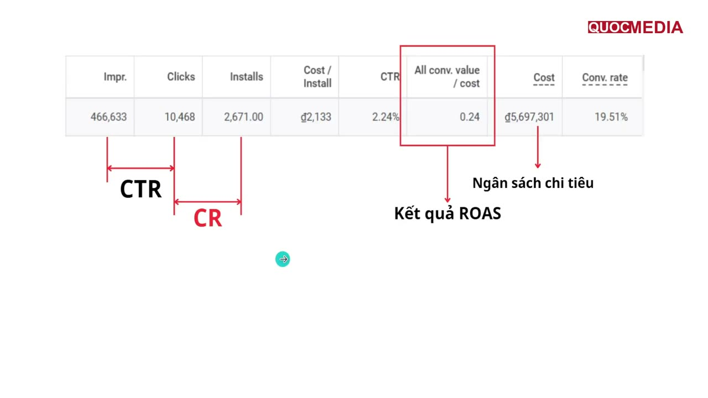

# Glossary chỉ số UA & monetization

## Bối cảnh

App Android kiếm tiền bằng quảng cáo (AdMob / AppLovin MAX), chạy UA chủ yếu qua Google App campaigns. Định nghĩa phía monetization lấy theo AdMob Reports glossary; phía UA là công thức chuẩn ngành, có ghi chú cách Google Ads hiển thị. Không có benchmark trong file này. Ngưỡng tốt/xấu phải lấy từ số liệu thật của app (xem [đọc chỉ số theo mốc](../05-optimization/doc-chi-so-theo-moc-thoi-gian.md)).

## 1. Chỉ số phía UA (chi tiền mua user)

| Chỉ số | Công thức | Cách đọc | Bẫy |
|---|---|---|---|
| **CPI** (Cost per Install) | Cost / Installs | Giá mua 1 lượt cài. Với App campaign tCPI thì đây là target. | "Install" trong Google Ads là conversion `first_open` (Firebase) hoặc install từ Google Play, không phải lượt tải. Mỗi nguồn đếm khác nhau. CPI những ngày đầu thường cao vì conversion về trễ (Google khuyên tính cả độ trễ này khi đánh giá, xem answer/6167162). |
| **CPA** (Cost per Action) | Cost / số in-app action | Giá cho 1 hành động sau cài (vd `first_open`, `level_complete`). | Với roadmap này, campaign "tCPA" tối ưu `first_open`, nên CPA ≈ CPI. Đừng so CPA của các event khác nhau với nhau. |
| **CTR** | Clicks / Impressions × 100% | Creative có kéo được người bấm không. | App campaign phân phối trên nhiều network (Search, Play, YouTube, Display). CTR khác nhau rất xa giữa các network, nên CTR tổng ít ý nghĩa. |
| **CVR / CR** (Conversion rate) | Conversions / Clicks (hoặc interactions) × 100% | Tỉ lệ từ click thành install/action. Phản ánh store listing + độ khớp giữa creative và app. | Google Ads tính "Conv. rate" trên *interactions*. Video view cũng có thể là interaction, nên CR có thể lệch so với tự tính bằng clicks. |
| **IPM** (Installs per Mille) | Installs / Impressions × 1000 | Chỉ số so creative phổ biến trên network như AppLovin/Unity/TikTok. Gộp được cả CTR lẫn CVR. | Chỉ so IPM trong cùng network, format và GEO. |
| **Cost** | Tổng chi | | Google Ads có thể chi tới 2× budget ngày vào ngày nhiều traffic (answer/15995101). Đánh giá theo tuần/tháng, đừng theo từng ngày. |
| **ROAS** | Revenue / Cost × 100% | Thu về được bao nhiêu % tiền đã chi. | Xem mục ROAS bên dưới. Đây là chỉ số dễ đọc sai nhất. |
| **Payback (period)** | Số ngày kể từ install đến khi ROAS cohort cộng dồn ≥ 100% | Bao lâu thì hoàn vốn. | Phụ thuộc retention dài hạn. Ngoại suy từ D7 ra D180 cần đường cong thực tế của chính app. |

### ROAS: D0 / D7 / D30 và cohort

- **ROAS Dn (cohort)** = doanh thu cộng dồn từ ngày 0 đến ngày n của *nhóm user cài trong khoảng X* ÷ chi phí để mua *chính nhóm đó*. D0 là doanh thu trong ngày cài, D7 sau 7 ngày, D30 sau 30 ngày.
- Đây là cách đúng để đánh giá UA vì doanh thu gắn với chi phí đã sinh ra nó.
- **ROAS "theo ngày lịch"** (doanh thu hôm nay ÷ chi hôm nay) trộn doanh thu của user cũ vào chi phí mua user mới, nên không dùng để đánh giá campaign.
- **ROAS trong Google Ads** ("Conv. value / cost") = giá trị conversion được Google *attribute* cho campaign trong conversion window (vd `ad_impression` value), không phải toàn bộ doanh thu của cohort. Theo hiểu biết của người viết, cột Conversions/Conv. value mặc định ghi theo **ngày của tương tác quảng cáo**, không theo ngày phát sinh conversion (có cột riêng "by conv. time"). Hệ quả: ROAS của mấy ngày gần nhất sẽ còn tăng dần khi conversion về trễ. *Chưa kiểm chứng lại trên tài liệu Google trong session này.*
- Với tROAS cho ad revenue, Google Ads mặc định hiển thị số conversions của `ad_impression` là 0. Muốn xem phải segment theo conversion action và thêm cột "Conversion value" (answer/13799577).
- **Bẫy doanh thu**: AdMob báo *estimated earnings* (ước tính, có thể điều chỉnh). Impression-level revenue có độ chính xác khác nhau theo nguồn (Precise / Estimated / Publisher provided / Unknown = $0), xem [mediation](../03-monetization/mediation-admob-vs-applovin-max.md). ROAS tính từ ad revenue vì vậy luôn là số ước tính.

## 2. Chỉ số phía monetization (AdMob / MAX)

Định nghĩa theo AdMob Reports glossary:

| Chỉ số | Công thức | Cách đọc | Bẫy |
|---|---|---|---|
| **Requests** | Số lần app/ad unit gọi quảng cáo, kể cả khi không có ad trả về | Nhu cầu hiển thị. | Code preload nhiều sẽ thổi phồng requests mà không có impression. |
| **Matched requests** | Số ad được ad source trả về | | Với partner bidding, AdMob tính khác nên match rate có thể giảm và show rate tăng mà doanh thu không đổi. |
| **Match rate** | Matched requests / Requests × 100% | Có bao nhiêu % request được trả ad. Thấp → GEO ít demand, floor quá cao, thiếu ad source. | Không so trực tiếp giữa ad unit bidding và waterfall. |
| **Fill rate** | (thuật ngữ chung, MAX/network khác) Filled / Requests | Gần nghĩa match rate. | AdMob glossary không có "fill rate", dùng "match rate". Đừng trộn hai hệ số liệu. |
| **Show rate** | Impressions / Matched requests × 100% | Ad đã load có được show không. Thấp → load quá sớm/thừa, user thoát trước khi tới placement, ad hết hạn. | Show rate thấp chủ yếu là vấn đề *code/placement* chứ không phải demand. |
| **Impressions** | Tổng số ad hiển thị | | |
| **eCPM** | Estimated earnings / Impressions × 1000 | Giá trung bình cho 1000 impression. | eCPM cao mà imps/DAU thấp vẫn có thể ra ARPDAU thấp. Luôn đọc cặp eCPM × imps/DAU. eCPM khác nhau rất xa theo GEO và format, nên so trong cùng GEO + format. |
| **Observed eCPM** | eCPM ước tính của network bên thứ 3 dựa trên lịch sử | Dùng cho waterfall được tối ưu. | Không phải doanh thu thật. |
| **CTR (ad)** | Clicks / Impressions × 100% | | CTR ad bất thường cao có thể là dấu hiệu click vô tình hoặc invalid traffic, rủi ro policy. |
| **Active users (AU/DAU)** | Số user duy nhất mở app, tính theo ngày là DAU | | |
| **Imps / AU (impressions per DAU)** | Impressions / Active users | "Ad density / ad load": mỗi user xem bao nhiêu ad mỗi ngày. | Tăng ad load sẽ tăng ARPDAU ngắn hạn nhưng có thể làm giảm retention. Phải theo dõi cùng retention. |
| **ARPU** | (Ads earnings + Purchase earnings) / Active users | Doanh thu trung bình mỗi user trong kỳ. | |
| **ARPDAU** | ARPU tính theo ngày | AdMob: "ARPU is sometimes known as ARPDAU when aggregated by date". | ARPDAU ≈ eCPM/1000 × imps/DAU (với app thuần ads). |
| **LTV** | Tổng doanh thu cộng dồn của 1 user (hoặc trung bình cohort) đến ngày n: LTV Dn | So với CPI: LTV Dn / CPI = ROAS Dn. | "LTV" không ghi mốc ngày thì vô nghĩa, luôn ghi D7/D30/D180. Dự báo LTV dài hạn là mô hình, không phải số đo. |

## 3. Retention

- **Retention Dn** = số user của cohort cài ngày X còn mở app vào ngày X+n ÷ số user của cohort.
- **D1** phản ánh trải nghiệm lần đầu (onboarding, crash, ad quá dày ngay đầu). **D7** phản ánh giá trị cốt lõi. **D30** quyết định LTV dài hạn.
- Bẫy:
  - Firebase/GA4 có thể định nghĩa "ngày" theo múi giờ property. MMP có thể dùng 24h kể từ install. Không so retention giữa 2 hệ đo khác nhau.
  - "Classic retention" (đúng ngày n) khác "rolling/unbounded" (ngày n hoặc sau đó). Phải ghi rõ đang dùng loại nào.
  - Retention theo nguồn traffic khác nhau nhiều. Retention tổng bị kéo bởi traffic organic.

## 4. Quan hệ giữa các chỉ số (app thuần ads)

```
ARPDAU  ≈ (eCPM / 1000) × (impressions / DAU)
LTV Dn  ≈ Σ (ARPDAU ngày k × retention ngày k), k = 0..n
ROAS Dn = LTV Dn / CPI
```

Công thức LTV là xấp xỉ (giả định ARPDAU của user mới ≈ ARPDAU trung bình). Dùng để biết cần kéo cần gạt nào (CPI ↓, retention ↑, ad load ↑, eCPM ↑), không dùng thay số đo cohort.

## 5. Bổ sung (bổ sung 2026-10-14 từ AI Knownledge, chưa duyệt)

- **% hay điểm %**: với chỉ số dạng tỉ lệ (retention, match rate, show rate, churn, crash-free) nói thay đổi bằng **điểm phần trăm (pp)**; với số đếm/tiền (DAU, installs, LTV, eCPM) dùng **% tương đối**. Retention 8% → 6,4% là **−1,6 pp**, không phải −20%. Đây là quy ước của các tool nội bộ (Police-product, App Performance Checker) và cũng là cách đọc đúng nói chung.
- **Retention bằng SQL trên GA4 BigQuery** (cohort `first_open`, active đúng ngày X+n — khớp định nghĩa classic ở mục 3), cùng DAU, engagement rate, DAU/MAU: [chỉ số sức khoẻ sản phẩm từ GA4 BigQuery](../04-measurement/ga4-bigquery-chi-so-suc-khoe-san-pham.md).
- **Churn D0** (mktpro nội bộ): tỉ lệ user mới không quay lại sau ngày cài — dùng khi so version, xem [hậu kiểm version app](../05-optimization/hau-kiem-version-app-nguong-verdict.md). Định nghĩa chính xác theo mktpro chưa có tài liệu.
- **ER (engagement rate) social organic** — mỗi nền tảng một mẫu số: Facebook Page = (reactions + comments + shares) ÷ **reach**; LinkedIn = (… + clicks/follows) ÷ **impressions**; TikTok = (likes + comments + shares + saves) ÷ **views**. Không so ER giữa các kênh. Chi tiết và bẫy export Meta Business Suite: [đánh giá social organic](../05-optimization/danh-gia-hieu-qua-social-organic.md).
- **Stickiness** = DAU ÷ MAU — user hằng tháng mở app bao nhiêu phần ngày.
- **Habit rate (tuần đầu)** = % user mới mở app ở ≥ 3 (hoặc ≥ 5) ngày khác nhau trong 7 ngày đầu — tín hiệu thói quen sớm hơn D30.
- **Tỉ lệ D7/D1** = D7 retention ÷ D1 retention — tách "onboarding tệ" (D1 thấp) khỏi "giá trị lâu dài tệ" (D7/D1 thấp).
- **Activation rate (D0)** = % install làm đủ hành động cốt lõi trong session đầu (Home Morph: có thể là `generation_completed`).
- **K-factor** = số lời mời/user × tỉ lệ chuyển đổi lời mời — cho feature referral.
- **Counter-metric**: chỉ số theo dõi nhưng không tối ưu, đi kèm primary metric để tránh tối ưu một chiều (vd tăng ad load → theo dõi retention, `app_remove`).
- **North Star Metric (NSM)**: một chỉ số đại diện giá trị dài hạn của sản phẩm. **Vanity metric**: tổng download/đăng ký/page view — tăng mãi, không nói lên giá trị.
- Định nghĩa "quay lại" khác nhau giữa tool (bất kỳ event / `session_start` / `user_engagement`) → cùng "D7 classic" vẫn lệch số. Đọc retention cả hình dạng đường cong, xem [khung phân tích](../05-optimization/khung-phan-tich-metrics-aarrr-cohort-funnel.md).
*(Nguồn mục này: skill po-metrics-analysis APR-102/APR-026, nội bộ. Benchmark game farming trong nguồn không có trích dẫn nên không chép.)*

## 6. Thuật ngữ khoá Quocmedia và chỗ dễ đọc sai (bổ sung 2026-10-15 từ khoá Quocmedia, chưa duyệt)

Bài 4.7 của [khoá Quocmedia](khoa-hoc-quocmedia-ua-marketing-2026.md) ôn thuật ngữ theo 4 nhóm: Google Ads, chỉ số campaign, AdMob, Firebase. Phần lớn **khớp** mục 1–2. Ví dụ, công thức eCPM, match rate và show rate trên slide trùng với AdMob glossary. Dưới đây chỉ ghi phần chưa có ở trên và những chỗ slide định nghĩa lệch.

**⚠️ Ba chỗ slide định nghĩa lệch:**

- **"CPI = giá thầu trên lượt cài"**: slide gộp hai thứ khác nhau.
  - **tCPI** là bid/target mình đặt.
  - **Cost / Install** là CPI thực tế trung bình, tức số Google Ads báo về.
  - Khi đọc số phải tách hai thứ này ra. Ví dụ ở [lesson tCPI thấp](../lessons/2024-12-quocmedia-demo-tcpi-thap-va-troas-cao-khong-spend.md): đặt tCPI ₫800 nhưng CPI thực khác hẳn.
- **"CR = Installs / Clicks"**: slide vẽ CR là đoạn từ Clicks sang Installs. Nhưng cột "Conv. rate" của Google Ads tính bằng **conversions ÷ interactions** (mục 1).
  - Ngay trên ảnh: 2.671 / 10.468 = 25,5%, còn cột Conv. rate ghi 19,51%.
  - Vì vậy đừng tự chia Installs/Clicks rồi so với cột Conv. rate.
- **"All conv. value / cost = kết quả ROAS"**:
  - Cột *All conv.* gồm cả conversion action phụ (secondary).
  - tROAS bid theo **Conv. value / cost**, tức chỉ tính action primary, ví dụ `ad_impression`.
  - Khi đánh giá campaign tROAS, đọc cột không có "All". *Định nghĩa All conversions theo hiểu biết chung về Google Ads, chưa dẫn trang Help trong session này.*



Ảnh lấy từ slide bài 4.7 (số all-time của tài khoản demo đến ~12/2024, app Max Volume Booster). Mũi tên CR nối Clicks → Installs, nhưng 19,51% ở cột Conv. rate không bằng Installs/Clicks. Số trên ảnh là ví dụ của khoá, không phải benchmark.

**Thuật ngữ Firebase/GA4 chưa có ở trên** (slide 4.7). Định nghĩa diễn giải theo hiểu biết chung về GA4, chưa đối chiếu Help:

| Thuật ngữ | Nghĩa | Ghi chú cho UA |
|---|---|---|
| **Realtime** | Báo cáo user/event trong ~30 phút gần nhất | Dùng để kiểm event (`first_open`, `ad_impression`) có bắn không ngay sau khi tích hợp. Không dùng để đánh giá hiệu quả |
| **Crashlytics** | Báo cáo crash/ANR theo version | Khoá dùng crash-free > 98% làm điều kiện qua giai đoạn test (🧪, xem [plan marketing](../playbooks/lap-ke-hoach-marketing-app-game.md)). Ngưỡng Vitals chính thức của Play ở [trả lời review](../01-pre-marketing/tra-loi-review-google-play.md) |
| **User acquisition** vs **Traffic acquisition** | Báo cáo GA4: user mới được gán theo nguồn **lần đầu** (first user source) vs session được gán theo nguồn **của session** | Muốn biết campaign mang về bao nhiêu user mới thì xem User acquisition |
| **Average engagement time per active user** | Thời gian app ở foreground trung bình mỗi active user | Chỉ số sức khoẻ sản phẩm, xem [GA4 BigQuery](../04-measurement/ga4-bigquery-chi-so-suc-khoe-san-pham.md) |
| **Audiences** | Nhóm user định nghĩa theo điều kiện | Lời giảng nói nhầm thành "nhóm quảng cáo". Audience có thể đẩy sang Google Ads làm signal hoặc remarketing |

## Việc tiếp theo

- Khi có data thật: thêm ví dụ số cụ thể (app, GEO, ngày) cho mỗi chỉ số vào `lessons/` và link về đây.
- Kiểm chứng lại cách Google Ads ghi ngày conversion cho App campaigns.
