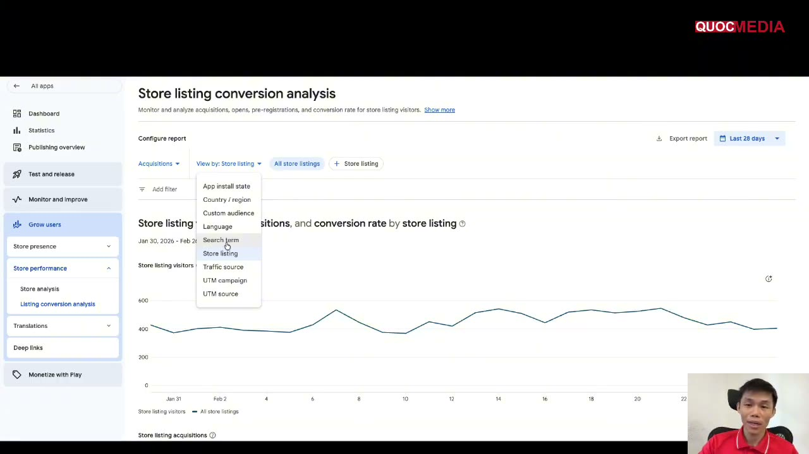
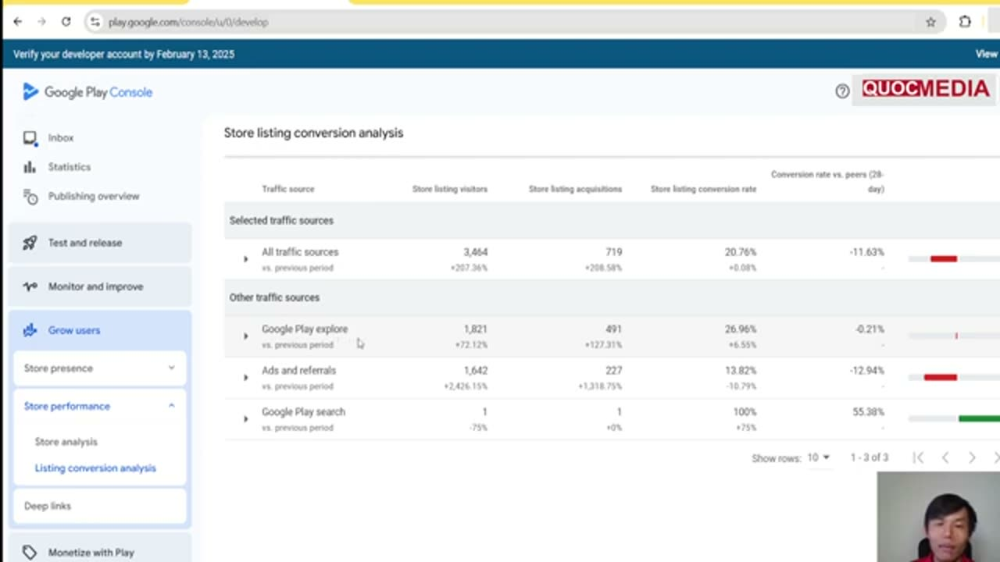

# ASO — store listing Google Play

## Bối cảnh

Bước 1 của [roadmap](../00-overview/roadmap.md) là ASO: video promo, screenshot, short description, keyword trong full description. Store listing quyết định **CVR từ click quảng cáo sang install**, nên làm kỹ trước khi đổ tiền UA. Trong App campaign, Google còn có thể lấy asset từ store listing để dựng quảng cáo. Mọi số dưới đây lấy từ Play Console Help, truy cập 2026-10-14.

## 1. Text

| Trường | Giới hạn | Ghi chú chính thức |
|---|---|---|
| **App name (title)** | ≤ **30 ký tự** | Không dùng chữ khuyến mãi ("Free", "No Ads"), xếp hạng ("#1", "Best"), emoji hay ký tự đặc biệt lặp lại. Không VIẾT HOA TOÀN BỘ trừ khi là tên thương hiệu. |
| **Short description** | ≤ **80 ký tự** | Đưa lợi ích lớn nhất lên đầu. Tránh "Best", "#1", "New", "Discount" và call-to-action kiểu "download now". Google nói keyword nhồi thêm *không giúp ranking*. Không lặp lại nguyên văn trong full description. |
| **Full description** | ≤ **4.000 ký tự** | Ngôn ngữ đời thường, "not a list of keywords". Nêu điểm khác biệt bằng sự thật kiểm chứng được. Lời chứng thực phải có nguồn: Google cấm testimonial ẩn danh. |

### Keyword: làm theo policy

Roadmap muốn "nhấn mạnh main keywords (chức năng app) trong full description". Làm như vậy được, miễn đúng các quy tắc chính thức:

- Viết keyword chính (chức năng cốt lõi) **tự nhiên trong câu**, nhất là ở đoạn đầu và trong các bullet tính năng.
- Policy cấm: "repetitive or unrelated keywords or references", dùng ký tự đặc biệt/all caps để thao túng ranking, và mô tả quá dài, lặp lại, format xấu.
- Không nhắc tên app/thương hiệu khác để câu traffic. Policy xếp mục này vào "unrelated references".
- Policy (kể cả ở bản dịch) áp dụng cho **mọi ngôn ngữ** của listing.
- *Kinh nghiệm ngành, chưa có xác nhận chính thức*: Google Play index title, short và full description để xếp hạng search. Google không công bố trọng số hay mật độ keyword "đúng", nên đừng tin con số mật độ % lưu truyền trên mạng.

## 2. Graphic assets

| Asset | Spec chính thức |
|---|---|
| **App icon** | PNG 32-bit (có alpha), **512 × 512 px**, tối đa **1024 KB**. Theo icon design spec của Google Play. Icon không được gây hiểu nhầm hoặc chứa text về ranking/khuyến mãi. |
| **Feature graphic** | JPEG hoặc PNG 24-bit (không alpha), **1024 × 500 px**. Tránh đặt chi tiết quan trọng ở vùng bị cắt, giữ trọng tâm ở giữa. Alt text ≤ 140 ký tự. |
| **Screenshots (phone)** | Tối thiểu 2 (tính trên các loại thiết bị) để publish, tối đa **8 mỗi loại thiết bị**. JPEG hoặc PNG 24-bit (không alpha). Cạnh từ 320 đến 3840 px, cạnh dài ≤ 2 × cạnh ngắn. |
| **Khuyến nghị cho app** | Ít nhất **4 screenshot**, độ phân giải ≥ 1080 px: dọc ≥ **1080 × 1920** (9:16) hoặc ngang ≥ **1920 × 1080** (16:9). |
| **Khuyến nghị cho game** | Ít nhất 3 screenshot ngang 1920×1080 hoặc dọc 1080×1920. |
| **Tablet / Chromebook** | Tối thiểu 4 ảnh, cạnh 1080 đến 7680 px, 16:9 hoặc 9:16. |
| **Text trên screenshot** | Tagline chiếm **≤ 20% ảnh**. Ảnh có chữ thì làm bản cho từng ngôn ngữ. |

## 3. Preview (promo) video

- Không bắt buộc với app nhưng Google "highly recommended".
- Nhập **URL YouTube** của *một* video, không dùng playlist/channel và không thêm tham số như timecode.
- Video ở chế độ **Public hoặc Unlisted** (không Private), **tắt quảng cáo** (tắt monetization; nội dung có claim bản quyền vẫn có thể bị chèn ad), không giới hạn độ tuổi, **cho phép embed**.
- Chỉ **30 giây đầu** tự phát, ở chế độ tắt tiếng. Cho thấy trải nghiệm cốt lõi trong **10 giây đầu**. Khoảng ≥ 80% video nên là trải nghiệm thật trong app.
- Quay ngang hoặc dọc đều được, nhưng video dọc không để viền đen. Nên có caption.
- Video có chữ thì làm bản theo từng ngôn ngữ.

## 4. Checklist ASO theo roadmap

- [ ] Title ≤ 30 ký tự, có keyword chức năng chính, không chữ khuyến mãi/ranking.
- [ ] Short description ≤ 80 ký tự, lợi ích chính ở đầu, không CTA, không "Best/#1/New".
- [ ] Full description ≤ 4000 ký tự: đoạn mở nêu chức năng chính, bullet tính năng chứa keyword tự nhiên, không liệt kê keyword.
- [ ] Icon 512×512 PNG 32-bit ≤ 1024 KB.
- [ ] Feature graphic 1024×500, chi tiết chính ở giữa.
- [ ] ≥ 4 screenshot 1080×1920 (dọc), text ≤ 20% ảnh, theo thứ tự các tính năng mạnh nhất.
- [ ] Preview video YouTube: unlisted/public, tắt ads, embeddable, 10 giây đầu là core experience.
- [ ] Localize text + screenshot cho các GEO chính sẽ chạy UA.
- [ ] Sau khi có traffic: dùng Store listing experiments / custom store listings của Play Console để A/B test. *Chưa tổng hợp chi tiết, cần bổ sung.*

## 5. Bổ sung (bổ sung 2026-10-14 từ AI Knownledge, chưa duyệt)

- **Metadata policy áp cho cả screenshot và ảnh quảng bá** (WebFetch 9898842, 2026-10-14): cấm ảnh/chữ thể hiện xếp hạng/thành tích ("App of the year", "Best of Play", "Popular", icon giải thưởng), giá/khuyến mãi ("10% off"), chương trình Google Play ("Editor's choice"); screenshot/video phải *"reflect your app's actual experience"*. Tool AI nội bộ hay sinh slide "social proof" vi phạm — xem mục 4 của [thiết kế screenshot store](thiet-ke-screenshot-store-quality-bar.md).
- **Ảnh iOS 1242×2688 không upload được lên Play** (tỉ lệ 2,16 > 2:1). Hai tool nội bộ mặc định xuất kích thước này — luôn xuất 1080×1920 cho Android.
- **Custom store listings**: tối đa 50 listing; target theo quốc gia, Google Ads campaign, URL, search keyword, user không hoạt động/đã gỡ (Play Console Help 9867158). Dùng để khớp screenshot với thông điệp từng ad group — xem mục 7 của [thiết kế screenshot store](thiet-ke-screenshot-store-quality-bar.md).
- Cách dựng bộ screenshot (narrative arc, quality bar) và chọn tool AI: [thiết kế screenshot store](thiet-ke-screenshot-store-quality-bar.md). Rating/review và trả lời review: [trả lời review Google Play](tra-loi-review-google-play.md). Lỗi policy listing đã gặp (Metadata, Impersonation, Misleading Claims): [lỗi policy thường gặp](policy-loi-thuong-gap-va-cach-fix.md). Check trademark tên app trước khi đặt title: [Super Legal](../06-tools/super-legal-check-trademark-ten-app.md).

## 6. Đo CVR store listing trong Play Console (bổ sung 2026-10-15 từ khoá Quocmedia, chưa duyệt)

Nguồn: khoá Quocmedia bài 2.1 (đường đi menu thấy trên màn hình demo, Play Console giao diện ~02/2026).

- **Visitors và Conversion rate theo listing**: Grow users → Store presence → **Store listings** → bảng "Default store listing" có cột Visitors, Conversion rate. Play Console còn tự gợi ý tạo **custom store listing** cho search keyword mang nhiều traffic (ví dụ trên màn hình: "Your app receives significant traffic from searches for '…'. Use Gemini to generate a custom store listing").
- **Phân tích chi tiết**: Grow users → Store performance → **Listing conversion analysis** → "View by": App install state, Country/region, Custom audience, Language, **Search term**, Store listing, **Traffic source**, UTM campaign, UTM source. Xem theo Search term để biết keyword nào mang install; theo Traffic source để tách organic search/explore/ads.

Ảnh cho thấy vị trí trang trong menu trái (Grow users → Store performance → Listing conversion analysis) và các chiều có thể tách CVR.

**Ngưỡng CR của giảng viên** — 🧪 `confidence: low`, ý kiến 1 người trên 1 app utility của mình, không rõ GEO/kênh:
- CR store listing ≥ 25% là tối thiểu, ≥ 30% là ổn, > 50% là cao; < 20% thì làm lại product page (mục 1–3).
- Ví dụ trên màn hình: 13.629 visitors, CR 39,3% (1 tháng); listing khác 2.107 visitors, CR 51,3% (08/2024). Giảng viên nói mỗi app một khác, chỉ là định hướng.
- **Không lẫn 2 loại CR**: CR ở đây = người cài / người vào trang store listing (Play Console). CR của Google Ads = conversions / interactions (xem [glossary](../00-overview/glossary-chi-so.md)). Hai số không so trực tiếp được.

**Khung ASO 4 giai đoạn của khoá** (để định vị việc đang làm): (1) Product page — icon, title, package ID, screenshot, feature graphic, short/full description, video → (2) Store CVR → (3) Social proof & ranking (download, rating, review, keyword ranking) → (4) App quality (crash rate — khoá đặt < 1% trong Firebase Crashlytics, khác ngưỡng Vitals của Google ở [trả lời review](tra-loi-review-google-play.md); app size; retention D1/D7; LTV). Package/Application ID không đổi được sau khi publish → chốt trước khi lên store; ảnh hưởng ranking của package name thì không có nguồn chính thức.

Keyword ranking organic của đối thủ (Sensor Tower free) và Keyword Planner: xem [research đối thủ & keyword](research-doi-thu-va-keyword-cho-app.md).

### 6.1 Đọc báo cáo conversion của listing: peers, traffic source, install state (bổ sung 2026-10-15 từ khoá Quocmedia bài 4.11 + Play Console Help 9859173, chưa duyệt)

Bài 4.11 xếp chỉ số đánh giá ASO thành 4 nhóm:

- **Hiển thị**: store listing visitors, traffic source breakdown, search term.
- **Chuyển đổi**: CR = install ÷ visitors.
- **Chất lượng**: rating & review, retention.
- **Hiệu suất**: crash, app size.

Bốn nhóm này khớp với khung 4 giai đoạn ở trên. Giảng viên khuyên đọc sau khi campaign đã chạy **3–7 ngày** để có đủ traffic. Ví dụ demo của khoá (app nhóm Personalization, 13/11–11/12/2024): 3.464 visitors, 719 acquisitions, CR 20,76%, thấp hơn peers 11,63%. Theo nước: Brazil 35,3%, India 15,4%, Bangladesh 11,0%. Giảng viên coi **< 20% là đáng báo động** (🧪, cùng nhóm ngưỡng ở trên).

**Cách đọc nên dùng.** Phần này lấy từ Play Console Help 9859173 (WebFetch 2026-10-15); khoá đọc sai 2 chỗ.

1. **So với peers trước, ngưỡng cố định sau.**
   - Trang listing conversion analysis có đường **peers' median** cùng P25/P75 của peer set (chọn theo category, vd "Personalization").
   - Có cột *Conversion rate vs. peers (28-day)*.
   - Đây là mốc tham chiếu chính thức theo category, tốt hơn con số 20/25/30% chung chung.
   - Benchmark chỉ hiện khi peer set có đủ dữ liệu.
2. **Tách theo traffic source trước khi kết luận listing tệ.**
   - Trong demo, *Ads and referrals* có CR 13,8% (−12,9 so với peers), còn *Google Play explore* có 27,0% (≈ peers).
   - Như vậy CR tổng thấp chủ yếu do traffic quảng cáo, không chắc do listing.
   - Cần xem cả độ khớp giữa creative ads và listing (xem [custom store listing](thiet-ke-screenshot-store-quality-bar.md) mục 7).
3. **⚠️ "Google Play search" không phải search keyword chung.**
   - Help định nghĩa: user tìm **tên app hoặc thương hiệu gần**.
   - User tìm theo danh mục hoặc từ chung (vd "racing game") được tính vào **Google Play explore**.
   - Khoá thấy "search 1 visitor / 1 install = 100%" rồi kết luận "keyword search convert rất cao, cần tối ưu keyword". Mẫu chỉ có n = 1 và là search brand, nên **không rút ra được gì**.
   - Muốn đánh giá keyword thì xem chiều **Search term**. Search term ít traffic bị gộp vào "Other".
4. **⚠️ "Returning users" là user từng cài rồi gỡ** khỏi mọi thiết bị, không phải "người chưa tải quay lại xem" như khoá giải thích.
   - Visitors và acquisitions chỉ đếm user **hiện chưa có app** trên thiết bị nào.
   - Acquisitions < installs vì cài nhiều máy chỉ tính 1.

Ảnh từ demo bài 4.11 (~12/2024). Nó cho thấy CR traffic quảng cáo thấp hơn organic explore khoảng một nửa. Dòng Google Play search chỉ có 1 visitor nên không dùng để kết luận.

**⚠️ Platform đã đổi metric (06–07/2026, theo Help 9859173):**

- Chỉ số chính của store listing performance giờ tính theo **unique clicks**: user bấm Install/Open/Pre-register.
- **CTR** = % visitors bấm nút, *"replaces the legacy "Conversion Rate" metric"*.
- Acquisitions (cài xong) vẫn xem được ở Grow users overview và Statistics.

Hệ quả:

- Các ngưỡng CR 20/25/30% của khoá (và ví dụ ở trên) đo bằng metric cũ, là install hoàn tất ÷ visitors.
- Không so thẳng các ngưỡng đó với CTR mới.
- Khi ghi CVR trước/sau đổi asset vào `lessons/`, phải ghi rõ đang dùng metric nào.
- Đường menu trong ảnh ở mục 6 có thể đã khác.

## 7. Viết description bằng AI và các ý bổ sung từ khoá Quocmedia (bổ sung 2026-10-15, chưa duyệt)

**Chuỗi prompt (khoá bài 2.3, tóm cấu trúc)**: input = title đã chốt + danh sách tính năng chính → P1 giao vai chuyên gia viết description chuẩn ASO Play Store → P2 viết full description tiếng Anh cho app *[tên]* với tính năng *[A, B, C, D]* → P3 viết short description ≤ 80 ký tự, câu mở bắt tai. Hậu kiểm: dịch ngược để kiểm nghĩa, heading "Main features" (game: "How to play").

**Thêm ràng buộc vào prompt** (vì output demo của khoá dính lỗi và giảng viên dùng nguyên): không superlative ("ultimate", "best", "#1"), không chữ khuyến mãi ("free", "new", "discount"), không CTA kiểu "download now" trong short description, không liệt kê/lặp keyword, kiểm ≤ 80 / ≤ 4.000 ký tự. Output demo có short description chứa "ultimate" và full description kết bằng "Download … now" — đúng nhóm mục 1 khuyên tránh.

**Ý khác của khoá, chưa xác minh chính thức**:
- Title chứa main keyword; mỗi tính năng = 1 keyword rải trong short/full; 3 trường đồng bộ thông tin — khớp mục 1, vẫn phải viết tự nhiên.
- In đậm keyword bằng thẻ `<b>…</b>` trong full description — chưa có nguồn chính thức nói thẻ nào được hỗ trợ hay có ảnh hưởng ranking; đừng lạm dụng (policy cấm định dạng để thao túng ranking).
- Thêm FAQ/contact/email/link help center cuối full description để tăng tin cậy — rủi ro thấp; link không được dẫn sang app khác/quảng cáo.
- Screenshot: 1–3 ảnh **ngang 16:9** đầu + 4–6 ảnh dọc, giảng viên nói "Google khuyến dùng gần đây" nhưng không đưa nguồn → giả thuyết, chỉ đổi sau Store listing experiment (xem [thiết kế screenshot](thiet-ke-screenshot-store-quality-bar.md) mục 9).
- Con số "Top 3 ưu tiên trên Play Store: Video 24%, Screenshot 13%, Mô tả 8%" — không nguồn, không rõ đo gì → **không dùng làm benchmark**.

### ⚠️ Mâu thuẫn với spec/policy chính thức

| Khoá Quocmedia | Chính thức (nguồn) | Theo |
|---|---|---|
| "Feature graphic = screenshot = thumbnail": dùng chung ảnh ngang **1920×1080** (bài 2.2, 2.4) | Feature graphic **1024×500** (~2,05:1), JPEG/PNG 24-bit (9866151, mục 2). Ảnh 16:9 không dùng thẳng được, phải dựng/crop lại. Việc feature graphic có làm thumbnail video hay không: chưa xác nhận | Chính thức. Ý "đồng bộ thông điệp giữa feature graphic và screenshot" vẫn dùng được |
| Video preview: đầu tư **voice-over** là tiêu chí chính, "ít text" (bài 2.2, 2.5) | Chỉ 30s đầu autoplay và **tắt tiếng**; nên có caption (9866151, mục 3) | Chính thức: thông điệp phải hiểu được bằng hình + caption; voice-over là phần thêm |
| Video preview dựng chủ yếu từ stock footage + mockup nhỏ (bài 2.5) | ≥ ~80% video nên là trải nghiệm thật trong app; Metadata policy: video phải *"reflect your app's actual experience"* (mục 3, mục 5) | Chính thức: ưu tiên quay màn hình UI thật |
| Prompt kịch bản voice "≤ 30 giây" nhưng LLM viết dài 36s, khoá giãn video 0,7x cho khớp (bài 2.5) | 30s đầu là phần autoplay | Kiểm độ dài kịch bản theo số từ trước khi TTS (ước lượng của mình ~2,5 từ/giây tiếng Anh, không phải số chính thức); thông điệp chính trong 30s đầu |
| Giai đoạn 3: chủ động "đẩy" lượt cài theo keyword search và **review 4–5 sao** theo chủ đích, ~3–5 review/1.000 download ads/ngày, "đừng làm quá tay" (bài 2.1) | Ratings, Reviews & Installs policy (9898684, WebFetch 2026-10-15): *"We prohibit any manipulation of ratings, reviews, or install counts"*; cấm *"inflating product ratings, reviews, or install counts by illegitimate means, such as fraudulent or incentivized reviews and ratings"*; *"Don't offer rewards or incentives for ratings or reviews"*, *"Don't use automated services to inflate installs or ratings"* | **Chính thức — không làm.** Rủi ro gỡ app/khoá tài khoản. Cách hợp lệ: Play In-App Review API hỏi user thật sau khi dùng thành công, không chọn trước số sao. Xem [lỗi policy](policy-loi-thuong-gap-va-cach-fix.md) mục 6 |
| Emoji ở từng tính năng trong full description (output demo) | Metadata policy cấm emoji ở **title**/icon/tên developer (mục 1); full description không có quy định rõ trong tài liệu đã đọc | Không cấm rõ — dùng tiết chế, không dùng emoji thay keyword hay lặp ký tự |

## Việc tiếp theo

- Bổ sung tài liệu về Store listing experiments (custom store listings đã có tóm tắt ở mục 5).
- Ghi lại CVR store listing trước/sau mỗi lần đổi asset vào `lessons/`.
