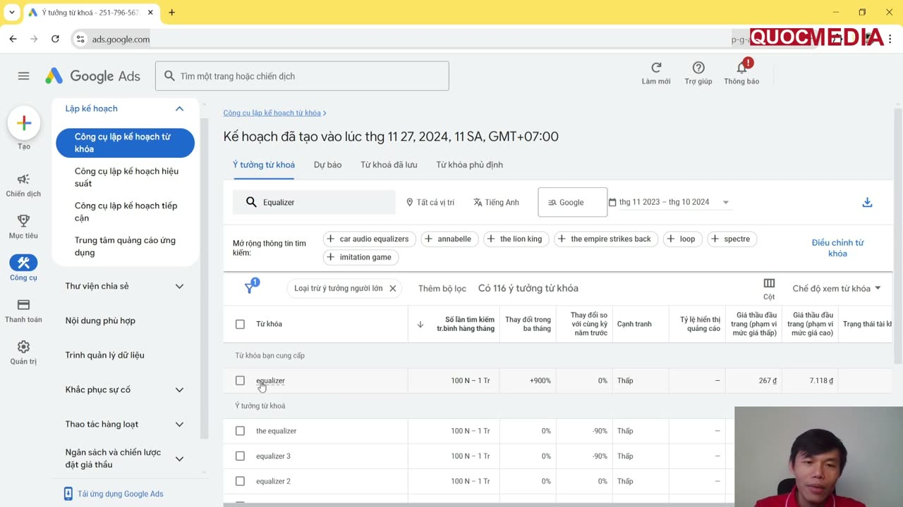
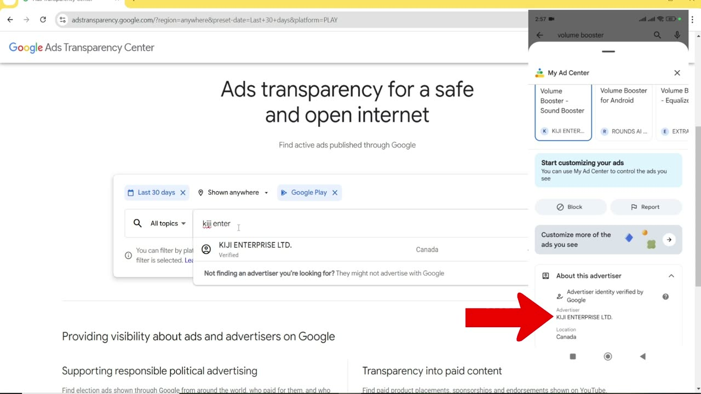
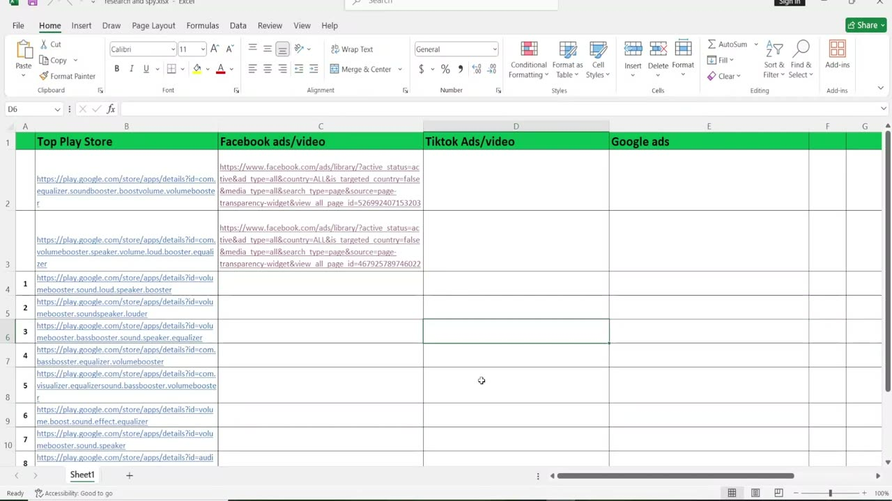

# Research đối thủ và keyword khi nhận app mới

## Bối cảnh

Nguồn chính: khoá Quocmedia bài 1.3–1.4 (ví dụ xuyên suốt là app utility Android "Max Volume Booster"), quay khoảng 11–12/2024 nên giao diện tool có thể đã đổi. Đây là bước **nhận một app đã có sẵn để chạy UA**, khác với [market research go/no-go](market-research-tam-sam-som-go-no-go.md) (quyết định có làm app hay không). Output của playbook này đi vào: headline/description App campaign ([creative assets](creative-assets-google-app-campaigns.md)), ASO ([store listing](aso-google-play-store-listing.md)) và brief creative ([style video & hook](style-video-creative-ads-va-cong-thuc-hook.md)).

Toàn bộ là chưa duyệt (draft). Các nhận định "đang win" là kinh nghiệm của giảng viên, chưa kiểm chứng.

## 1. Checklist khi nhận app mới

- [ ] **Cài app trên máy thật, dùng thử hết luồng chính.** Liệt kê từng tính năng (ví dụ của khoá: Equalizer, Volume boost, Music Player, Drum pad).
- [ ] **Map mỗi tính năng → 1 nhóm keyword/thông điệp.** Nhóm này về sau thành 1 ad group (xem [creative assets](creative-assets-google-app-campaigns.md) mục 5) và 1 screenshot store.
- [ ] **Persona**: ai dùng, dùng để được gì, nhóm tuổi, sở thích (ví dụ: người thích nghe nhạc, chỉnh âm thanh, chơi nhạc cụ). Với mỗi tính năng ghi thêm *insight* — cảm xúc/kết quả user muốn — để làm hook (xem [style video](style-video-creative-ads-va-cong-thuc-hook.md)).
- [ ] Research keyword (mục 2) và đối thủ (mục 3), ghi vào bảng spy (mục 4).

## 2. Keyword

### 2.1 Google Ads Keyword Planner

Đường đi: Google Ads → **Công cụ** → Lập kế hoạch → **Công cụ lập kế hoạch từ khoá** → **Khám phá các từ khoá mới** → nhập seed theo từng tính năng (tên app + tên tính năng).

- Vị trí/ngôn ngữ: khoá dùng **"Tất cả vị trí" + tiếng Anh** cho app chạy global. Khi app chạy GEO cụ thể thì đặt đúng nước + ngôn ngữ đó (vd Home Morph chạy ID+PH+VN — xem [quyết định GEO](../decisions/2026-09-home-morph-geo-ua-ads-only.md)), không chỉ EN global.
- Sắp xếp theo "Số lần tìm kiếm trung bình hàng tháng"; chọn keyword **volume cao, thay đổi 3 tháng/YoY dương, cạnh tranh thấp**. Keyword quá rộng thì đào sang biến thể (equalizer → music equalizer, bass booster equalizer).
- Kết quả: danh sách keyword theo nhóm tính năng → dùng làm headline/description (App campaign không có keyword targeting, keyword chỉ là chất liệu viết text) và rải vào title/description ASO.

Ảnh cho thấy đủ các cột cần đọc: volume tháng (100N–1Tr), thay đổi 3 tháng (+900%), YoY (0%), cạnh tranh (Thấp), giá thầu đầu trang (267 ₫ – 7.118 ₫). Số là của 11/2024, chỉ để minh hoạ cách đọc.

#### ⚠️ Mâu thuẫn — cách đọc cột "giá thầu đầu trang"

- **Khoá học** (bài 1.3, [04:37]): đọc 267 ₫ là giá "trên một install".
- **Google** (Google Ads Help 3022575, WebFetch 2026-10-15): *"Top of page bid (low range): The lower range bid—an approximation of the 20th percentile—that advertisers have historically paid"* (high range ≈ phân vị 80) — đây là **CPC trên Google Search** để quảng cáo text lên đầu trang kết quả. *"Competition: The number of advertisers that showed on each keyword relative to all keywords across Google."*
- **Kết luận**: theo Google. Cột này **không phải CPI** và không phải giá của App campaign (App campaign không đấu giá theo keyword). Chỉ dùng như tín hiệu tương đối về mức cạnh tranh/nhu cầu. Ước CPI phải lấy từ campaign thật hoặc benchmark có nguồn.
- Ngoài ra, "Avg. monthly searches" là lượt **search trên Google (web)**, không phải search trong Play Store. Dùng làm proxy nhu cầu được, nhưng không thay dữ liệu keyword trong store (mục 2.2).

### 2.2 Sensor Tower bản free — keyword ranking organic của đối thủ

- app.sensortower.com (khoá dùng không cần đăng nhập) → search app đối thủ → tab **Organic User Acquisition** → biểu đồ **Keyword Rankings** theo nước.
- Ví dụ trong khoá (app "Volume Booster – Sound Booster", US, ~02–03/2026): "volume booster" #2, "bass booster" #2, "sound" #15. Bản free còn hiện ước tính downloads/revenue tháng và category ranking; RPD, DAU, time spent bị khoá.
- Dùng để biết đối thủ đang đứng top ở keyword nào trong **store** — bổ sung cho Keyword Planner (search web). Số download/revenue của Sensor Tower là ước tính của bên thứ ba.

## 3. Spy ads đối thủ

Nguyên tắc chung: chỉ học **format, hook, angle, headline/description**; không tải về rồi dùng lại video người khác làm asset (khoá có gợi ý "lấy content ad iOS trên TikTok, edit lại chạy Android" — **không làm**: trái nguyên tắc ở [nghiên cứu trend](nghien-cuu-trend-cho-creative.md) mục 6 và rủi ro Impersonation/Copycats, xem [lỗi policy](policy-loi-thuong-gap-va-cach-fix.md)).

### 3.1 Google Ads Transparency Center — xem creative App campaign của đối thủ

- `https://adstransparency.google.com`. Bộ lọc: thời gian **Last 30 days** (hoặc Any time), vị trí **Shown anywhere**, nền tảng **Google Play**, rồi lọc format (ảnh/text/video).
- Giới hạn thấy trên màn hình: lọc theo nền tảng chỉ áp cho ads hiển thị **từ 04/09/2023** trở đi.
- **Mẹo tìm tên advertiser** (tên pháp nhân, không phải tên app): trên điện thoại mở Google Play → search keyword ngách → app có nhãn **Sponsored** → ⋮ → **My Ad Center** → "About this advertiser" → thấy tên đã xác minh + quốc gia. Nhập tên đó vào Transparency Center để xem **mọi** ads của advertiser (ví dụ trong khoá: một advertiser có ~300 video ad trong 30 ngày, chạy nhiều app utility).
- Từ từng creative đọc được headline, description, last shown, số biến thể — nguồn tốt để viết text asset.

Ảnh cho thấy luồng: ad Sponsored trên Play → My Ad Center → "About this advertiser" ra tên pháp nhân → gõ tên đó vào ô search của Transparency Center với bộ lọc Last 30 days + Google Play.

### 3.2 Meta Ads Library

- `https://www.facebook.com/ads/library/` → **Tất cả quốc gia**, **Tất cả quảng cáo**, search keyword ngách. Kết quả theo fanpage; mở "Chi tiết quảng cáo" để xem video và bấm CTA ra link Play Store của app.
- Tải ad về để phân tích: [Video Download](../06-tools/video-download-tai-video-hang-loat.md) (chỉ để nghiên cứu).
- 🧪 Kinh nghiệm giảng viên, chưa kiểm chứng: page có nhiều ad active cùng lúc (ví dụ 28 ad, mới khởi chạy) là dấu hiệu app "đang win"; page chỉ 1 ad thì yếu. Lưu ý nhiều ad cũng có thể chỉ là đang test hàng loạt.

### 3.3 TikTok Creative Center — Top Ads

- `https://ads.tiktok.com/business/creativecenter` → Inspiration → **Top Ads**. Bộ lọc: Region (bỏ mặc định VN, chọn GEO cần), Industry = **Apps** (tick các nhóm con), Objective = **App Installs**, **Last 30 days**; sort theo Reach/CTR.
- Mỗi ad có likes, **CTR percentile** (vd Top 1%), mức budget (High/Medium/Low); trang "About this ad" có region, objective, landing page, caption. Đây là nguồn ads **trả phí** có tín hiệu hiệu quả — khác các tool nội bộ chỉ crawl TikTok organic ([TikTok Trend Tool](../06-tools/tiktok-trend-crawler-video-ai-viral.md), [Social Tracker](../06-tools/social-tracker-tiktok.md)).
- Nhiều ad trên Top Ads là app iOS — vẫn học được hook/format, không lấy video.

### 3.4 Nhận định về thứ tự kênh (độ tin thấp)

🧪 Giảng viên cho rằng app thường **thắng trên Google Ads trước rồi mới scale sang Meta/TikTok**, nên app có mặt ở Meta/TikTok là app đang có lãi. Không có số liệu đi kèm — chỉ dùng như gợi ý ưu tiên đối thủ để theo dõi.

## 4. Bảng theo dõi đối thủ

Mỗi dòng 1 đối thủ, 4 cột: **Top Play Store** (link store) | **Facebook ads/video** (link Ads Library của page) | **TikTok ads/video** | **Google ads** (link Transparency Center của advertiser). Có thể thêm cột: keyword đứng top (Sensor Tower), hook/style chính, ngày ghi nhận. Mục đích: theo dõi định kỳ thay đổi UI, creative, lượt download của đối thủ.

Ảnh là file Excel mẫu với link Play Store của các app volume booster ở cột A và link Meta Ads Library tương ứng ở cột C.

## Việc tiếp theo

- Khi làm cho Home Morph: chạy lại mục 2–3 với GEO ID/PH/VN, ngách AI interior design; lưu bảng spy vào `exports/` và ghi insight (không phải dữ liệu thô) vào `apps/home-morph/`.
