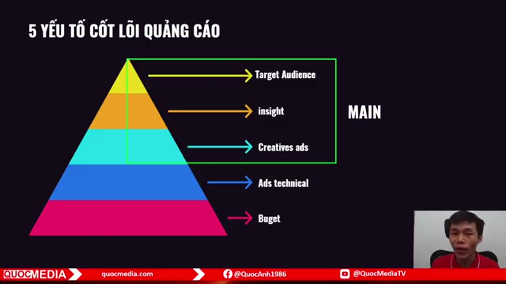
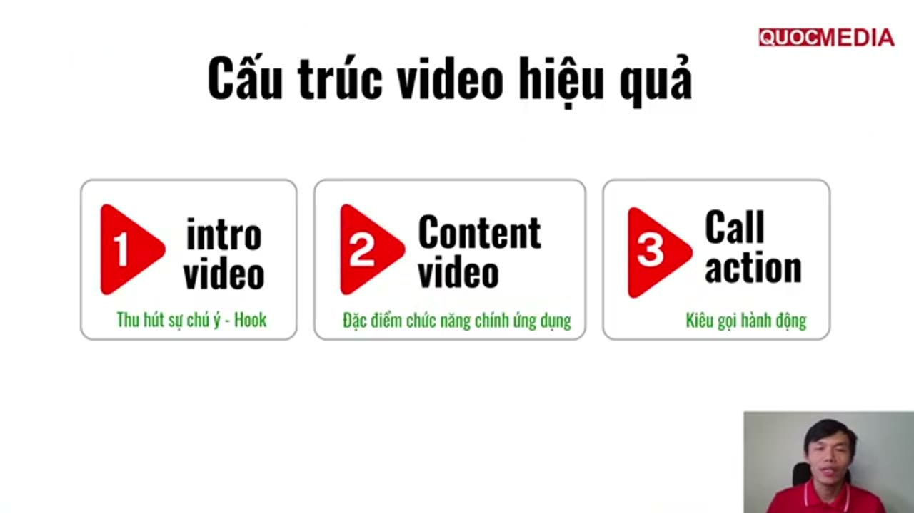

# Style video creative ads và công thức Hook → Content → CTA

## Bối cảnh

Tổng hợp từ khoá Quocmedia chương 3 (bài 3.2 mindset, 3.3 sáu style, 3.6 dựng video). Ví dụ trong khoá phần lớn là **game** và app utility âm thanh. Không có số liệu CTR/IPM/CPI nào cho từng style — xếp hạng là ý kiến giảng viên → `confidence: low`. Spec kích thước/số lượng asset xem [creative assets](creative-assets-google-app-campaigns.md); dây chuyền sản xuất xem [playbook](../playbooks/san-xuat-creative-hang-loat-bang-ai.md).

## 1. Kim tự tháp 5 yếu tố

Từ trên xuống: **Target Audience → Insight → Creative ads** (3 tầng "MAIN") → Ads technical → Budget. Ý của giảng viên: không rõ audience và insight thì làm creative "như mò"; kỹ thuật lên camp và ngân sách kém quan trọng hơn — ngân sách nhỏ vẫn test được.

Ảnh cho thấy thứ tự ưu tiên khoá đề xuất: audience, insight, creative là phần chính; technical và budget là nền phía dưới.

Cách dùng: trước mỗi đợt creative, viết 1 dòng cho mỗi tầng trên (ai, insight gì, creative thể hiện insight đó thế nào) — persona và insight lấy từ [checklist nhận app mới](research-doi-thu-va-keyword-cho-app.md).

## 2. Cấu trúc video: Hook → Content → CTA

Ảnh là slide 3 phần khoá dùng cho cả video ads và video organic. Bài 3.2 gọi phần giữa là "Gameplay" (game); với app non-game là demo tính năng.

| Phần | Thời lượng (khoá) | Nội dung |
|---|---|---|
| **Hook** | ~3 giây đầu (khoá nói "2–5 giây đầu") | Gây bất ngờ/tò mò. Mẹo: tìm hình theo **insight** của tính năng, không theo tên tính năng (Music Player → insight "tận hưởng nhạc" → stock "music dance") |
| **Content** | 8–12 giây | 1 tính năng chính: UI thật (mockup/quay màn hình) + text tên tính năng |
| **CTA** | ~3 giây | Icon + tên app + badge Google Play, chuyển động kêu gọi tải |

- Tổng độ dài: khoá nói 8–25 giây là đủ, video demo 14 giây; bài Creatify nói "Google Ads chỉ cần 15 giây".
- **⚠️ Mâu thuẫn (nhẹ) với Google**: Google khuyến nghị video App campaign **10–30 giây** và **dùng nhiều độ dài khác nhau** (6167162). Cận dưới 8s của khoá thấp hơn; chỉ làm 1 độ dài 15s trái khuyên "đa dạng". Theo Google: giữ 10–30s, có cả bản ~15s và ~30s.
- Badge Google Play: dùng file badge chính thức của Google (play.google.com/intl/en_us/badges/), không lấy ảnh search rồi xoá nền như khoá làm. *Chưa đối chiếu brand guideline chi tiết.*
- Text/caption phải đọc được khi tắt tiếng: video preview trên Play autoplay **tắt tiếng** (9866151); feed video ads nhiều nơi cũng mặc định tắt tiếng.

## 3. Sáu style video ads (khoá 3.3)

| # | Style | Cơ chế (theo giảng viên) | Hợp với | ⚠️ Rủi ro |
|---|---|---|---|---|
| 1 | **Fake Choice** — giảng viên xếp "Top 1" | Hook → người xem tưởng được chọn → twist; đánh vào tò mò + "tôi chọn đúng hơn" | Game, quiz | **Cao**. Nếu lựa chọn/gameplay không có trong app → Misleading/Deceptive ads, review "false advertising". Chỉ dùng khi cơ chế đó có thật trong app |
| 2 | **First-person POV** | Người xem thấy như chính mình đang dùng app, tự nhiên như content TikTok | Mọi app; app tiện ích, AI | Thấp, miễn UI là app thật |
| 3 | **Meme + Reaction** | Ghép meme đang hot với tình huống dùng app; bám trend, dễ viral | Social (TikTok/Meta) | Bản quyền meme/nhân vật; trend hết nhanh |
| 4 | **UGC / người thật review** | KOL hoặc người thật dùng và nói về app | Mọi app | Testimonial phải thật; avatar AI đóng vai "người dùng thật" có thể bị coi là gây hiểu nhầm — cần nhãn AI nếu kênh yêu cầu |
| 5 | **Before → After** | Payoff rõ ràng, thấy ngay kết quả | App photo/video editor, **app AI** | Kết quả "after" phải đúng chất lượng app làm được |
| 6 | **Shock value jumpcut** | Hình gây sốc + cắt nhanh | Game | **Cao**. Hình nhạy cảm/gây sốc dễ dính App Promotion / nội dung không phù hợp (xem [lỗi policy](policy-loi-thuong-gap-va-cach-fix.md)) |

Ngoài ra: dù style nào, UI xuất hiện trong video phải khớp app thật (checklist ở [playbook](../playbooks/san-xuat-creative-hang-loat-bang-ai.md)).

## 4. A/B test liên tục

Khoá nhấn mạnh: làm UA mà không test nhiều biến thể thì "rất yếu" — phải ra nhiều biến thể để tìm creative thắng. Cách làm đọc được kết quả (theo [creative assets](creative-assets-google-app-campaigns.md) mục 3–4): mỗi đợt đổi **1 biến** (style, hook hoặc độ dài), thêm asset mới thay vì xoá asset đang tốt, đặt tên file có style + hook để đọc asset report.

## 5. Gợi ý cho app AI thiết kế nội thất (Home Morph) — gợi ý, chưa test

*Đây là suy luận từ bảng trên, không phải kết quả đo.*
- **Before → After** là style tự nhiên nhất: ảnh phòng thật (trước) → phòng sau khi AI thiết kế lại, hook ngay 1–2 giây đầu bằng khoảnh khắc biến đổi.
- **First-person POV**: tay cầm điện thoại chụp phòng → chọn style → ra kết quả, UI thật.
- Tránh Fake Choice/Shock trừ khi có cơ chế thật trong app (vd "chọn style nào?" là tính năng thật của app thì dùng được).
- Khi chạy: đặt tên asset theo style và ghi asset report (Best/Low) theo style vào `apps/home-morph/campaigns.md`.
