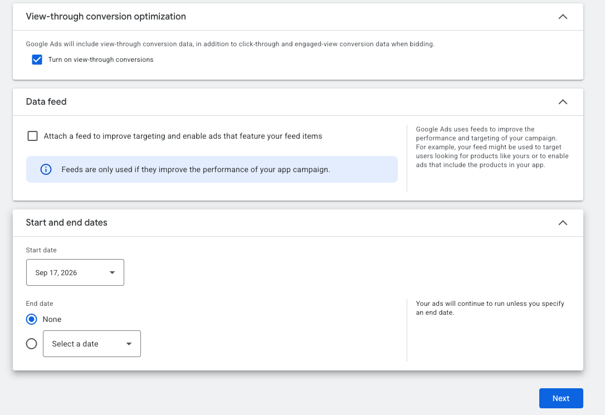
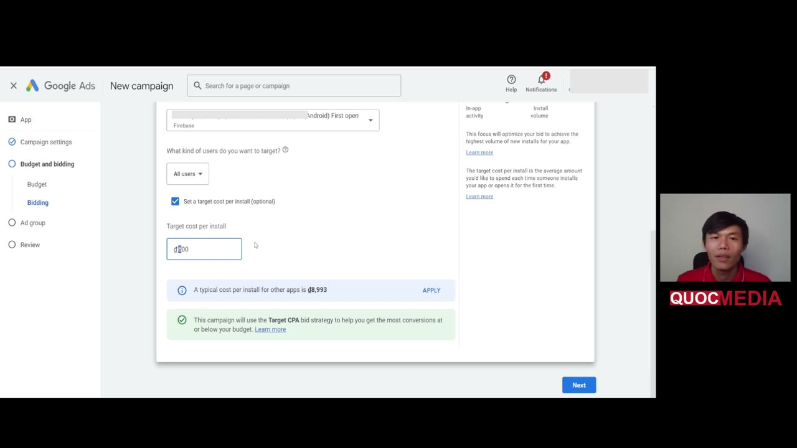

# Google App campaigns: tổng quan

## Bối cảnh

Kênh UA chính trong [roadmap](../../00-overview/roadmap.md). Mọi số dưới đây lấy từ Google Ads Help, truy cập 2026-10-14. Nhiều trang help của Google bị tách nhỏ và đôi khi nói khác nhau, nên mỗi ý đều ghi số answer để tra lại.

## 1. Loại App campaign (subtype)

| Subtype | Viết tắt | Dùng khi |
|---|---|---|
| App installs | **ACi** | Mua user mới. Đây là loại dùng trong roadmap. |
| App engagement | **ACe** | Kéo user đã cài quay lại. Cần audience segment liên quan mới chạy được. |
| App pre-registration | **ACpre** | Android, app chưa ra mắt. |

Điều kiện: app đã publish trên Google Play/App Store, có phương thức thanh toán, khai báo thông tin cơ bản. Google tự ghép asset và phân phối trên Search, Google Play, YouTube, Discover, Display (6247380). **Không có keyword targeting, không chọn placement.** Người chạy chỉ điều khiển: GEO + ngôn ngữ, budget, bid strategy + target, conversion event, asset, audience signal (tuỳ chọn).

## 2. Bid strategy (12073727, 7100895)

| Strategy | Tối ưu cho | Ghi chú chính thức |
|---|---|---|
| **Target CPI (tCPI)** | Install (ACi) | Google coi là biến thể của Target CPA. Ví dụ: budget $100/ngày với tCPI $2 thì nhắm ~50 install/ngày. Bid guidance chỉ có cho ACi tCPI với "All users". |
| **Target CPA (tCPA)** | In-app action (ACi, ACe) | Ví dụ: $300/ngày, tCPA $10 thì ~30 action/ngày. **Chỉ chọn 1 action**: chọn nhiều sẽ thành target pha trộn. Khi đã có data, đặt tCPA cao hơn mức CPA quan sát được 20%. ACe: target đủ cao để có > 100 conversion. |
| **Target ROAS (tROAS)** | Giá trị in-app action (ACi, ACe) | **Bắt buộc Firebase SDK** (7100895). 10617884 ghi cho Android dùng Firebase conversion reporting. Event phải có **dynamic value**. Target cao thì tập user hẹp lại, target thấp thì dễ scale hơn. |
| Maximize conversions / conversion value | | Không đặt target. "Maximize conversions" campaign budget nhỏ có thể không ra conversion nào. Một số biến thể đang beta, giới hạn advertiser. |

Bid khác: iOS nên bid cao hơn Android 1,5× (12073727). Không áp dụng cho repo này vì chỉ chạy Android.

### tROAS cho app thuần ads (ARO: tROAS for ad revenue, 13799577)
- Điều kiện: bidding trên GA events, đã **import `ad_impression`** vào Google Ads, ad revenue (AdMob link, hoặc nền tảng khác log qua Firebase) đã vào GA4, và doanh thu app **chủ yếu từ ads**.
- `ad_impression` **chỉ dùng cho tROAS**.
- Conversion window khuyến nghị 7 đến 30 ngày. 14104492 khuyên window đủ để bắt ~90% conversion và < 30 ngày.
- Target khởi điểm: lấy ROAS đã đạt của campaign trước đó. Nếu chưa có thì lấy ROAS của **campaign tCPA tương đương** (cùng app ID, event, GEO, ngôn ngữ). Có công cụ "Bid guidance" (15995101).

### Chuyển từ tCPA sang tROAS (15995101)
- App/campaign mới: chạy Maximize Conversions hoặc tCPA trước để gom data. Chuyển sang tROAS khi volume ổn định, **"typically 30+ conversions in 30 days"**.
- Chuyển từ tCPA cần **3 đến 4 tuần dữ liệu conversion value**.
- Tính tROAS khởi điểm: bật cột *Conv. value/cost* của campaign tương đương trong khoảng bằng conversion window, rồi dùng làm target. Nếu tCPA được đặt cao hơn hẳn CPA thực tế thì nhân hệ số điều chỉnh (ví dụ Google: CPA thực $3 / tCPA $6 thì áp modifier 50%).
- Conversion source phải là **Firebase hoặc Google Play codeless**. Bên thứ 3 có thể bị giới hạn.
- ⚠️ (bổ sung 2026-10-15 từ khoá Quocmedia) Khoá Quocmedia — nguồn gốc roadmap — dạy chuyển sau 2–3 ngày, đổi tại chỗ, target cố định 50–60% rồi ~1 tháng sau nhảy 90–100%. Mâu thuẫn với các mục trên; bảng so sánh và gợi ý dung hoà ở [playbook bước 3](../../playbooks/launch-google-app-campaign-tcpa-den-roas.md).

## 3. Budget: quy tắc chính thức

| Loại | Budget ngày tối thiểu (14104492, 9176652) |
|---|---|
| ACi **tCPI**, ACpre | **≥ 50 × bid** |
| ACi **tCPA** | **≥ 10 × bid** |
| ACe tCPA | ≥ 15 × bid |
| tROAS | Google **không công bố** hệ số. 7100895 chỉ có ví dụ $300 × 20% → ~$60 value. |

- Campaign có nhãn "Limited by budget" thì tăng budget.
- Campaign "bid-constrained" (CPA thực bám sát hoặc vượt target, hoặc tROAS luôn cao hơn ROAS đạt được) thì nâng bid hoặc hạ target ROAS.
- Ngày traffic cao có thể chi tới **2× budget ngày** (15995101).

## 4. Learning period & quy tắc thay đổi

Chính thức:
- 14104492: thay đổi **trước khi có 100 conversion đầu tiên** có thể làm gián đoạn quá trình học.
- 9176652: campaign cần "a few days" để gom dữ liệu. **Tránh đổi budget hoặc CPI > 20%** một lần. Tránh đổi loại campaign sau khi launch.
- 15995101 (cho tROAS): thay đổi lớn kích hoạt **learning phase 7 đến 14 ngày**. Không đổi budget/target lớn quá **1 lần mỗi 1 đến 2 tuần**. Giữ thay đổi target trong khoảng **±15 đến 20%** so với trung bình lịch sử. Đánh giá xu hướng trên cửa sổ **14 đến 30 ngày**, bỏ khoảng gần nhất vì conversion về trễ.
- 13020501 (chung cho Google Ads): learning thường mất **1 đến 2 conversion cycle**, phụ thuộc volume conversion, độ dài conversion cycle và bid strategy. Thêm/bớt campaign/ad group cũng có thể kích hoạt lại learning.
- Tránh dao động bid lên xuống liên tục, nên **đổi một lần**. Không đổi conversion settings (window, counting), event tối ưu, GEO lớn, asset đang tốt (14104492).
- Không chạy 2 App campaign cùng app **trùng GEO** vì chúng cạnh tranh nhau (9176652).
- Conversion về trễ nên CPI những ngày đầu có thể cao. Đánh giá cần tính đến độ trễ (9176652).
- (bổ sung 2026-10-15 từ khoá Quocmedia) Ngoại lệ 🧪 cho quy tắc 20%: campaign **gần như không phân phối** (bid-constrained, chưa có data để học) thì nâng một lần về mức bid guidance là hợp lý — khoá Quocmedia nâng tCPI ₫800 → ₫2.000 và campaign tiêu đủ budget sau 1–2 ngày ([lesson](../../lessons/2024-12-quocmedia-demo-tcpi-thap-va-troas-cao-khong-spend.md)).
- (bổ sung 2026-10-15 từ khoá Quocmedia bài 4.9) Nhịp scale tROAS của khoá **khớp** các quy tắc trên: chỉ scale khi ROAS ≥ target ổn định 7–14 ngày và tiêu đều ≥ budget; target **+5–10%/lần mỗi tuần**, budget **+10–20%/tuần**, không đổi quá **20%/lần** (tăng ×3–×5 budget một lúc thì "máy học reset"). Lệch nhẹ: khoá đổi target và budget **cùng lúc** — xem dung hoà ở [vận hành & scale tROAS](../../playbooks/van-hanh-va-scale-troas-google-app-campaign.md).

## 5. Ad group

- Mỗi campaign có ≥ 1 ad group. Mỗi ad group có bộ asset riêng (≤ 5 headline, ≤ 5 description, ≤ 20 ảnh, ≤ 20 video, ≤ 20 HTML5), audience signal và deep link riêng (tuỳ chọn).
- Mỗi ad group cần ≥ 1 text, 1 ảnh, 1 video được duyệt. **Ad Strength ≥ Good** (14104492).
- Ad group nên theo **chủ đề/thông điệp** (vd mỗi tính năng chính 1 ad group) để đọc được asset report. Deep link trả về đúng màn hình theo chủ đề ad group (14104492).
- Thêm ad group mới là "composition change" nên có thể kích hoạt learning (13020501). Tránh thêm khi campaign chưa ổn định.
- Chi tiết asset: [creative-assets-google-app-campaigns](../../01-pre-marketing/creative-assets-google-app-campaigns.md).
- (bổ sung 2026-10-15 từ khoá Quocmedia bài 4.6) Đọc hiệu quả theo ad group/asset/network/GEO trên UI: Ad groups sort theo *All conv. value / cost*; **Segment → Network (with search partners)** tách Google search / Search partners / Display / YouTube (chỉ để chẩn đoán — App campaign không chọn được network); Assets có nhãn **Best/Good/Low/Learning**; GEO ở **Insights and reports → When and where ads showed → Matched locations**. Quy tắc giữ/pause/tách: [vận hành & scale tROAS](../../playbooks/van-hanh-va-scale-troas-google-app-campaign.md).

## 5b. Các setting khi tạo campaign: VTC, Data feed, ngày, bidding UI

(Bổ sung 2026-10-14 từ việc setup Home Morph 1 ngày 18/09/2026.)

Ảnh trên: ba khối cuối của Campaign settings trong App campaign (UI 09/2026). "Turn on view-through conversions" **đang được tick sẵn** khi tạo campaign mới; Data feed không gắn; End date = None.

- **View-through conversion (VTC) optimization** ✅ (16257907): đưa tín hiệu view-through vào bidding cho campaign install, tăng view/VTC trên một số format ở Display (AdMob) và YouTube; **chỉ cho app Android**. View = ≥ 50% pixel hiển thị ≥ 1 giây (video ≥ 2 giây); VTC đếm khi conversion khớp một view trong **24 giờ**. VTC được tính bid sẽ nằm trong cột Conversions (segment theo ad event type = "Impression"), không nằm ở cột VTC. Bật/tắt được lúc tạo hoặc sửa campaign; Google không đưa khuyến nghị bật/tắt.
  - 🧪 Session khuyên **tắt** khi đang validate với budget nhỏ và không có MMP: VTC có thể gộp cả install vốn là organic → CPI báo cáo trông rẻ hơn, làm nhiễu D0 ROAS cần đo. Đây là đánh đổi chưa kiểm chứng; nếu bật thì nhớ khi đọc số phải tách theo ad event type.
  - 🧪 Quyết định trước khi publish; theo session, đổi giữa chừng có thể kích hoạt lại learning (Google không nói rõ trong 16257907).
- **Data feed**: chỉ dùng khi app có catalog sản phẩm (e-commerce, travel…) để ad hiện item cụ thể. App tool không có catalog thì để trống.
- **Start/End date**: 🧪 không đặt End date cho campaign UA chạy liên tục (tránh campaign tự tắt giữa lúc đo).
- **Bidding UI (focus Install volume)**: chọn "How do you want to track install volume?" = Firebase **First open** thay vì Google Play install để chỉ trả cho user thật sự mở app (xem [firebase-events-cho-ua](../../04-measurement/firebase-events-cho-ua.md)). Ô *Target cost per install* có gợi ý "A typical cost per install for other apps targeting your selected area is …" + nút APPLY; UI báo campaign dùng bid strategy **Target CPA** (tCPI là biến thể của tCPA). Ví dụ thật: [Home Morph 1](../../apps/home-morph/campaigns.md).
- 🧪 Đặt tCPI thấp hơn nhiều so với gợi ý để "tiết kiệm" thì dễ không tiêu hết budget, ít conversion, kẹt learning.

### Thêm từ khoá Quocmedia (bổ sung 2026-10-15 từ khoá Quocmedia)

UI Google Ads khoảng 12/2024 quay trong khoá "UA Marketing Mobile App 2026" (bài 4.3, 4.5):

Ảnh trên: khoá học đặt tCPI ₫800 (lấy từ Keyword Planner) trong khi gợi ý của Google là ₫8.993 — campaign sau đó gần như không spend ([lesson](../../lessons/2024-12-quocmedia-demo-tcpi-thap-va-troas-cao-khong-spend.md)). Khẳng định lại 🧪 ở trên bằng một case cụ thể; **Keyword Planner top-of-page bid là CPC Search, không dùng để chọn tCPI**.

- **App engagement (ACe)**: UI ghi subtype này cần app có **tối thiểu 50K installs** (đọc từ màn hình, chưa đối chiếu Help).
- **tCPI và audience signal**: với focus Install volume + tCPI, UI báo *"Audience signals won't be used in this campaign with this bid strategy"* → không mất công soạn audience signal cho campaign tCPI.
- **Đổi bidding focus trên campaign có sẵn**: Campaign → Settings → Bidding ("Bạn muốn tập trung vào điều gì?") → đổi *Số lượt cài đặt* sang *Giá trị hành động trong ứng dụng* → giữ install tracking First open, tick `ad_impression` → nhập target ROAS → UI báo chuyển sang bid strategy **ROAS mục tiêu**. UI cho phép, nhưng ⚠️ Google khuyên tránh đổi loại campaign sau launch (9176652) và đổi focus/bid strategy là thay đổi lớn, learning 7–14 ngày (15995101). Xem bảng mâu thuẫn ở [playbook bước 3](../../playbooks/launch-google-app-campaign-tcpa-den-roas.md).
- **Giá trị mặc định conversion action `ad_impression` khi import** (UI 12/2024): Count = Every conversion; Post-install window **90 ngày**; Click-through **90 ngày**; Engaged-view 3 ngày; View-through 1 ngày; Attribution Last click (Google paid channels). Count, view-through, attribution không sửa được. Khoá đổi post-install + click-through về **1 tuần**, khớp khuyến nghị 7–30 ngày ✅ (13799577). Đổi **trước** khi gắn vào campaign tROAS (đổi giữa chừng reset learning, 14104492).

### Targeting: cái không điều khiển được

- App campaign không có keyword, placement (6247380); session nêu thêm: không có target tuổi/giới/sở thích (🧪 khớp với danh sách control ở mục 1, chưa tìm câu chính thức).
- 🧪 Đòn bẩy thay thế: **creative chính là targeting** (concept video khác nhau → Google tự tìm nhóm user khác nhau), đổi conversion event sang in-app action sâu hơn khi đủ data, location xuống cấp thành phố.

## 6. Measurement

- Dùng Firebase hoặc attribution partner được Google duyệt. Track install + ≥ 1 in-app event, lý tưởng là có event mang doanh thu (6167162).
- Conversion window Google Ads nên khớp với window của hệ đo bên thứ 3 (thường mặc định 30 ngày) (6167162).
- Bật auto-tagging. Nếu chạy song song ACi + ACe thì bật attribution sharing cho in-app conversion (14104492).

## Chưa xác minh được

- Ngưỡng conversion/ngày "chuẩn" (vd "10 conversion/ngày" hay "50 install/ngày") hay lưu truyền: **không tìm thấy trên trang chính thức** đã đọc. (bổ sung 2026-10-15) Khoá Quocmedia bài 4.6 dùng "~10 install/ngày" làm điều kiện để tách 1 nước ra campaign riêng — vẫn là rule-of-thumb 🧪.
- Hệ số budget cho tROAS: Google không công bố.
