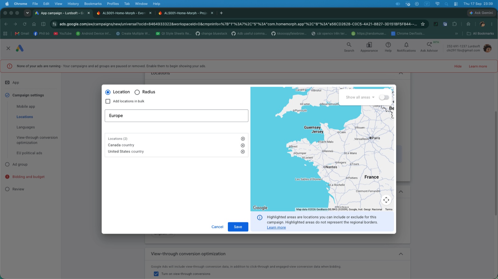

# Google App campaigns — chọn GEO, nhóm nước và ngôn ngữ

## Bối cảnh

Rút từ việc setup campaign đầu của Home Morph (17–18/09/2026). Đánh dấu: ✅ = có trong Google Ads Help; 🧪 = lời khuyên của Claude trong session hoặc kinh nghiệm, chưa kiểm chứng.

## 1. Nhập danh sách nước

Campaign settings → **Locations** → *Enter another location* → popup Location/Radius. Tick **Add locations in bulk**, dán mỗi nước một dòng → Search → Add all → Save.



Ảnh trên (17/09/2026): popup chọn location trong App campaign. Lúc này user đang gõ "Europe" và list đã có Canada + United States từ trước — dễ sót nước không mong muốn, phải soát cột "Locations (n)" trước khi Save. Menu trái cho thấy các mục của Campaign settings: Locations, Languages, View-through conversion optimization, EU political ads.

🧪 **"Europe" ≠ EU.** Theo session, target "Europe" (nếu có) là cấp châu lục, gồm cả UK, Norway, Switzerland, Ukraine, Turkey… Muốn đúng EU thì dán đủ 27 nước:

```
Austria, Belgium, Bulgaria, Croatia, Cyprus, Czechia, Denmark, Estonia, Finland,
France, Germany, Greece, Hungary, Ireland, Italy, Latvia, Lithuania, Luxembourg,
Malta, Netherlands, Poland, Portugal, Romania, Slovakia, Slovenia, Spain, Sweden
```

(Nếu "Czechia" không ra thì thử "Czech Republic".) Tier-1 châu Âu thường thêm UK, Switzerland, Norway (ngoài EU).

## 2. Gom nước vào campaign

- ✅ Không chạy 2 App campaign của cùng app **trùng GEO** (9176652).
- 🧪 Không gom các nước có CPI chênh nhau nhiều vào 1 campaign: Google tối ưu số conversion nên sẽ dồn budget vào nước rẻ nhất, nước đắt gần như không có install → mất data. Gom khi CPI **xấp xỉ** nhau (vd ID + PH + VN), tách riêng nước rẻ hơn hẳn (vd India) hoặc đắt hơn hẳn (vd Gulf).
- 🧪 Budget nhỏ (vd ~$7–8/ngày) → chỉ chạy **1 campaign**; chia nhiều campaign thì không cái nào đủ conversion để thoát learning.
- 🧪 Đọc kết quả ở **cấp country** (report tách theo location), không chỉ cấp campaign; ~100 install/nước trở lên mới đủ để quyết định cắt/scale.
- 🧪 Target xuống cấp thành phố (vd Jakarta, Surabaya) có thể dùng ở vòng tối ưu sau; không nên làm khi budget nhỏ vì thu hẹp volume.

### Phương án "Global test" của khoá Quocmedia (bổ sung 2026-10-15 từ khoá Quocmedia, chưa duyệt)

Khoá "UA Marketing Mobile App 2026" (bài 4.3, 4.5) — nguồn gốc của chữ "global" trong [roadmap](../../00-overview/roadmap.md) — chạy **1 campaign duy nhất, Locations = All countries and territories, Languages = English**, cho cả campaign CPI lẫn campaign ROAS (đổi tại chỗ nên không có 2 campaign trùng GEO).
- Mục đích: chỉ cần **install rẻ để test** SDK AdMob, retention, cho `ad_impression` xuất hiện — không cần đọc theo nước. Với mục đích đó, việc Google dồn budget vào nước rẻ là chấp nhận được.
- Số thật trong khoá (app demo Android, 05–07/12/2024): 157 install, CPI ₫1.708 ([lesson](../../lessons/2024-12-quocmedia-demo-tcpi-thap-va-troas-cao-khong-spend.md)) — là CPI trung bình của mix nước Google tự chọn, không suy ra được CPI từng nước.
- ⚠️ Đánh đổi so với gom theo tier ở trên: không mâu thuẫn tài liệu chính thức, nhưng trái khuyến nghị 🧪 "không gom nước có CPI chênh nhiều". Data global khó đọc theo nước, ROAS bị kéo bởi nước rẻ eCPM thấp, và campaign tROAS chạy global sẽ học trên mix đó. 🧪 Global hợp cho bước test kỹ thuật ngắn ngày; khi chuyển sang tối ưu ROAS thì nên tách GEO theo CPI/eCPM. Home Morph đã chọn hướng khác (ID+PH+VN): [quyết định](../../decisions/2026-09-home-morph-geo-ua-ads-only.md).

## 3. Location options

- ✅ App campaign có mục **Location options** để chỉ định cách target/loại trừ (12575501).
- ✅ Với các loại campaign được mô tả trong 1722038 (Search, Display, PMax…), mặc định là **"Presence or interest"**; "Presence" chỉ nhắm người đang ở/thường ở vùng target. Bài 1722038 **không nhắc App campaign**.
- 🧪 Session khuyên chọn **Presence** ("People in your targeted locations") để tránh traffic từ nước khác chỉ vì "quan tâm" vùng target. Chưa kiểm chứng trên UI App campaign hiện có đúng 2 lựa chọn này không — khi setup lần sau, chụp màn hình lại.

## 4. Ngôn ngữ

- ✅ Google Ads **không dịch** ad → chỉ target ngôn ngữ khớp với asset (12575501).
- Chọn ngôn ngữ theo **ngôn ngữ app đã localize + ngôn ngữ thiết bị phổ biến** ở GEO. Ví dụ đã dùng: ID + PH + VN → English, Indonesian, Vietnamese.
- 🧪 Giữ **English** cho hầu hết GEO: phủ nước nói tiếng Anh (Philippines) và cả user để máy tiếng Anh ở nước khác. Location đã khoá nên English không "rò" sang nước ngoài danh sách.
- 🧪 Nhắm EU mà chỉ để English sẽ bóp reach; thêm French, German, Spanish, Portuguese, Italian, Dutch, Polish… **nếu** app và asset có các tiếng đó.
- 🧪 Ưu tiên GEO mà app đã có bản dịch (vd app có `tr`, `uz`, `ar` → Turkey/Uzbekistan/MENA là lợi thế). RTL (Arabic) phải test layout trước khi chạy.

## 5. Ad group theo ngôn ngữ

- 🧪 Mỗi ngôn ngữ một ad group với bộ text/ảnh/video riêng (vd `ID - Indonesian`, `EN - English`, `VI - Vietnamese`) thay vì trộn 3 thứ tiếng trong 1 ad group. Giới hạn ký tự headline 30 / description 90: xem [creative-assets](../../01-pre-marketing/creative-assets-google-app-campaigns.md).
- Lưu ý: thêm ad group là "composition change" có thể kích hoạt learning ✅ (13020501, xem [app-campaigns-tong-quan](app-campaigns-tong-quan.md)) → nên tạo đủ ad group trước khi publish.
