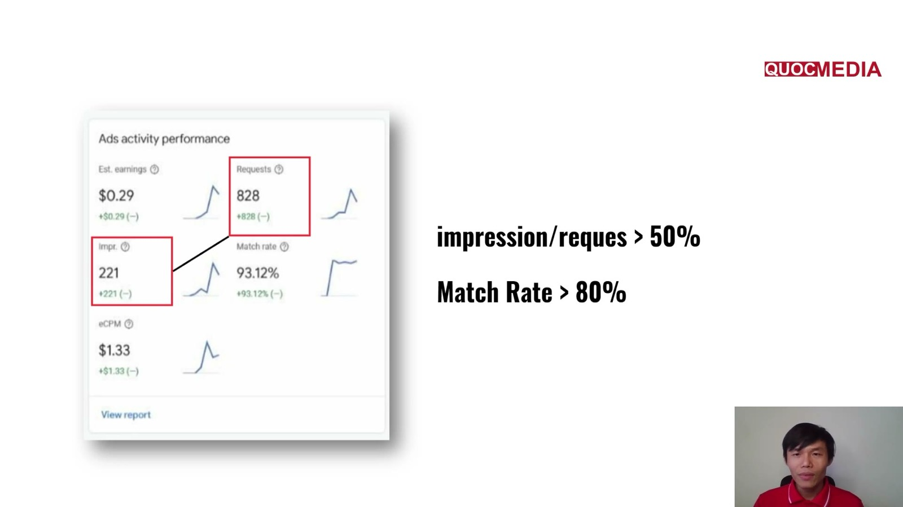

# AdMob cơ bản

## Bối cảnh

AdMob là nền tảng monetization (và mediation) của Google cho app. Với app thuần ads, doanh thu từ AdMob là "R" trong ROAS. Thông tin dưới đây lấy từ AdMob Help, truy cập 2026-10-14.

## 1. Ad formats (6128738)

| Format | Mô tả chính thức | Dùng khi |
|---|---|---|
| **Banner** | Hiển thị ở trên/dưới màn hình | Hiển thị liên tục, ít gây phiền. Hợp app utility (Google gợi ý utility nên cân nhắc banner thay vì interstitial). |
| **Interstitial** | Toàn màn hình, ở điểm chuyển tự nhiên (vd xong level). Hỗ trợ video. | App có luồng tuyến tính, có điểm dừng rõ. |
| **Rewarded** | User chủ động xem video/playable/survey để nhận thưởng | Monetize user free-to-play. User phải **opt-in**. |
| **Rewarded interstitial** *(Beta)* | Toàn màn hình, có thưởng, xuất hiện ở điểm chuyển tự nhiên (user không phải opt-in) | Điểm chuyển muốn tặng thưởng. |
| **Native advanced** | Tuỳ biến theo giao diện app, nằm inline với nội dung. Hỗ trợ video. | Feed, danh sách, màn kết quả. |
| **App open** | Xuất hiện khi user mở app hoặc quay lại app, phủ lên loading screen | Thay cho interstitial lúc mở app (interstitial lúc mở app là **vi phạm**, xem mục 3). |

Mỗi ad unit chỉ nhận ad thuộc các ad type đã chọn (text/image/rich media, video, interactive).

## 2. Chỉ số trong AdMob report (Reports glossary)

Phễu doanh thu:

```
Requests ──match rate──> Matched requests ──show rate──> Impressions ──eCPM──> Estimated earnings
```

| Chỉ số | Định nghĩa / công thức chính thức |
|---|---|
| **Requests** | Số lần app/ad unit gọi ad. **Đếm cả khi không có ad trả về.** |
| **Matched requests** | Số ad mà ad source trả về. Không phải matched request nào cũng thành impression. |
| **Match rate** | Matched requests / Requests × 100% |
| **Impressions** | Tổng số ad đã hiển thị cho user |
| **Show rate** | Impressions / Matched requests × 100% |
| **Clicks / CTR** | CTR = Clicks / Impressions × 100% |
| **Estimated earnings** | Doanh thu ước tính trong kỳ, **có thể thay đổi** |
| **eCPM** | Estimated earnings / Impressions × 1000 |
| **Observed eCPM** | eCPM ước tính của network bên thứ 3 từ dữ liệu lịch sử (chỉ cho network được tối ưu) |
| **Active users** | Số user duy nhất mở app. Theo ngày là DAU. |
| **ARPU** | (Ads earnings + Purchase earnings) / Active users. Gộp theo ngày là ARPDAU. |
| **Imps / AU** | Impressions / Active users, còn gọi là "ad density / ad load" |
| **Imps / Sessions** | Chỉ cho rewarded: số rewarded ad trung bình mỗi session |

### Cách đọc để chẩn đoán

| Triệu chứng | Nghi vấn |
|---|---|
| Match rate thấp | Thiếu demand ở GEO, floor eCPM quá cao, thiếu ad source/bidder, app mới chưa có lịch sử. |
| Show rate thấp | Load ad quá sớm/quá nhiều (preload không dùng), user rời màn hình trước placement, ad hết hạn, logic show sai. Thường là **vấn đề code/placement**. |
| eCPM giảm mà imps tăng | Mở rộng ra GEO eCPM thấp, hoặc tăng ad load ở format rẻ. Đọc theo GEO + format. |
| Imps/AU tăng mạnh | Kiểm tra retention và `app_remove` cùng kỳ. Ad load cao có thể đánh đổi retention. |
| Partner bidding | AdMob tính matched requests khác nên **match rate có thể giảm, show rate tăng mà doanh thu không đổi**. Không kết luận vội. |

Các chiều nên xem: **ad unit**, **format**, **country (top GEO)**, **ad source**, **app version**. Đây cũng là các chiều roadmap yêu cầu ở bước đo lường.

### 🧪 Ngưỡng rule-of-thumb của khoá Quocmedia (bổ sung 2026-10-15 từ khoá Quocmedia bài 4.4, chưa duyệt)

Nguồn: giảng viên Quốc Anh, khoá "UA Marketing Mobile App 2026" — **không phải Google**, AdMob Help không công bố ngưỡng nào. Dùng để kiểm SDK AdMob trên lượng user từ campaign CPI **trước khi** chuyển sang tROAS:



Ảnh trên: slide ngưỡng của khoá; chính ví dụ trên slide (221/828 = 27%) lại **dưới** ngưỡng impression/request.

| Chỉ số | Ngưỡng 🧪 | Dưới ngưỡng thì |
|---|---|---|
| Impressions / Requests | **≥ 50%** (100–200 imp / 1.000 request là "rất đáng báo động") | Làm lại với dev: SDK, hàm load ad, logic show |
| Match rate | **≥ 80%** (≥ 90% là tốt) | Xem lại cấu hình ad unit / mediation / floor |

- Impressions / Requests = **match rate × show rate** (theo định nghĩa ở bảng trên). Nên tách ra xem từng vế: match rate thấp → nghi demand/floor; match rate cao mà tỉ lệ thấp → show rate thấp → nghi code/placement.
- Ví dụ số khoá đưa ra (không rõ app/kỳ): 46 req → 25 imp (54%), match 100%, eCPM $3.39; 766 → 351 (46%), match 99,61%, eCPM $3.84; 828 → 221 (27%), match 93,12%, eCPM $1.33.
- ⚠️ Lệch với thang nội bộ Apero ở [hậu kiểm version](../05-optimization/hau-kiem-version-app-nguong-verdict.md): tool nội bộ coi match rate **≥ 70% là tốt**, 50–70% trung bình, < 50% xấu (khoá: ≥ 80%); show rate ≥ 80% tốt. Cả hai đều là rule-of-thumb, không phải Google; chưa có số thật của app mình để chọn. Match rate còn phụ thuộc GEO và mediation (partner bidding làm match rate giảm mà doanh thu không đổi — bảng trên).

## 3. Policy dễ dính

### Invalid traffic (2753860)
- **Không tự click ad của mình**, kể cả để test. Dùng **test ads** (test ad unit / test device).
- Không dùng bất kỳ cách nào thổi phồng impression/click.
- Không đặt Google ads trong app **trả tiền/thưởng cho việc click hoặc xem ad** (compensation programs). Rewarded ad đúng policy là ngoại lệ.
- Không mở tài khoản phụ để lách. Tài khoản trùng sẽ bị đóng.
- Refresh banner phải nằm trong khoảng SDK cho phép.

### Interstitial: các cách triển khai bị cấm (6201362)
- **Không show interstitial khi app vừa load hoặc khi thoát app.** Muốn có ad lúc mở app thì dùng **App open**.
- **Không show sau mọi hành động** của user, kể cả khi bấm Back.
- **Không bật bất ngờ** giữa lúc user đang thao tác (đang chơi, đang nhập form).
- Không show khi app chạy nền hoặc ngoài môi trường app.
- Không chặn điều hướng hay nội dung chính.
- Lưu ý UX (6066980): một số interstitial cần tới 5 giây mới có nút đóng, video tương tác cao tới 12 giây, một số video third-party bidding tới 30 giây. Tính vào trải nghiệm khi đặt placement.

### Rewarded (7313578)
- Chỉ show **sau khi user chủ động, rõ ràng opt-in**. Từ chối xem thì app vẫn dùng bình thường.
- Công bố rõ hành động cần làm và phần thưởng **trước** mỗi ad.
- **Không thưởng tiền thật** hoặc vật phẩm quy đổi/chuyển nhượng được ra tiền.
- Phải trao đúng phần thưởng đã hứa.

### Chung (6128543)
- AdMob áp dụng AdSense Program policies + Google Publisher Policies. Google có quyền tắt ad serving hoặc đóng tài khoản khi vi phạm.

## 4. Chuẩn nội bộ Apero và chỗ lệch với policy (bổ sung 2026-10-14 từ AI Knownledge, chưa duyệt)

- Chuẩn đặt ad chi tiết theo format (49 rule của QA Apero), mô hình ad unit **primary + 2ID (high floor)** bật/tắt bằng Remote Config: [quy tắc đặt quảng cáo in-app Apero](quy-tac-dat-quang-cao-in-app-apero.md). Template ~50 key RC theo phase build/normal/2-floor: [Remote Config theo phase](remote-config-ads-theo-phase-build-normal-2floor.md).
- Khi đọc report theo ad unit, tách unit high floor (`_2ID`, `_2fl`, `_high`) khỏi unit thường; so 2 app version theo ad unit (tách user First Open/Home): [hậu kiểm version app](../05-optimization/hau-kiem-version-app-nguong-verdict.md).

### ⚠️ Mâu thuẫn: interstitial ngay sau splash
- **Nội bộ** (APR-108 rule #9): chuẩn "Open app → splash → **inter** → main"; app thật có placement `inter_splash` / `inter_splash_high`, template RC bật `fo_inter_splash` ở phase normal và 2-floor.
- **AdMob 6201362** (WebFetch lại 2026-10-14): *"Do not place interstitial ads on app load and when exiting apps"*; *"We recommend placing an app open ad when loading an app or switching back to it."* — khớp mục 3 bài này.
- **Verdict**: theo nguồn chính thức. Inter lúc mở app là rủi ro policy; dùng App open ad. Chưa sửa gì ở tài liệu nội bộ — cần team monetization xác nhận Apero có ngoại lệ hay đang chấp nhận rủi ro (đã đặt mốc trong watchlist).
- **Tần suất**: nội bộ flag "> 1 ad/phút"; AdMob: *"no more than one interstitial ad after every two user actions"* (áp cả nút Back). Hai thước đo khác nhau — áp cả hai.

## Việc tiếp theo

- Khi có app cụ thể: liệt kê ad unit (ID, format, placement) vào `apps/<app>/profile.md`.
- Thêm bài về banner/native placement guidance (6128877) nếu cần.
