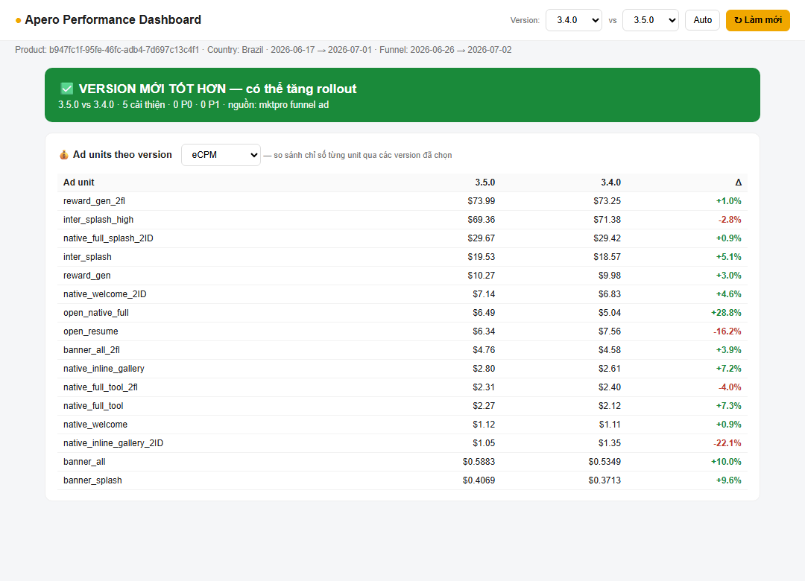

# Quy tắc đặt quảng cáo in-app của Apero

## Bối cảnh

- Hai nguồn nội bộ của team QA Apero (07/2026):
  - **APR-108** (Hoài Nguyễn Thị): checklist "Ad Policy — Apero" dùng trong skill review spec, gắn link [AdMob policy](https://support.google.com/admob/answer/6329638). Đánh số rule #1–#49.
  - **APR-092** (Phạm Thị Út Vân): checklist test case ads bắt buộc cho mọi ad placement, mô tả cách Apero cấu hình ad unit qua Remote Config.
- Đây là **chuẩn nội bộ**, có chỗ chặt hơn và có chỗ **lệch** với policy chính thức của AdMob (xem mục ⚠️). Chưa đối chiếu từng rule với policy gốc.
- Bổ sung cho [admob-co-ban](admob-co-ban.md), bài đó đã có phần policy chính thức (invalid traffic, interstitial, rewarded).

## 1. Quy tắc đặt ad theo format (APR-108)

### Interstitial
| # | Quy tắc |
|---|---|
| 1 | Bắt buộc **show loading ad trước** inter: màn A → bấm nút → loading ad → Inter → tắt → màn C |
| 2 | Chỉ đặt ad khi action của user **dẫn tới chuyển màn**. Tắt inter mà không chuyển màn là vi phạm |
| 3 | Inter phải hiện **ngay** sau khi user click điểm đặt. Hiện trễ dễ gây click nhầm. Chấp nhận hiện sau thanh tiến trình/loading |
| 4–6 | Khi inter đang show: không popup đè, không phát nhạc nền, không để resume ad đè lên |
| 7 | Không show inter liên tiếp. Sau 1 ad phải có bước nhảy/frequency cap |
| 8 | Không đặt quá nhiều inter trong flow. Khi review: flag nếu > 1 ad/phút sử dụng |
| 9 | Không có video inter **trước** splash. Chuẩn nội bộ: Open app → splash → inter → main (xem ⚠️) |
| 10 | Back: chỉ một chiều có inter (A→B **hoặc** B→C), không cả hai |
| 11 | Không 2 ad full màn liên tiếp (inter rồi resume hoặc ngược lại) |
| 12 | Click vào ad phải có xử lý |
| 13 | Nút tắt ad phải hiện **trước giây thứ 15** |

### App open / Resume ad
- #14: nền dưới ad không được trong suốt để lộ data app. Nên có màn trắng phía dưới, tắt ad thì tắt luôn màn trắng.
- #17: click ad phải có xử lý. Màn đang mở web ngoài thì **không** show ad.

### Banner (#18–#26) và Native (#27–#42)
- Hiện **loading ad** trước, kích thước loading ≈ ad thật (chấp nhận khoảng 3/4). Vị trí đặt ad phải có loading ngay từ đầu, ad không được bất ngờ nhảy ra.
- Không đặt ad ở màn đang mở web ngoài, ở **popup Rate app**, hoặc ở màn không có data/content. Đề xuất: thêm file sample hoặc ẩn ad. Chấp nhận khi màn chỉ có 1 button là nội dung.
- Content và ad không đè nhau. Banner có **line phân cách** với content. Native có padding và background khác app.
- **Inline banner** chỉ được đặt trong vùng cuộn được.
- Native: ad **không được là nội dung chính** của màn hình; AdChoices (chữ i) nằm trong khung ad (lệch ra ngoài > 50% là lỗi); "Ad" attribution tối thiểu 15px; title cắt sau 25 ký tự, body cắt sau 90 ký tự; MediaView ≥ 120×120dp; CTA phải có xử lý click.

### Rewarded (#43–#48)
- **Opt-in**: điểm trigger phải có dấu hiệu nhận biết (icon/text "Watch an ad"…). Spec ghi "click → reward ads" mà không có CTA cảnh báo là VIOLATION.
- Không popup/nhạc/resume ad đè. Không 2 ad full màn liên tiếp. Click phải có xử lý.

### Link sang app/web khác (#49) và app AI
- Button dẫn sang web/app khác (không liền mạch với chức năng chính) phải có nhãn "AD" hoặc cảnh báo.
- App có kết quả AI (gen ảnh/video/chat): **bắt buộc nút Report content** ở màn kết quả. Khớp lỗi "AI-Generated Content" của Google Play, xem [policy](../01-pre-marketing/policy-loi-thuong-gap-va-cach-fix.md).

### Red flags khi đọc spec
| Spec ghi | Kết luận |
|---|---|
| "Click button → reward ads", không có CTA opt-in | Vi phạm #43 |
| "Open app → inter ad → splash" | Vi phạm #9 |
| Không nhắc loading ad | Thiếu thông tin #1/#18/#27 |
| Không có frequency cap inter | Thiếu thông tin #7/#8 |
| Inter ở action không chuyển màn | Vi phạm #2 |
| Banner/native ở popup Rate | Vi phạm #22/#31 |

## 2. Mô hình cấu hình ad unit ở Apero (APR-092)

Các spec app của Apero dùng một pattern cấu hình chung, nên UA/monetization cần hiểu khi đọc report theo ad unit:

- Mỗi placement có **2 ad unit**: `primary` và `2ID` (ad unit thứ hai, trong report thường có hậu tố `_2ID`, `_2fl`, `_high`, tức là unit **high floor**). Cả hai bật/tắt bằng **Remote Config** (RC):
  - primary=true, 2ID=true → load **2ID trước**; 2ID fail thì **fallback** về primary.
  - primary=true, 2ID=false → chỉ load primary, không request 2ID.
  - primary=false → không load, không request, không show (kể cả 2ID).
- **Frequency bằng RC `jump_*`**: jump=0 → show mọi lần trigger; jump=1/2/3 → show theo nhịp 1,3,5… / 1,4,7… / 1,5,9….
- **Preload và reload**: inter/banner/native thường preload ở Home khi mở app; native full screen ("Nafu") load khi vào màn sắp trigger. Sau khi show xong reload **đúng 1 request**. Banner/native còn reload khi user click ad rồi back, hoặc app ẩn rồi mở lại.
- **Sub gate (mặc định)**: user mua Sub thành công → **mọi ad ẩn, không request, không show**, kể cả dấu hiệu nhận biết reward.
- Ad load xong khi app đang background thì **không** show ngay lúc foreground lại, chờ trigger tiếp theo.
- Tên placement hay gặp: `inter_splash`, `open_resume`, `open_native_full`, `native_full_splash`, `native_welcome`, `native_inline_gallery`, `banner_all`, `banner_splash`, `reward_gen`, `nafu_back`, `interstitial_click_template`.

### Số liệu thật minh hoạ (1 app, 1 GEO)

Ảnh dưới là bảng eCPM theo ad unit của app **TeraBot/Synza (AIP806)**, thị trường **Brazil**, 17/06–01/07/2026, so version 3.5.0 với 3.4.0. Nguồn: mktpro Admob report, do APR-101 bắt lại.

Đọc ở bản 3.5.0: unit high floor (`reward_gen_2fl` ~$74, `inter_splash_high` ~$69) có eCPM gấp 3–7 lần unit thường cùng format (`reward_gen` ~$10, `inter_splash` ~$19.5). Banner chỉ ~$0.4–0.6, native thường ~$1–7. Đây là **1 app, 1 GEO, 2 tuần**, chỉ để hiểu cấu trúc, không dùng làm benchmark. eCPM unit high floor cao vì nó chỉ được tính trên lượt fill được giá cao, nên phải đọc kèm match rate và impressions.

## ⚠️ Mâu thuẫn với policy chính thức

- **Inter sau splash.** Rule #9 nội bộ coi "Open app → splash → **inter** → main" là chuẩn, và app thật có placement `inter_splash`. Trong khi đó [AdMob 6201362](https://support.google.com/admob/answer/6201362) (WebFetch 2026-10-14, kiểm lại lần 2 cùng ngày) ghi: *"Do not place interstitial ads on app load and when exiting apps"*. Google khuyên dùng **App open ad** khi mở app hoặc quay lại app. [admob-co-ban](admob-co-ban.md) cũng ghi interstitial lúc mở app là vi phạm.
  - Đánh giá: nguồn chính thức > tài liệu nội bộ. Inter ngay sau splash có rủi ro policy. Cần hỏi team monetization xem Apero có xác nhận riêng (từ account manager Google) hay chấp nhận rủi ro. Chưa đủ bằng chứng để coi rule #9 là an toàn. **Verdict KB: theo AdMob** — placement mở app nên là App open ad; `inter_splash` / `fo_inter_splash` (xem [Remote Config theo phase](remote-config-ads-theo-phase-build-normal-2floor.md)) được ghi là rủi ro policy cho tới khi team monetization xác nhận (đã đặt mốc theo dõi trong watchlist).
- **Tần suất.** Nội bộ flag khi "> 1 ad/phút". AdMob ghi *"no more than one interstitial ad after every two user actions"*, và quy định này áp dụng cả cho nút Back. Hai thước đo khác nhau, nên áp cả hai.
- **Nút đóng trước 15s** (#13) khớp với lỗi Disruptive Ads của Google Play (ads non-skippable > 15s). Trang AdMob 6066980 ghi một số video inter third-party bidding cần tới 30s mới đóng được. Cái này là hành vi của network, app không kiểm soát được.

## Bài học / Kết luận

- Dùng checklist mục 1 khi review spec placement mới, **trước** khi dev code. Sửa spec rẻ hơn sửa sau khi bị Google báo.
- Khi đọc report theo ad unit, tách unit `_2ID/_2fl/_high` (high floor) khỏi unit thường. Nếu gộp, eCPM trung bình sẽ đổi theo tỉ lệ fill của unit high floor, không phản ánh thay đổi giá.
- Bật/tắt unit hay đổi `jump_*` qua RC là đòn bẩy monetization không cần ra version mới. Mỗi lần đổi phải ghi lại ngày + giá trị để đọc ARPDAU/retention về sau.
