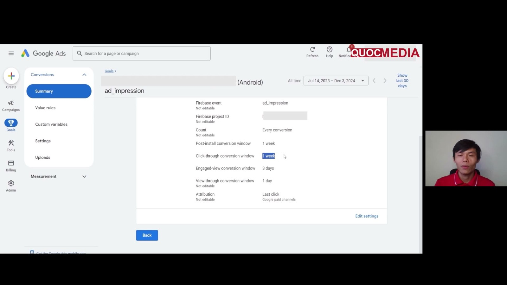

# Firebase events dùng cho UA

## Bối cảnh

Google App campaigns tối ưu dựa trên **conversion import từ GA4/Firebase**. Với app thuần ads, chuỗi event chính là `first_open` (dùng cho tCPA giai đoạn đầu) rồi `ad_impression` có value (dùng cho tROAS ad revenue). Setup link xem [firebase-setup-link-google-ads-admob](firebase-setup-link-google-ads-admob.md).

## 1. Event tự động thu (theo Firebase Help 9234069)

| Event | Khi nào bắn | Ghi chú cho UA |
|---|---|---|
| `first_open` | Lần đầu user mở app sau khi cài hoặc **cài lại** | Event "install" cho Google Ads. Không đếm lượt tải chưa mở. |
| `session_start` | User bắt đầu tương tác với app | Mỗi session có session ID và session number. |
| `user_engagement` | App ở foreground ≥ 1 giây (param `engagement_time_msec`) | Dùng để tính engagement time và active user. Bị chặn sớm (crash, thoát ngay) thì không có. |
| `app_remove` | Package bị gỡ khỏi máy **Android** (chỉ Android) | Đếm mọi lượt gỡ, **bất kể nguồn cài**. Dùng để theo dõi tỉ lệ uninstall, ví dụ sau khi tăng ad load. Không gắn với ngày cài, nên muốn đọc theo cohort phải tự join. |
| `in_app_purchase` | User hoàn tất IAP (kể cả subscription lần đầu) | Chỉ với app version có Firebase SDK. Bỏ qua giao dịch test/sandbox/invalid. Gia hạn là event khác (`app_store_subscription_renew`). Log tay thêm sẽ bị **trùng**. |
| `ad_impression` | User thấy một ad impression. Publisher event từ AdMob qua Google Mobile Ads SDK (hoặc Ad Manager) | Param `ad_event_id`, `value`. **Không export sang BigQuery**. Firebase Help ghi: "No ad_impression value or currency is passed with the default integration". Value đến từ AdMob khi **link AdMob↔Firebase + bật impression-level ad revenue**. |
| `ad_reward` | Rewarded ad trao thưởng | Param `reward_type`, `reward_value`. |
| `app_update`, `os_update` | Lần mở đầu sau khi cập nhật app / OS | Dùng khi soi crash theo version. |

## 2. `ad_impression`: nguồn value

### a) Monetize bằng AdMob (kể cả AdMob mediation)
- Firebase **tự log** `ad_impression` khi AdMob app đã link Firebase/GA4 (Firebase Android SDK ≥ 17.6.0).
- Muốn có **value** phục vụ tROAS: bật **Impression-level ad revenue** trong AdMob (Settings → Account → Account controls). Google Mobile Ads SDK Android ≥ 21.1.0.
- **Không** log `ad_impression` thủ công từ `OnPaidEventListener` (AdMob paid event) khi đã link, vì sẽ đếm đôi doanh thu. Paid event dùng để gửi doanh thu sang **MMP/hệ thống riêng**. *(Suy ra từ cơ chế auto-log + cảnh báo trùng của Firebase. Nên xác nhận trên DebugView khi tích hợp.)*
- Độ chính xác value theo AdMob: *Precise* (AdMob Network, bidding), *Estimated*, *Publisher provided* (CPM thủ công của waterfall), *Unknown* = $0 (vd AdMob campaigns, house ads). Impression qua Partner Bidding không còn được gửi qua AdMob (answer/11322405).

### b) Monetize bằng AppLovin MAX (hoặc mediation khác)
Firebase **không tự có** dữ liệu, phải log `ad_impression` thủ công trong callback ILRD của MAX (`MaxAdRevenueListener.onAdRevenuePaid`):

```kotlin
override fun onAdRevenuePaid(ad: MaxAd) {
    val params = Bundle().apply {
        putString(FirebaseAnalytics.Param.AD_PLATFORM, "appLovin")
        putString(FirebaseAnalytics.Param.AD_UNIT_NAME, ad.adUnitId)
        putString(FirebaseAnalytics.Param.AD_FORMAT, ad.format.label)
        putString(FirebaseAnalytics.Param.AD_SOURCE, ad.networkName)
        putDouble(FirebaseAnalytics.Param.VALUE, ad.revenue)   // MAX trả USD
        putString(FirebaseAnalytics.Param.CURRENCY, "USD")
    }
    firebaseAnalytics.logEvent(FirebaseAnalytics.Event.AD_IMPRESSION, params)
}
```

Quy tắc (Firebase docs):
- Bắt buộc có **`value` và `currency`** thì Google Ads mới xử lý được. Currency theo **ISO 4217** (vd "USD"). Value là số dùng dấu chấm thập phân.
- MAX: revenue có thể là **-1** khi lỗi, và **rỗng ở test mode**. Phải lọc trước khi log (đừng gửi -1 hay 0).
- `revenuePrecision` của MAX: `exact` (auction realtime), `estimated`, `publisher_defined`, `undefined`.
- Validate: DebugView khi dev, Realtime sau khi release. Có BigQuery export thì soi các event value = 0/null.
- Nếu app dùng **cả** AdMob trực tiếp lẫn MAX thì cẩn thận đếm đôi (AdMob tự log + MAX log). Chọn một đường duy nhất cho mỗi impression. *(Cần kiểm tra cụ thể khi AdMob chạy như một network trong MAX.)*

## 3. Event nào để tối ưu bid strategy nào

| Bid strategy (App campaign for installs) | Event tối ưu | Điều kiện |
|---|---|---|
| **tCPI** (focus Installs) | install (`first_open` hoặc Google Play install) | Budget ≥ 50× tCPI (14104492). |
| **tCPA** (focus In-app actions) | 1 in-app event sau cài (vd `level_complete`) | Budget ≥ 10× tCPA. Chỉ chọn 1 action, trừ khi các action có giá trị ngang nhau. |

> **Lưu ý thuật ngữ:** roadmap gọi bước đầu là "tCPA tối ưu `first_open`". Trong Google Ads, `first_open` là **install conversion**, nên tối ưu `first_open` thực chất là bid **target CPI** (Google xếp tCPI là một biến thể của Target CPA, answer/12073727). Budget theo quy tắc **50× tCPI**, không phải 10× tCPA. Cần đối chiếu trên UI thực tế: chọn focus nào và bid hiện tên gì thì ghi lại vào `lessons/`. Xem [playbook](../playbooks/launch-google-app-campaign-tcpa-den-roas.md).
| **tROAS** (focus In-app action value) | Event có **dynamic value**: `ad_impression` (ad revenue), `in_app_purchase` (IAP), hoặc cả hai (Hybrid) | Cần Firebase SDK (7100895). Event phải có value, không để "Don't use a value". |

Ràng buộc chính thức riêng cho **`ad_impression` / tROAS for ad revenue (ARO)** (answer/13799577):
- App phải bidding trên GA events, đã **import `ad_impression`** từ GA4 vào Google Ads, và đã đánh dấu là conversion/key event trong GA4.
- App phải có "significant majority or entirety" doanh thu đến từ ads. Nếu không thì dùng Hybrid (thêm `ad_impression` + event IAP).
- `ad_impression` **chỉ dùng được với tROAS**, không dùng cho tCPI/tCPA. Google ghi event này được "reserved for exclusive use in tROAS for ad revenue (ARO) campaigns".
- Chỉ hỗ trợ attribution qua Google Analytics. **Không** hỗ trợ log server-to-server (Measurement Protocol).
- Conversion window khuyến nghị **7 đến 30 ngày**.
- Cột Conversions của `ad_impression` mặc định hiển thị **0**. Xem bằng segment theo conversion action + cột "Conversion value".

### Thực hành từ khoá Quocmedia (bổ sung 2026-10-15 từ khoá Quocmedia bài 4.5)

- **App mới chưa có `ad_impression` trong Firebase → Events.** Event chỉ xuất hiện sau khi có user thật xem ad (app demo của khoá lúc đầu chỉ có `app_clear_data`, `app_remove`, `first_open`, `screen_view`, `session_start`). Vì vậy phải chạy campaign CPI trước vài ngày rồi mới bật key event + import được — đây là lý do thực tế của mốc "~3 ngày" trong [roadmap](../00-overview/roadmap.md).
- Đường import trên UI 12/2024: Firebase Events → bật toggle *Mark as key event* cho `ad_impression` → Google Ads **Goals → Conversions → Summary → + Create conversion action → App → Google Analytics (Firebase) → tick `ad_impression` (đúng app) → Import and continue → Done**.
- Conversion window: mặc định khi import là post-install **90 ngày** / click-through 90 ngày / engaged-view 3 ngày / view-through 1 ngày, Last click. Khoá đổi post-install và click-through về **1 tuần** cho "kết quả về nhanh hơn" — nằm trong khoảng 7–30 ngày ở trên ✅.



Ảnh trên: trang chi tiết conversion `ad_impression` trong Google Ads (12/2024) sau khi đổi window về 1 tuần; Count, view-through và attribution ghi "Not editable".

**Đọc event trên Firebase/GA4 (bổ sung 2026-10-15 từ khoá Quocmedia bài 4.8)**
- Khoá coi `ad_impression` và `first_open` là 2 event quan trọng nhất cho app kiếm tiền bằng ads, kèm `app_remove` để xem gỡ cài đặt. Xem ở Firebase → **Key events** (count + % đổi so cùng kỳ) hoặc GA4 → Engagement → **Events**.
- GA4 Events có cột **Total revenue**: với AdMob đã link, toàn bộ doanh thu ads hiện ở dòng `ad_impression` (demo 01/01–10/12/2024: 56.937 event, 7.178 user, $375,92). Đây là cách kiểm nhanh ad revenue đã vào GA4 trước khi tin cột Conv. value của Google Ads.
- Cùng màn hình đọc được tỉ lệ thô `app_remove` users / `first_open` users (demo 8.770 / 9.462 ≈ 93%) và imps/user (demo 7,93) — xem [lesson](../lessons/2024-12-quocmedia-demo-troas-60-ket-qua-ad-group-geo.md).

## 4. Event tuỳ chỉnh nên có (gợi ý, chưa kiểm chứng hiệu quả)

- Event đánh dấu "user đã trải nghiệm core feature" (vd `feature_used`, `level_complete`). Có thể dùng làm tCPA event chất lượng hơn `first_open` khi volume đủ. Google khuyên tCPA ACe đủ cao để "drive more than 100 conversions".
- Event về ad placement (vd `ad_show_failed`) để soi show rate theo màn hình.

## 5. Tính chỉ số từ BigQuery export (bổ sung 2026-10-14 từ AI Knownledge)

Khi đã bật GA4 → BigQuery export, các event ở trên truy vấn được trên bảng `events_*`: DAU, new users, retention D1/D7 theo cohort `first_open`, engagement. **Ngoại lệ: `ad_impression` do AdMob tự log KHÔNG có trong BigQuery export** (Firebase Help 9234069, kiểm lại 2026-10-14: "This event is not exported to BigQuery"). Vì vậy ARPDAU = tổng `value` của `ad_impression` ÷ DAU chỉ tính được trên BigQuery khi `ad_impression` được **log tay** (vd ILRD từ AppLovin MAX); với AdMob auto-log thì lấy doanh thu từ AdMob report rồi chia DAU. SQL và quy tắc đọc: [chỉ số sức khoẻ sản phẩm từ GA4 BigQuery](ga4-bigquery-chi-so-suc-khoe-san-pham.md). Template agent tự báo cáo hằng ngày: [Police-product](../06-tools/police-product-bao-cao-suc-khoe-app-hang-ngay.md).

## 4b. Đặt tên event custom (quy ước nội bộ)

Quy ước company-wide của các skill PO (APR-102/APR-026): `[screen]_[element]_[action]` (7 loại: `_scr`, `_display`, `_btn_click`, `_click`, `[action]`, `_success`, `_fail`), success/fail là 2 event riêng, `_fail` bắt buộc có `failure_reason`. Chi tiết, giới hạn tên/param và checklist validate: [tracking spec & metrics plan](tracking-spec-va-metrics-plan-cho-feature.md).

- Khi chọn event tCPA, ưu tiên event `_success` của core feature (vd `generation_success`) thay vì `_btn_click` — bấm nút chưa phải là nhận giá trị. *(Gợi ý, chưa kiểm chứng hiệu quả.)*
- Event Home Morph đang theo dõi (`generation_completed`, `rewarded_ad_completed`) không theo quy ước này. Không đổi tên khi campaign đang dùng nó để bid (reset learning); chỉ áp quy ước cho event mới.

## Bẫy hay gặp

- Một số tài liệu nội bộ (skill po-metrics-analysis) ghi `in_app_purchase` "chỉ iOS, Android dùng `purchase`" — sai: Firebase Help 9234069 thu event này cho cả app Android và iOS. Đừng log tay thêm `purchase` cho Android, sẽ trùng.
- Đặt event custom trùng tên event tự động/dành riêng (`screen_view`, `ad_impression`, `first_open`, `app_remove`…) hoặc dùng tiền tố `firebase_`/`google_`/`ga_` → event bị bỏ hoặc ghi đè dữ liệu tự động.
- Bắn event màn hình mỗi lần re-render → thổi phồng số. Bắn 1 lần mỗi lần vào màn.
- `dynamic_link_app_open` (còn trong vài tài liệu nội bộ) thuộc Firebase Dynamic Links — dịch vụ đã ngừng, không dùng làm event acquisition.
- Gửi value bằng micros (AdMob paid event trả `valueMicros`) mà không chia 1.000.000 nên ROAS bị phóng đại 10^6. *(Chỉ gặp khi tự log.)*
- Gửi currency sai hoặc thiếu, Google Ads bỏ qua event.
- Đổi tên event tối ưu hoặc đổi conversion window khi campaign đang học thì reset learning (14104492).
- (bổ sung 2026-10-15 từ khoá Quocmedia bài 4.8) **GA4 gán gần hết user mới cho Organic Search dù đang chạy Google Ads**: demo có 9,2K/9,5K new user "Organic Search" và thẻ *Sessions by Google Ads campaign* = No data, trong khi Google Ads báo 2.671 install. Đừng dùng báo cáo acquisition GA4 để so UA vs organic khi chưa kiểm link Google Ads ↔ GA4 và cách GA4 gán nguồn cho install từ Play Store (chưa xác minh nguyên nhân).
