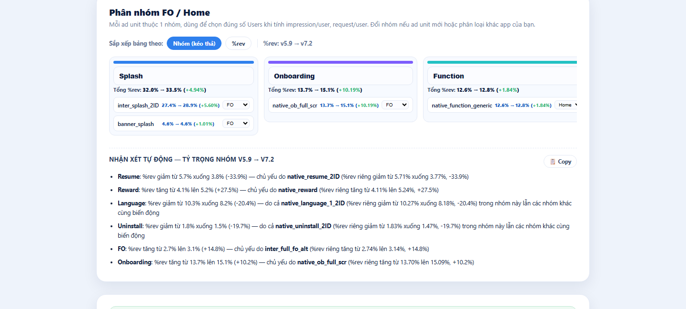

# Hậu kiểm version app trước khi tăng rollout

## Bối cảnh

- Ở Apero, mỗi version mới được roll dần (vd 20%) rồi so với version cũ trên **mktpro** (`mktpro.aperogroup.ai`, trang `product-report/compare-app-version`), **mktpro Admob Report** và **GA4 Funnel Exploration** (segment theo version).
- Hai tool nội bộ đã mã hoá cách so sánh này thành quy tắc:
  - **APR-099 stum-weekly-report** (My Nguyễn Thảo): báo cáo tuần theo mẫu "stum".
  - **APR-101 App Performance Checker** (Trần Thị Ngọc Oanh): ra verdict theo ngưỡng của skill nội bộ `app-performance-analysis`.
- Các ngưỡng dưới đây là **quy ước nội bộ trong code** (07/2026), chưa có nguồn chứng minh thống kê. Coi là điểm khởi đầu, chỉnh theo app.
- Bài này thêm góc **so version** cho [đọc chỉ số theo mốc thời gian](doc-chi-so-theo-moc-thoi-gian.md). Bài đó đọc theo campaign/thời gian.

## 1. Khi nào số "đủ" để so (APR-099)

- Chỉ tính ngày có số **new user/ngày** của country đạt ngưỡng theo tier: **Tier 1 = 100, Tier 2 = 300, Tier 3 = 1000**. Tier cao là thị trường giá trị cao nên ngưỡng thấp hơn. Ngày không đạt thì bỏ.
- Version thứ 2 phải có **≥ 300 new user/tuần** mới coi là đang chạy song song. Dưới mức đó thì báo cáo như 1 version.
- Mỗi app chỉ xét **top 3 country theo revenue**. Dữ liệu Thứ 2 → Thứ 7, bỏ Chủ Nhật.
- Chưa đủ số thì vẫn báo cáo version đang chạy, kèm ghi chú "Chưa đủ số thị trường nào".

### Bảng tier country dùng trong tool (toàn cục, áp cho mọi app)
- **Tier 1 (19):** US, Canada, UK, Ireland, Australia, New Zealand, Germany, Austria, Switzerland, France, Belgium, Netherlands, Luxembourg, Italy, Spain, Denmark, Finland, Norway, Sweden.
- **Tier 2 (63):** gồm Brazil, Mexico, Argentina, Chile, Colombia, Peru, Japan, South Korea, Hong Kong, Singapore, Malaysia, Thailand, **Indonesia, Philippines**, China, Saudi Arabia, UAE, Qatar, Oman, Israel, Turkey, Egypt, Morocco, South Africa, Poland, Portugal, Greece, Czech Republic, Romania, Hungary, Ukraine, Russia, các nước Baltic…
- **Tier 3 (64):** gồm **Vietnam, India**, Pakistan, Bangladesh, Nigeria, Kenya, Algeria, Iraq, Jordan, Kuwait, Bahrain, Sri Lanka, Cambodia, Laos…
- Danh sách đầy đủ ở `src/tiers.js` của Stum-Tool.

## 2. Chỉ số so sánh

| Nguồn | Chỉ số |
|---|---|
| mktpro compare-app-version | Active users, **LTV D0–D28**, Retention (R1, R7), **Churn D0–D7**, Session/User, Time/User, Crash-free %, Uninstall %, User convert % |
| mktpro Admob Report | eCPM, match rate, show rate, impressions, earnings, CTR, **tách theo ad unit × version** |
| GA4 Funnel | Active users, completion %, abandon % từng step (vd first_open → splash → ad_splash → onboarding_1..3 → màn chính), overall conversion |

Mẫu stum ghi: LTV D0 từng ngày (so % với version cũ); R1/Churn/Session/Time lấy trung bình kỳ rồi so %; Crash. Quy ước câu chữ: |Δ| < 1% → "đi ngang", 1–2% → "tăng/giảm nhẹ"; Time/User |Δ| < 3s → "đi ngang".

## 3. Ngưỡng ra verdict (APR-101, `verdict.js`)

Δ tính theo **điểm %** (pp) với tỉ lệ, theo **% tương đối** với tiền.

| Chỉ số | Tốt hơn nếu | P1 khi xấu đi ≥ | P0 khi xấu đi ≥ | Ngưỡng tuyệt đối |
|---|---|---|---|---|
| Retention D1 | tăng | 2pp | **5pp** | — |
| Retention D7 | tăng | 2pp | — | — |
| Churn D0 | giảm | 3pp | **10pp** | — |
| LTV D0 | tăng | 15% | — | — |
| LTV D7 | tăng | 10% | **20%** | — |
| Crash-free % | tăng | 0.3pp | — | < 99% → P1 |
| Uninstall % | giảm | 5pp | — | — |
| User convert % | tăng | 3pp | — | — |
| Match rate | tăng | 5pp | — | **< 50% → P0**, < 70% → P1 |
| Show rate | tăng | 5pp | — | **< 60% → P1** |
| eCPM | tăng | 20% | — | — |
| Funnel overall conversion | tăng | 3pp | — | — |
| Drop-off 1 step | — | abandon tăng ≥ 5pp | **≥ 10pp** | — |

Màu benchmark trong tool: match rate ≥ 70% tốt, 50–70% trung bình, < 50% xấu; show rate ≥ 80% tốt, 60–80% trung bình, < 60% xấu.

**Verdict:**
- Có P0 → "CÓ REGRESSION NẶNG — chưa nên tăng rollout".
- Có P1 và có cải thiện → "HỖN HỢP"; chỉ có P1 → "CẦN THEO DÕI".
- Chỉ có cải thiện → "VERSION MỚI TỐT HƠN — có thể tăng rollout".
- Không có gì đáng kể → "KHÁC BIỆT KHÔNG ĐÁNG KỂ".
- Active users chỉ là context (version mới roll ít nên ít user), **không chấm điểm**.

Khi phân tích sâu, skill nội bộ truy root cause theo **LTV chain (ads)**: Requests/session × Match rate × Show rate × eCPM × Sessions × Retained days.

## 4. Ví dụ thật

App **TeraBot/Synza (AIP806)**, Brazil, so **3.5.0 vs 3.4.0** (mktpro 17/06–01/07/2026, GA funnel 26/06–02/07/2026):

Ảnh là màn Kết luận của [App Performance Checker](../06-tools/apero-app-performance-checker.md) với số thật của một app, một GEO — chỉ để hiểu cách đọc, không dùng làm benchmark.

- Verdict "VERSION MỚI TỐT HƠN" (5 cải thiện, 0 P0, 0 P1). eCPM $4.77 (+6.5%), match rate 72.11% (+1.08pp), funnel conversion 70.93% (+2.47pp).
- Cần theo dõi: show rate 60.46% (−1.92pp, sát ngưỡng 60%), uninstall +1.02pp.
- Active users −84% chỉ vì 3.5.0 mới roll.
- Kết luận của tác giả: app theo chiến lược **70% sub / 30% ads**, nên phải có thêm dữ liệu subscription mới chốt được tổng doanh thu. Có thể tăng rollout sau khi vá tracking ở step cuối funnel và theo dõi show rate của `reward_gen`.

## 5. Đào sâu theo ad unit bằng export AdMob (APR-161)

> Gộp 2026-10-14 từ tài liệu ứng viên "Hậu kiểm AdMob theo app version" — quy trình của đội Ad Monetization (PRD tool APR-161, 07/2026, ghi là "đúng 100% theo file Excel gốc của đội"). Quy trình nội bộ, không phải hướng dẫn của Google. Tool tự động hoá: [AdMob Revenue Report Tool](../06-tools/admob-revenue-report-so-sanh-version.md).

Dùng khi release **đổi luồng ads** (thêm/bớt/đổi vị trí ad unit, đổi First Open, Splash/Onboarding/Language) và verdict ở mục 3 cho thấy eCPM/match/show rate thay đổi — để biết do ad unit nào.

1. **Export**: AdMob → Reports, chiều Ad unit, filter **1 country**, mỗi file **1 app version**. Chọn khoảng ngày cả 2 version đủ user.
2. **Số user** mỗi version từ Firebase/GA4, tách **Users FO** (user mới qua luồng First Open) và **Users Home** (vào màn chính). Ad unit luồng FO chỉ user mới thấy; chia cho DAU làm imps/user FO thấp giả.
3. **Gán nhóm** ad unit theo từ khoá tên: Splash, Language, Onboarding, FO, Banner, Tutorial, Function, Resume, Result, Thumbnail, Uninstall, Reward, Khác; mỗi unit thuộc FO hoặc Home. → Đặt tên ad unit có tiền tố luồng ngay từ đầu (`splash_inter`, `onboarding_native`, `banner_all`) để tự động hoá được.
4. **Tính**: `%rev = Earnings unit ÷ tổng Earnings (country + version)`; `impression/user = Impressions ÷ Users (FO hoặc Home)`; `request/user` tương tự.
5. **Ghép unit cùng tên** giữa 2 version, tính 7 delta: Δ eCPM, Δ Match rate, Δ CTR, Δ Show rate, Δ %rev, Δ impression/user, Δ request/user.
6. **Mức biến động tổng thể** = trung bình |Δ| có trọng số Earnings → Ít / Vừa / Mạnh (PRD không ghi ngưỡng).
7. **Đọc theo chuỗi nhân quả** Request → Impression → Earnings → %rev, ghi số trước → sau (không chỉ %). Liệt kê unit bị xoá/thêm/thay và unit gần như không có doanh thu.

Ảnh cho thấy bước 3: mỗi ad unit được gán màu theo nhóm luồng và gắn FO/Home, kéo-thả lại được nếu tên unit không theo quy ước.

Cách đọc kết hợp phễu AdMob:
- req/user tăng mà imps/user không tăng → show/match rate giảm: preload thừa hoặc thiếu fill (bảng chẩn đoán trong [AdMob cơ bản](../03-monetization/admob-co-ban.md)).
- %rev của một unit tăng **không** có nghĩa nó tốt hơn — có thể unit khác giảm. Luôn nhìn kèm tổng earnings/user.
- Tách unit high floor (`_2ID`, `_2fl`, `_high`) khỏi unit thường, xem [mô hình primary/2ID](../03-monetization/quy-tac-dat-quang-cao-in-app-apero.md).
- Version có imps/user FO cao hơn nhưng R1 thấp hơn có thể lỗ về LTV — đọc kèm retention (mục 3).
- Nếu giữa 2 version có đổi **phase Remote Config** (normal ↔ 2-floor), khác biệt có thể do RC chứ không do code — xem [Remote Config theo phase](../03-monetization/remote-config-ads-theo-phase-build-normal-2floor.md).

## Bài học / Kết luận

- Trước khi so 2 version, kiểm 3 thứ: (1) đủ new user/ngày theo tier, (2) cùng GEO và cùng khoảng ngày, (3) version thứ 2 thật sự đang chạy (≥ 300 new user/tuần).
- Show rate dưới ~60% hoặc match rate dưới ~50–70% thường là lỗi placement/code (xem [admob-co-ban](../03-monetization/admob-co-ban.md)), nên sửa trước khi bàn tăng UA.
- ⚠️ **Hai bảng tier khác nhau** (không bên nào sai, khác mục đích). Bảng ở mục 1 là bảng nội bộ cho **ngưỡng đủ số**. Nó khác cách chia Tier 1 trong [quyết định GEO Home Morph](../decisions/2026-09-home-morph-geo-ua-ads-only.md): Portugal ở Tier 2 theo bảng này nhưng ở Tier 1 theo quyết định. Bài [unit economics](unit-economics-ads-only-theo-tier.md) cũng đang gọi ID/PH là Tier 2/3. Khi bàn GEO cần nói rõ đang dùng bảng tier nào. Đã ghi chú vào bài quyết định (không đổi quyết định).
