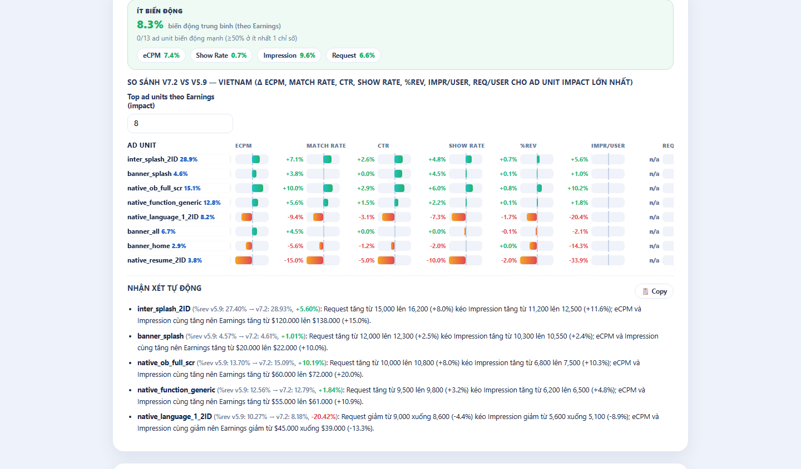

# AdMob Revenue Report Tool (hậu kiểm ads 2 version)

## Bối cảnh
- Vị trí: `AI Knownledge/APR-161 - Tool hậu kiểm ads 2 ver` — file chạy `1. File san pham/admob-report-tool.html`, PRD + 7 screenshot trong `3. Ban mo ta san pham (PRD)/`, video demo trong `2. Video Demo/`.
- Owner: Bùi Thị Ngọc Ánh (Product Owner).
- Bước roadmap: **giai đoạn 3 — Đo lường & tối ưu, phần AdMob**. Dùng sau mỗi lần release đổi luồng ads (thêm/bớt/đổi vị trí ad unit, đổi luồng First Open) để biết thay đổi đó tốt hay xấu.

## Làm gì
Thay việc dò tay trên Google Sheets: tự tính %rev, so sánh eCPM / Match Rate / CTR / Show Rate / impression per user / request per user theo từng ad unit giữa version cũ và mới của **cùng 1 country**, tự viết nhận xét tiếng Việt, xuất Excel có công thức thật.

## Input / Output
| | |
|---|---|
| Input | 1–2 file CSV export từ AdMob Reports, chiều **Ad unit**, lọc **1 country**, mỗi file **1 app version**. Số Users FO và Users Home nhập tay (AdMob export không có). |
| Output | Dashboard: banner so sánh, bảng nhóm màu ad unit + nhận xét theo nhóm, mức biến động Ít/Vừa/Mạnh, biểu đồ diverging bar top ad unit, bảng chi tiết từng version + biểu đồ tròn %rev, danh sách ad unit bị xoá/thêm/thay thế. File `.xlsx` (mỗi country 1 sheet, công thức `=C{row}/C{total}`...). |

Công thức và cách đọc chi tiết: xem [Hậu kiểm AdMob theo app version](../05-optimization/hau-kiem-version-app-nguong-verdict.md).

## Cách chạy
1. AdMob → Reports → chia theo Ad unit, filter 1 Country, filter App version (mỗi version 1 lần export CSV).
2. Mở `admob-report-tool.html` bằng Chrome/Edge (không cần cài, chạy offline).
3. Chọn file Version 1 (gốc, bắt buộc) và Version 2 (so sánh). Tool hiện "Phát hiện: Country — version (n dòng)" và cảnh báo nếu 2 file khác country.
4. Bấm **Xử lý dữ liệu** → kiểm tra/kéo-thả lại nhóm ad unit, chọn FO/Home cho ad unit mới, nhập Users FO/Home.
5. Bấm **Xuất Excel (.xlsx)**.

Ảnh trên cho thấy ô mức biến động tổng thể, biểu đồ top ad unit và đoạn nhận xét nhân quả Request → Impression → Earnings → %rev (số liệu Vietnam trong ảnh là giả lập).

## Giới hạn / rủi ro
- Không nối AdMob API; mỗi lần chỉ 1 country, tối đa 2 version.
- Phân nhóm mặc định theo **từ khoá trong tên ad unit** (Splash, Language, Onboarding, FO, Banner…) — app đặt tên khác quy ước sẽ phải kéo-thả tay.
- Số Users nhập tay → impression/user sai nếu lấy sai nguồn user (FO vs Home).
- Dữ liệu lưu localStorage của trình duyệt, không đồng bộ giữa máy. Dữ liệu không rời máy (client-side) — phù hợp số doanh thu nhạy cảm.
- Không cần API key.
