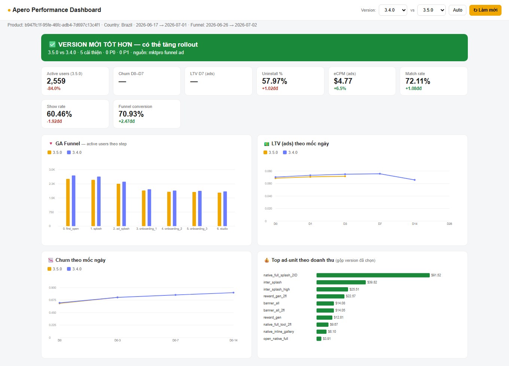

# Apero App Performance Checker

## Làm gì
mktpro vẽ số bằng canvas và GA4 chèn tiền tố chống XSSI, nên không copy số trực tiếp được. Extension **chặn network response** của chính các trang người dùng đang mở (đã đăng nhập), parse số, lưu vào `chrome.storage.local`, rồi dựng dashboard và verdict so 2 version.

| Nguồn | Trang | Lấy gì |
|---|---|---|
| mktpro | `product-report/compare-app-version` | Active, LTV D0–D28, retention, churn, business, utility, quality |
| mktpro | Business Report → Admob Report | eCPM, match/show rate, impressions, earnings, CTR theo **ad unit × version** |
| GA4 | Exploration dạng Funnel (segment theo version) | Drop-off từng step |

- Tab: 🏁 Kết luận (verdict + P0/P1/P2) · 📊 So sánh version (Δ%) · 🔻 GA Funnel · 💰 Ad Perf (tô màu theo benchmark match/show) · 🗂 Raw captures. Nút "📊 Mở Dashboard" mở biểu đồ full màn hình.
- Nút **⤓ Bundle → Claude** xuất 1 file `.md`. Thả file đó vào Claude (skill nội bộ `app-performance-analysis`) sẽ ra báo cáo hậu kiểm và file `.xlsx` (Verdict, Metrics compare, Funnel, Ad units, Action items).
- Ngưỡng verdict xem [Hậu kiểm version app](../05-optimization/hau-kiem-version-app-nguong-verdict.md).

- **Dùng ở bước:** đo lường & tối ưu, sau mỗi release / trước khi tăng % rollout. Cũng dùng để soi eCPM/show rate từng ad unit.
- **Owner:** Trần Thị Ngọc Oanh (PO). Repo: `github.com/Apero-Vibecode/tera-post-audit`.
- **Vị trí:** `AI Knownledge/APR-101 - Apero App Performance Checker` (`tool-extension.zip`, 2 file docx hướng dẫn và demo).

Ảnh cho thấy màn Kết luận: verdict xanh "version mới tốt hơn", các thẻ KPI có Δ và cờ show rate sát ngưỡng 60%.

## Cách chạy
1. `chrome://extensions` → bật Developer mode → Load unpacked → chọn thư mục extension → ghim icon.
2. Đăng nhập sẵn mktpro và GA trong chính Chrome đó. Extension dùng phiên hiện có, không lưu mật khẩu, không cần API key.
3. Mở trang compare-app-version, chọn App/Country/2 version/khoảng ngày → **Apply**, cuộn mở hết mục LTV/Retention/Churn. (Tuỳ chọn) mở Admob Report → Apply. (Tuỳ chọn) GA4 Funnel → đổi khoảng ngày để GA tải lại.
4. Mở popup → chọn version (hoặc Auto = 2 version mới nhất) → ↻ Làm mới → xem Kết luận/Dashboard.

## Giới hạn / rủi ro
- Không có data thì: reload extension, F5 trang, Apply lại. Dashboard cần ít nhất data compare 2 version của mktpro.
- Admob report trả rất nhiều version, nên chọn 2 version cụ thể thay vì Auto.
- Extension không bắt `/users/me`, `/notifications`, `/projects` (có PII) và scrub field nhạy cảm. File export CSV/JSON vẫn có số nội bộ, không đưa lên chỗ công khai.
- Ngưỡng P0/P1 là quy ước nội bộ, chưa hiệu chỉnh theo từng app.
