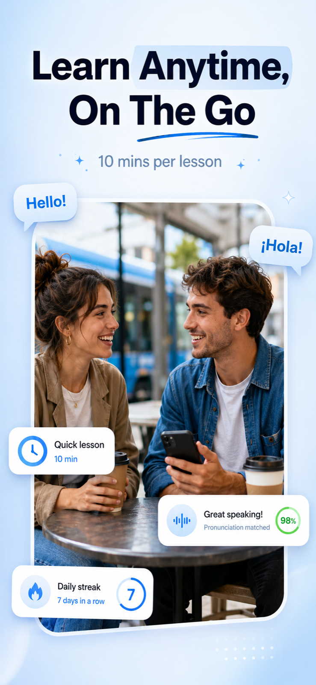

# App Store Screenshot Studio

## Làm gì
Tạo nhanh bộ screenshot marketing cho store mà không cần designer.
- **Input**: mô tả app (bắt buộc), N ảnh màn hình (mỗi ảnh = 1 slide, headline nhập tay hoặc để AI đặt), style/màu (khuyến nghị kèm mã hex), 1 ảnh style mẫu (tuỳ chọn), kích thước (preset hoặc px tuỳ chỉnh, làm tròn bội số 16), model.
- **Pipeline 2 lớp**: (1) "đạo diễn" là LLM đọc ảnh (Gemini qua fal) ra 1 style chung + headline/vị trí từng slide; (2) dựng ảnh song song bằng GPT Image 2 (mặc định, chữ đẹp) / Nano Banana (sửa bám ảnh gốc, rẻ) / Nano Banana Pro.
- Rule cứng: **1 điện thoại + 1 headline mỗi slide**, không collage; headline 3–6 từ, không trùng; slide 1 là hook chính.
- Sửa từng slide bằng chat (mỗi lần sửa tốn 1 ảnh). Lịch sử lưu trong `data/` trên máy.
- **Bước roadmap**: Pre-Marketing → ASO (screenshot). Làm nhanh nhiều biến thể để test bằng Store listing experiments / custom store listings.
- **Owner**: Tuấn Nguyễn Đình. Vị trí: `AI Knownledge/APR-052 - App Store Screenshot Studio`.

## Cách chạy
Node.js LTS. Copy `.env.example` thành `.env.local`, điền <cần FAL_KEY — API key fal.ai, tài khoản đã nạp credit>. Tuỳ chọn đổi model mặc định qua `FAL_GEN_MODEL`, `FAL_EDIT_MODEL`, `FAL_DIRECTOR_MODEL`. Windows: `start.bat`; hoặc `npm install && npm run dev` → http://localhost:3000.

## Giới hạn / lưu ý
- **Kích thước cho Android**: demo xuất 1242×2688 (iPhone 6.5"), tỷ lệ > 2:1 nên **Google Play từ chối**. Với app Android chọn custom 1080×1920. Xem [thiết kế screenshot store](../01-pre-marketing/thiet-ke-screenshot-store-quality-bar.md).
- Tốn phí fal theo từng ảnh. Bộ 6 slide = 6 ảnh + mỗi lần sửa.
- Ảnh AI có thể "vẽ lại" UI không giống app thật. Google cấm screenshot gây hiểu nhầm về trải nghiệm app, nên phải so với app thật trước khi đẩy lên store.
- Phần quality bar chi tiết (contrast, % chiều cao phone) chỉ có ở tool [CPP generator](cpp-generator-screenshot-tool.md).

Ảnh cho thấy output điển hình của tool: bố cục 1 điện thoại + 1 headline. Lưu ý đây là kích thước iOS, không upload được lên Google Play.
