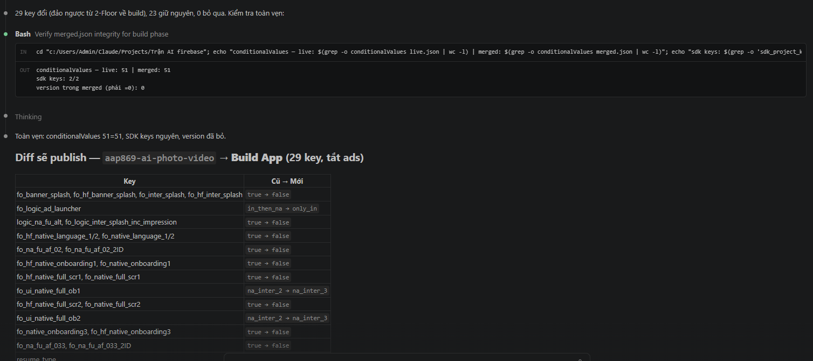

# Remote Config hàng loạt qua Firebase MCP + rc_apply.js

## Làm gì
Đổi khoảng 50 key Remote Config điều khiển ads (theo [template phase build/normal/2-floor](../03-monetization/remote-config-ads-theo-phase-build-normal-2floor.md)) cho nhiều app cùng lúc khi release, bằng một câu lệnh cho Claude, thay vì sửa tay trên Firebase console.

- **Bước roadmap**: chuẩn bị app trước khi launch UA (tắt ads lúc build/review) → bật ads thường → bật 2-floor khi chạy UA. Rollback nhanh khi có sự cố.
- **Input**: project-id Firebase + phase (`build` | `normal` | `twofloor`) hoặc danh sách `key=value`. **Output**: template mới đã publish, báo cáo diff, (tuỳ chọn) thông báo Discord.
- **Owner**: Lê Trọng Đạt (PO). Vị trí: `AI Knownledge/APR-007 - Update remote config hàng loạt cho ver 1.0.0 sử dụng mcp firebase` (file zip `Trận AI firebase.zip`).

## Cài đặt (1 lần)
- Cần Node.js (`npx`), Claude Code, và tài khoản Google có role **Firebase Remote Config Admin** hoặc **Editor** trên project.
- `.mcp.json` ở thư mục làm việc: server `firebase` = `npx -y firebase-tools@latest experimental:mcp` (Windows phải bọc `cmd /c`). **Không** dùng `claude mcp add firebase -- npx -y ...` vì cờ `-y` bị parser nuốt; dùng `claude mcp add-json` nếu muốn thêm bằng CLI.
- Thư mục phải có `firebase.json` chứa block `remoteconfig`, nếu không tool `remoteconfig_*` của MCP không xuất hiện.
- "login firebase" trong Claude. Nhiều account thì dùng `npx firebase-tools login:add`.
- Discord (tuỳ chọn): `discord_config.json` chứa <cần bot token Discord> và map project-id → channelId. **Không commit/chia sẻ file này.**

## Luồng chạy (prompt: `active project = <id>`, `phase = <...>`)
1. `firebase_update_environment` set project → 2. `remoteconfig_get_template` ra `live.json` →
3. `node rc_apply.js --live live.json --csv "Auto test Ads - Template - Remote Config.csv" --phase twofloor --out merged.json --report report.json` (đổi lẻ: `--set banner_all=true`) →
4. Hiện diff, kiểm tra `conditionalValues` của live và merged bằng nhau →
5. **Chờ người duyệt gõ "publish"** (bắt buộc với app production) →
6. `remoteconfig_update_template(force: true)`; lỗi ETag lần đầu thì publish lại với force →
7. Bắn Discord → 8. Xoá file tạm (`live.json`, `merged.json`, `report.json`).

Rollback: "rollback remote config <id> về version N".

Ảnh cho thấy bước duyệt bắt buộc: Claude liệt kê từng key đổi giá trị (true → false) trước khi người dùng gõ "publish".

## Vì sao an toàn hơn sửa tay / Apps Script
`rc_apply.js` chỉ sửa `defaultValue.value` tại đúng chỗ key nằm (top-level hoặc trong group). Script giữ nguyên conditions, parameterGroups, conditionalValues, valueType, mọi key khác; tự chuẩn hoá `TRUE/FALSE`; chặn sai kiểu; bỏ qua key app không có. Quy tắc vàng: **không bao giờ publish một template tự dựng**, vì sẽ xoá conditions của app.

## Giới hạn / bẫy
- **Quirk account**: MCP validate project bằng **account mặc định** (login gần nhất), bỏ qua active account. Lỗi `Invalid project selection` thì logout account kia.
- Chạy tương tác qua Claude, không tự động theo lịch. Pipeline tự động vẫn dùng Apps Script cũ (service account).
- CSV parse bằng `split(',')` nên giá trị không được chứa dấu phẩy.
- Đổi phase làm đổi doanh thu/UX. Ghi ngày đổi vào nhật ký campaign của app.
