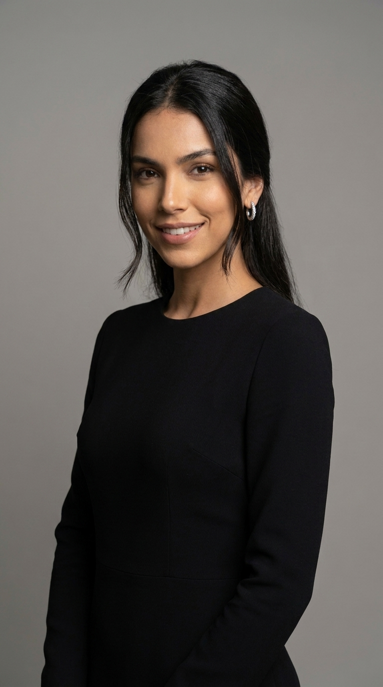

# KA Tool Bulk (Google Flow)

## Bối cảnh
- Vị trí: `AI Knownledge/APR-262 - Tool gen ảnh và video hàng loạt` (PRD .md/.pdf, ảnh mẫu `File sản phẩm/Ảnh Original`, `Ảnh Template`, video mẫu, video demo). Tool: labs.google/fx/tools/flow/shared/tool/900c9e27-83fd-4e8e-b607-4d14200ca346
- Owner: Anh Hoàng Thị Kim. PRD là bản "tài liệu hoá ngược" — nhiều điểm là giả định.
- Bước roadmap: **giai đoạn 1 — creative** (ảnh/video ads số lượng lớn) — đặc biệt hợp với app AI photo/video cần ảnh "before/after", template khuôn mặt.

## Làm gì
| Chế độ | Input | Output |
|---|---|---|
| Face Template | N ảnh gốc + 1 ảnh mẫu khuôn mặt/style (+ prompt tuỳ chọn) | N ảnh mang template |
| Prompt Single | N ảnh gốc + 1 prompt | N ảnh biến đổi theo cùng prompt |
| Bulk Prompt | N ảnh gốc + danh sách prompt đánh số | ảnh i ghép prompt i (giả định số dòng = số ảnh) |
| Tạo Video | N ảnh gốc + 1 prompt chuyển động | N video |

Cặp ảnh trên là before/after trong folder sản phẩm: cùng một chân dung gốc được áp template "chân dung chuyên nghiệp" — đúng dạng asset "trước/sau" hay dùng cho creative app AI photo.

## Cách chạy
Đăng nhập labs.google/fx/tools/flow → mục **Tools** → **KA Tool Bulk** → chọn loại output, chọn ảnh gốc, chọn chế độ, nhập template/prompt → "Bắt đầu tạo". Tiêu thụ credit Google Flow (xem chi phí ở [Hạnh Creative](hanh-creative-google-flow-nhan-vat-nhat-quan.md)).

## Giới hạn (theo PRD, chưa xác nhận)
- Chưa rõ batch size tối đa, tỉ lệ khung hình hỗ trợ, cách tính credit, xử lý khi 1 item lỗi, có tải hàng loạt hay không.
- Bulk Prompt lệch số dòng → ít kết quả hơn số ảnh.
- Khuôn mặt người thật: cần quyền sử dụng hình ảnh trước khi dùng cho ads.
