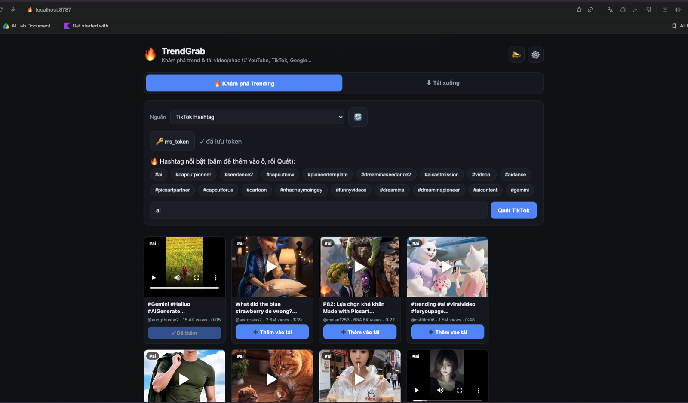

# TrendGrab

## Bối cảnh
- Vị trí: `AI Knownledge/APR-255 - TrendGrab` (PRD.md, `Demo output.png`, video fork `Forks/Output — Thảo Trịnh Thị.mov`). Web: https://frontend-roan-theta-46.vercel.app
- Owner: Quang Ngô Hồng (quangnh@apero.vn). 18 sao trên hub — asset được dùng nhiều nhất trong nhóm trend.
- Bước roadmap: **giai đoạn 1 — Pre-Marketing, creative** (nghiên cứu hook/format đối thủ, lấy footage/nhạc tham khảo) và hỗ trợ ASO.

## Làm gì
**Tab Khám phá Trending** — 4 nguồn:
| Nguồn | Chip gợi ý | Cần gì |
|---|---|---|
| TikTok Hashtag | hashtag đang trend (rút từ tag phổ biến của video mới nhất) | **<cần ms_token>** của chính người dùng, nhập qua nút 🔑 (lưu localStorage) |
| YouTube | autocomplete keyword | không |
| Dailymotion | tag từ video trending | không |
| Google Trends | chủ đề hot theo khu vực → video YouTube liên quan | không |

Bấm chip = thêm từ khoá vào ô (gộp, dedup); chỉ nút Tìm/Quét/Xem mới chạy. Kết quả stream về từng video, xem inline, ➕ đẩy sang tab tải.

**Tab Tải xuống** — dán 1 hay nhiều URL hoặc nhập file `.csv/.xlsx/.txt`; `yt-dlp` hỗ trợ 1000+ site (YouTube, TikTok, Facebook, Instagram, Vimeo…); chọn Video (Best/1080p/720p) hoặc Music (MP3/M4A/Opus); "Tải tất cả" → 1 file ZIP.

Theo `_info.md`: có thêm phần **đào insight từ transcript + comment bằng AI** → gợi ý ý tưởng sản phẩm xếp ưu tiên P0… (nghề cần làm, nhu cầu ẩn, hướng sản phẩm, cách kiếm tiền). PRD v1.0 không mô tả chi tiết phần này.

Ảnh cho thấy kết quả tab Khám phá: mỗi thẻ là một video kèm nguồn và chỉ số, có thể đẩy sang tab tải.

## Cách chạy
Mở link web, không cài đặt. Backend chạy trên Mac của quản trị qua Cloudflare tunnel, fallback Render — người dùng không cấu hình gì.

## Giới hạn / rủi ro
- TikTok cần `ms_token` (hết hạn định kỳ); TikTok chặn IP datacenter → crawl ổn khi backend chạy IP dân cư.
- Không có TikTok theo từng quốc gia (cần residential proxy), không có Meta Ad Library / app intelligence (cần API trả phí như Sensor Tower), không có Reddit.
- Backend phụ thuộc máy cá nhân + tunnel; cả tunnel lẫn Render cùng lỗi thì web không chạy.
- Chỉ dùng **nghiên cứu nội bộ**: nội dung tải về có bản quyền của người khác — không đăng lại hay dùng làm asset quảng cáo.
