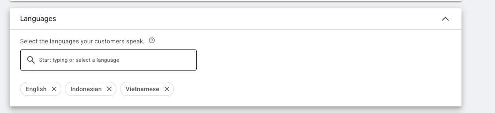
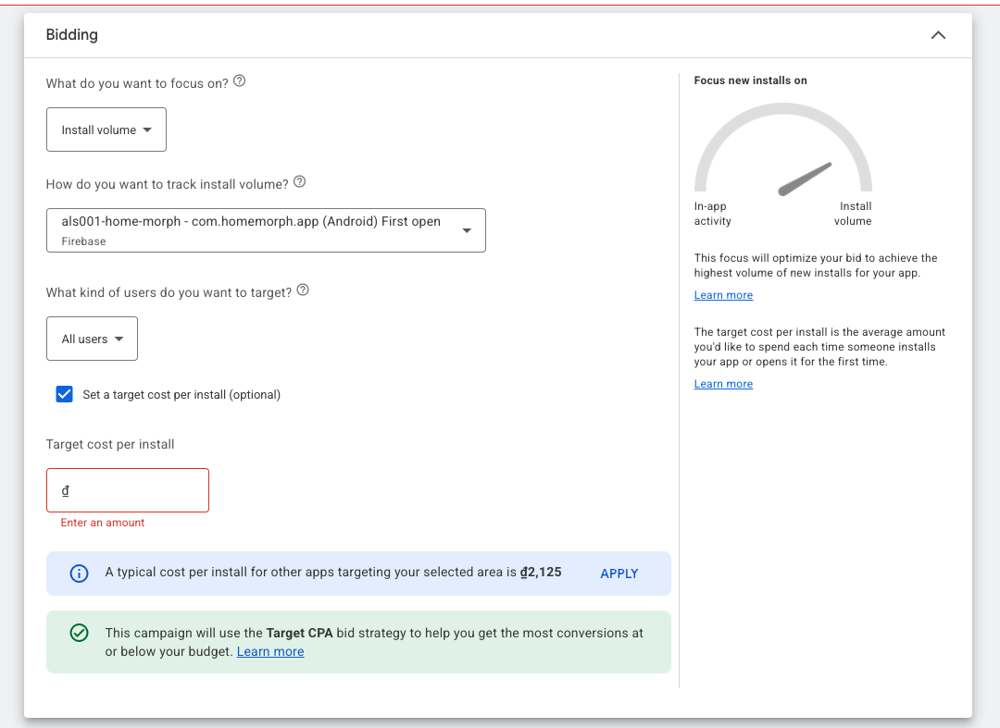
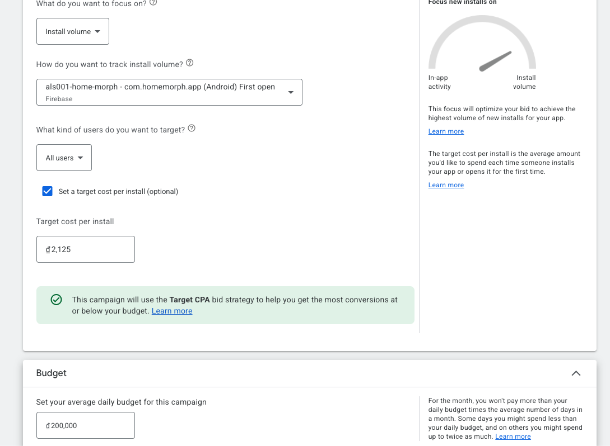

# Home Morph — nhật ký campaign

## Home Morph 1 — App installs, ID + PH + VN (dựng 2026-09-17/18)

**Trạng thái cuối session (18/09/2026 ~00:30):** bản nháp, đã xong Campaign settings + Bidding & budget, đang điền Ad assets. **Chưa rõ đã publish chưa** và chưa có số liệu chạy. Google Ads 252-691-1237 (Lurdsoft), campaignId `281499244861583`.

### Diễn biến chọn GEO

1. Ban đầu user muốn nhắm **EU + US**. Form lúc đó có sẵn Canada + United States (ảnh ở [geo-va-ngon-ngu-targeting](../../02-ua-channels/google-ads/geo-va-ngon-ngu-targeting.md)).
2. Sau khi bàn unit economics (ads-only, Tier 1 CPI cao), chuyển sang Tier 2/3. Xem [quyết định](../../decisions/2026-09-home-morph-geo-ua-ads-only.md).
3. Ngân sách thật của user: **200.000 ₫/ngày** (~$7,6). Với budget này chạy **1 campaign duy nhất** gồm 3 nước CPI tương đương: **Indonesia, Philippines, Vietnam**. India bị loại khỏi campaign này vì CPI rẻ hơn hẳn sẽ hút hết budget (lập luận trong session, chưa kiểm chứng).

### Cấu hình (thực tế trên UI, theo screenshot)

| Mục | Giá trị | Ghi chú |
|---|---|---|
| Loại | App promotion → App installs, Android, `com.homemorph.app` | |
| Locations | Indonesia, Philippines, Vietnam | Nhớ xoá Canada/US còn sót |
| Languages | English, Indonesian, Vietnamese | Ảnh 1 |
| Focus | Install volume | |
| Đo install | **Firebase — First open** (`als001-home-morph - com.homemorph.app (Android) First open`) | |
| Users | All users | |
| Target cost per install | **₫2.125** = đúng mức Google gợi ý "typical cost per install for other apps targeting your selected area" | Ảnh 2 |
| Daily budget | **₫200.000** | Ảnh 3. Budget/tCPI ≈ 94× (≥ 50× theo quy tắc tCPI của Google 14104492) → ~94 install/ngày nếu đạt target |
| View-through conversions | Khuyến nghị **tắt** trong session (mặc định đang bật). Chưa rõ user đã tắt chưa | Xem [app-campaigns-tong-quan](../../02-ua-channels/google-ads/app-campaigns-tong-quan.md) |
| Data feed | Không gắn | |
| Start / End date | Start = ngày bật; End = None | |
| Ad groups (dự kiến) | 3 ad group theo ngôn ngữ: `ID - Indonesian`, `EN - English`, `VI - Vietnamese`, mỗi cái 5 headline + 3 description đã kiểm độ dài | Copy nằm trong session def570ce; số "100+ styles" cần khớp số preset thật |

Ảnh trên: mục Languages của campaign với đúng 3 ngôn ngữ cho bộ ID + PH + VN (English để phủ Philippines và máy để tiếng Anh).

Ảnh trên: màn Bidding khi chưa điền target — Google gợi ý CPI điển hình ₫2.125 cho vùng đã chọn (ID+PH+VN, 18/09/2026), và báo campaign sẽ dùng bid strategy "Target CPA" (tCPI là biến thể của tCPA).

Ảnh trên: cấu hình cuối cùng tCPI ₫2.125 và budget ₫200.000/ngày; cột phải ghi rõ trong tháng không trả quá budget ngày × số ngày trung bình, có ngày có thể tiêu tới 2×.

### Kế hoạch đọc số (đề xuất trong session, chưa áp dụng)

- Ngày 1–7 không chỉnh gì (learning). Ngày 8 tách report theo country, đọc **D0 ROAS** từng nước: ≥ 25% → dồn budget vào nước đó; 15–25% → giữ, tập trung tăng ad density; < 15% cả 3 → tắt, sửa session đầu của app.
- Tuần 2 có thể hạ tCPI dần về ₫1.300–1.600, mỗi lần ≤ 20%.
- Ngưỡng D0 ROAS 25% là **quan điểm của user** (kinh nghiệm "các cty ads-only vẫn ROAS 25%+ D0"), Claude chấp nhận; chưa có benchmark nguồn ngoài.

### Kết quả

- (chưa có — cập nhật khi có số sau 7 ngày chạy)
