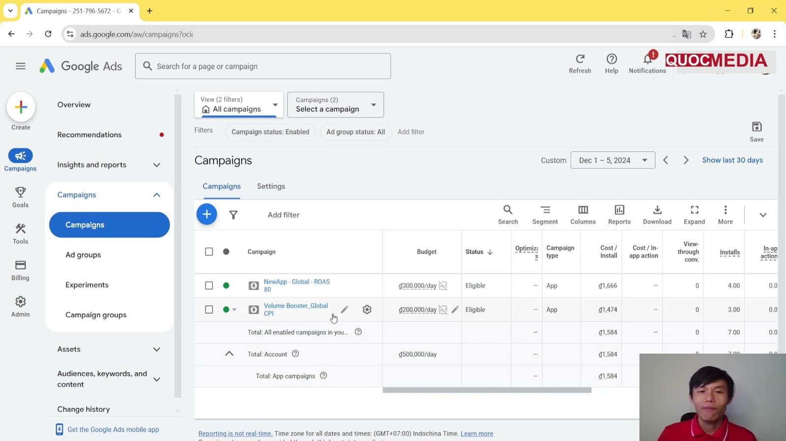
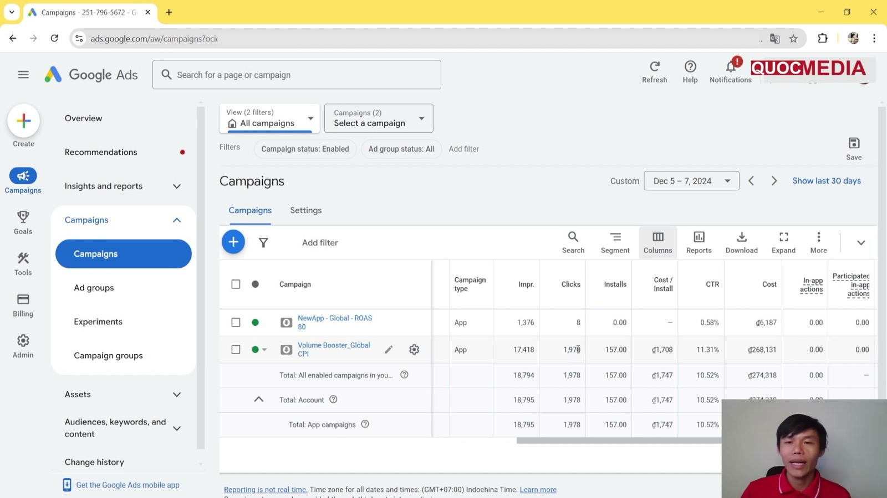

# Case khoá Quocmedia: tCPI quá thấp và tROAS quá cao đều gần như không spend

> ⚠️ **Đây không phải app của mình.** Toàn bộ số dưới đây đọc từ màn hình tài khoản demo trong khoá "UA Marketing Mobile App 2026" (Quocmedia, giảng viên Quốc Anh), bài 4.3–4.4, quay khoảng 01–07/12/2024. Không có quyền truy cập tài khoản, không kiểm được attribution, đơn vị conversion value không rõ. Dùng làm minh hoạ cơ chế, **không** dùng làm benchmark CPI.

## Bối cảnh

- App demo "Max Volume Booster" (Android, utility tăng âm lượng, ads-only bằng AdMob). Tài khoản Google Ads `251-796-5672`, tiền tệ VND.
- Campaign "Volume Booster_Global CPI": App installs, **All countries and territories + English**, budget **₫200.000/ngày**, focus Install volume, tracking = Firebase First open, 1 ad group (5 headline, 5 description, 15 ảnh, 14 video, Ad strength Excellent).
- tCPI ban đầu **₫800**, chọn bằng cột *Top of page bid (low range)* của Keyword Planner (keyword "volume booster" ₫253–674) rồi "đặt cao hơn một chút". Ngay dưới ô bid, Google gợi ý *"A typical cost per install for other apps is ₫8,993"* (gấp ~11 lần) nhưng giảng viên bỏ qua. Xem ảnh ở [app-campaigns-tong-quan §5b](../02-ua-channels/google-ads/app-campaigns-tong-quan.md).
- Cùng tài khoản có campaign thứ hai **"NewApp - Global - ROAS 80"** (app khác, theo tên là tROAS 80%), budget ₫300.000/ngày.

## Diễn biến

### 1. tCPI ₫800: gần như không spend (01–05/12/2024)

Ảnh trên: sau ~5 ngày, campaign CPI chỉ có 3 install, cost ₫4.421 (≈ 2% budget 1 ngày), conv. rate 3,70%. Campaign "ROAS 80" cũng chỉ có 4 install, ~₫6.666 trên budget ₫300k/ngày.

| Campaign | Khoảng ngày | Budget/ngày | Cost | Installs | Cost/Install |
|---|---|---|---|---|---|
| Volume Booster_Global CPI (tCPI ₫800) | 01–05/12/2024 | ₫200.000 | ₫4.421 | 3 | ₫1.474 |
| NewApp - Global - ROAS 80 | 01–05/12/2024 | ₫300.000 | ~₫6.666 | 4 | ₫1.666 |

### 2. Nâng tCPI ₫800 → ₫2.000 (+150%), đợi 1–2 ngày (05–07/12/2024)

Giảng viên chẩn đoán "giá thầu thấp" (nguyên nhân thứ hai có thể là creative không hấp dẫn/không khớp app) và nâng thẳng lên ₫2.000.

Ảnh trên: bộ lọc ngày 05–07/12/2024 (giảng viên nói "sau 1 ngày"), campaign CPI đã tiêu đủ budget; campaign ROAS 80 vẫn đứng yên.

| Campaign | Impr. | Clicks | Installs | Cost/Install | CTR | Cost | Conv. rate |
|---|---|---|---|---|---|---|---|
| Volume Booster_Global CPI (tCPI ₫2.000) | 17.418 | 1.970 | 157 | **₫1.708** | 11,31% | ₫268.131 | 5,21% |
| NewApp - Global - ROAS 80 | 1.376 | 8 | 0 | – | 0,58% | ₫6.187 | 0,00% |

- CPI thực (₫1.708) **thấp hơn** tCPI mới (₫2.000) nhưng **cao gấp ~2 lần** tCPI cũ (₫800): tCPI ₫800 thấp hơn mức thị trường nên Google gần như không đấu thầu được.
- Conv. rate Google báo (5,21%) ≠ installs/clicks (157/1.970 = 7,97%), vì Google tính trên *interactions* chứ không chỉ click.
- Firebase cùng kỳ (25/11–01/12): DAU 23, D1 retention 15%, revenue $0.02 — nên ROAS thực của campaign CPI gần như bằng 0 (nếu conv. value 1.758 là VND thì ~0,7%).

## Bài học / Kết luận

- **Đặt tCPI theo bid guidance / "typical CPI" của Google, không theo Keyword Planner.** Top-of-page bid là CPC ước tính trên Google Search, không phải CPI; App campaign không đấu giá theo keyword. Hợp với ✅ 12073727 (bid guidance cho ACi tCPI) và 🧪 cảnh báo ở [app-campaigns-tong-quan §5b](../02-ua-channels/google-ads/app-campaigns-tong-quan.md).
- **Campaign gần như không spend là "bid-constrained" → nâng bid là đúng hướng** (14104492). Quy tắc "không đổi CPI > 20% một lần" (9176652) nhằm tránh làm rối campaign đang học; khi campaign chưa có data nào thì nâng mạnh một lần là ngoại lệ chấp nhận được (🧪, case này cho kết quả nhanh). Vẫn chỉ đổi **một lần** rồi đợi 1–2 ngày, không cycle lên xuống.
- **Target ROAS cao trên app chưa có ROAS thực thì campaign gần như không phân phối.** "ROAS 80" chỉ tiêu ~₫6k/3 ngày. Đây là bằng chứng cho khuyến nghị của Google: target khởi điểm = Conv. value/cost thực của campaign CPI/tCPA (15995101), không đặt con số cố định — xem mục ⚠️ Mâu thuẫn ở [playbook bước 3](../playbooks/launch-google-app-campaign-tcpa-den-roas.md).
- Budget ₫200k/ngày với tCPI ₫800 = 250× và ₫2.000 = 100× đều thoả quy tắc ≥ 50× tCPI (14104492) — vấn đề là bid, không phải budget.

## Giới hạn của case

- Một app, một tài khoản, vài ngày; GEO toàn cầu nên CPI là trung bình của mix nước Google tự chọn.
- Không biết campaign "ROAS 80" đặt target trên value nào và app đó có doanh thu ra sao; kết luận về nó chỉ là suy luận từ việc không spend.
