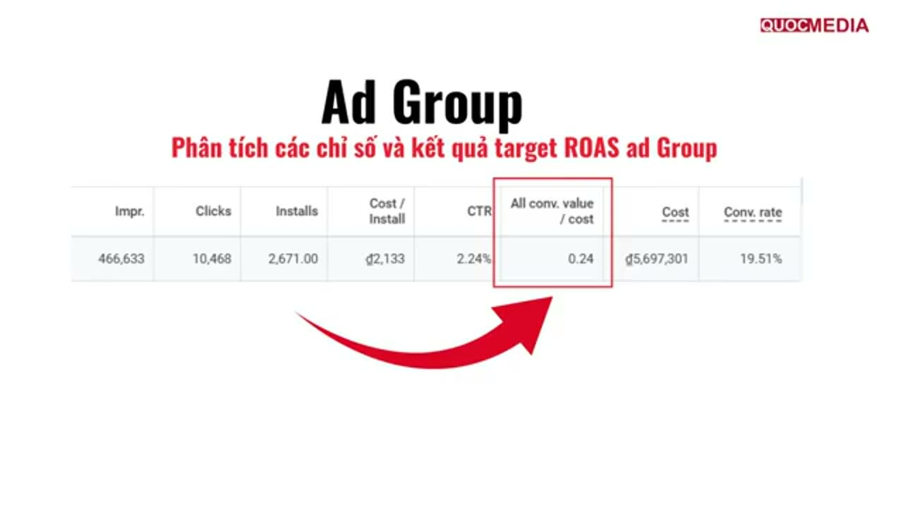
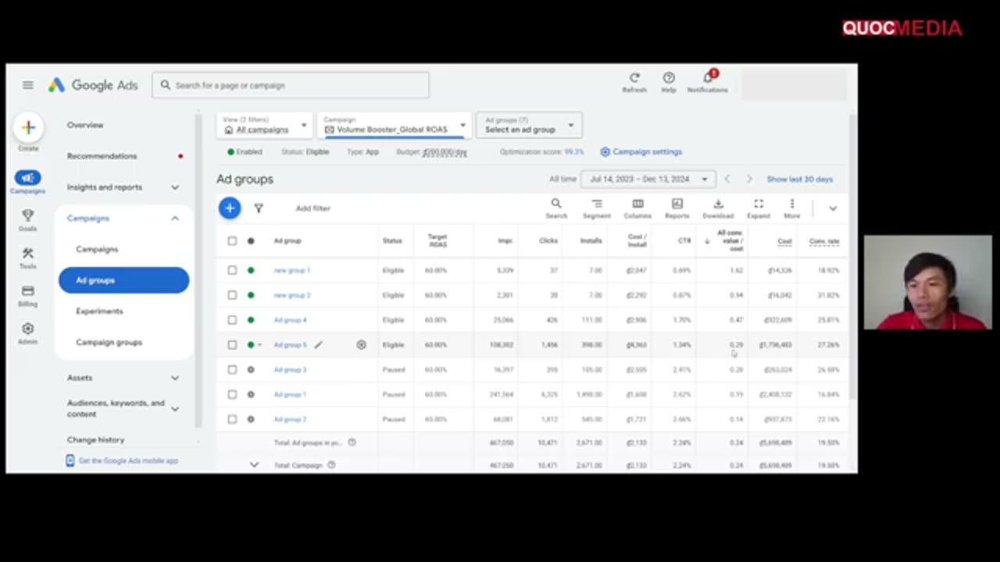
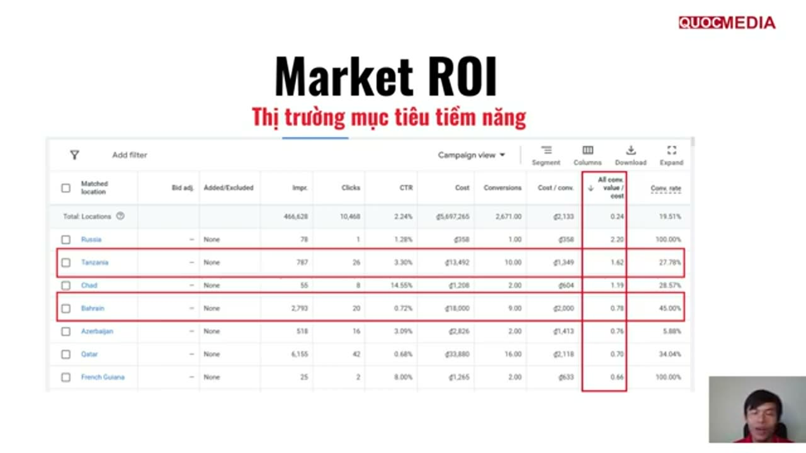
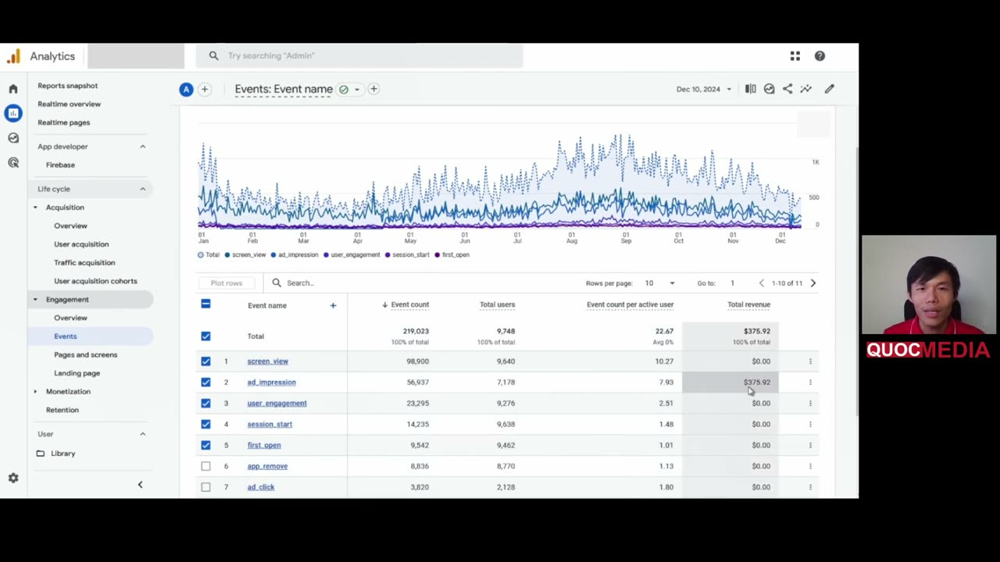

# Case khoá Quocmedia: đọc kết quả tROAS 60% (ROAS thực 0,24)

> ⚠️ **Không phải app của mình.** Số đọc từ màn hình tài khoản demo trong khoá "UA Marketing Mobile App 2026" (Quocmedia), bài 4.6 và 4.8, quay khoảng 13/12/2024, độ nét trung bình (chữ số cuối có thể sai). Dùng để học **cách đọc** và **bẫy khi đọc**, không dùng làm benchmark.

## Bối cảnh

- App "Max Volume Booster" (Android, utility, ads-only AdMob), tài khoản Google Ads VND. Tiếp nối [case tCPI](2024-12-quocmedia-demo-tcpi-thap-va-troas-cao-khong-spend.md): ngày 04/12/2024 giảng viên đổi campaign sang focus In-app action value, event `ad_impression`, **target ROAS 60%**, budget ₫200.000/ngày, GEO All countries + English.
- Bài 4.6 đọc campaign "Volume Booster_Global ROAS" với bộ lọc **All time 14/07/2023 – 13/12/2024**.

## Số liệu

### Campaign

Ảnh trên: giảng viên khoanh cột **All conv. value / cost = 0,24** là "kết quả ROAS" — với target 60%.

| Impr. | Clicks | Installs | Cost/Install | CTR | Avg. CPC | All conv. value/cost | Cost | Conv. rate |
|---|---|---|---|---|---|---|---|---|
| 466.633 | 10.468 | 2.671 | ₫2.133 | 2,24% | ₫544 | **0,24** | ₫5.697.301 | 19,51% |

Tổng tài khoản cùng kỳ: cost ₫9.996.293, 4.947 install, CPI ₫2.021, ROAS 0,19.

### Ad group (cùng kỳ, mọi ad group target 60%)

Ảnh trên: cột Status cho thấy 3 ad group bị pause chính là 3 ad group tiêu nhiều tiền nhất; 2 ad group "lời" có cost vài chục nghìn đồng.

| Ad group | Installs | Cost | Cost/Install | All conv. value/cost | Hành động của khoá |
|---|---|---|---|---|---|
| new group 1 | 7 | ₫14.326 | ₫2.047 | **1,62** | giữ |
| new group 2 | 7 | ₫16.042 | ₫2.292 | 0,94 | giữ |
| Ad group 4 | 111 | ₫322.609 | ₫2.906 | 0,47 | giữ |
| Ad group 5 | 398 | ₫1.736.483 | ₫4.363 | 0,29 | giữ |
| Ad group 3 | 105 | ₫263.024 | ₫2.505 | 0,28 | pause |
| Ad group 1 | 1.498 | ₫2.408.132 | ₫1.608 | 0,19 | pause |
| Ad group 2 | 545 | ₫937.873 | ₫1.721 | 0,14 | pause |

Segment theo Network: phần lớn spend ở Google search + **Search partners** (vd Ad group 5: Search partners 96.935 impr, ROAS 0,41; Google search ROAS 0,23); riêng Ad group 4 có Display 247 click, CTR 8,13%, ROAS 0,20. YouTube gần như 0.

### Asset (slide, không rõ ad group)

Headline 1 **Best** ROAS 3,19 (2 install); Description 1 **Best** 2,00 (4 install); Headline 2 **Good** 1,68; Description 2 **Low** 1,61; Headline 3 **Learning** 0,54; 2 video 0:10 **Learning** với 1–2 impression. Giảng viên: asset tốt → gom vào 1 ad group mới (đó là "new group 1/2").

### GEO (Matched locations, cùng kỳ)

Ảnh trên: các nước "lời" mà khoá đề xuất tách ra campaign riêng đều có cost dưới ₫18.000 (< $1) và 1–10 conversion trong cả 17 tháng.

### Firebase / GA4 của cùng app (01/01–10/12/2024)

Ảnh trên: toàn bộ doanh thu GA4 thấy được ($375,92) đến từ `ad_impression`; `app_remove` gần bằng `first_open`.

- New users 9,5K (GA4 gán **Organic Search 9,2K**, Direct 325); thẻ "Sessions by Google Ads campaign" = **No data**.
- Retention cohort tuần (14/11–11/12): Week 1 15,3%, Week 2 5,6%, Week 3 3,3%, Week 4 2,8%.
- Avg engagement time/active user 4m04s; 7,93 `ad_impression`/user.

## Phân tích (của mình, không phải của khoá)

1. **ROAS 0,24 không phải kết quả tROAS.** Bộ lọc all-time và số liệu trùng gần hết tổng tài khoản ở bài 4.2 (đến 02/12/2024: 463K impr, ₫5,69M) → campaign này mang lịch sử chi tiêu từ 2023, giai đoạn tROAS (~9 ngày) chỉ là phần rất nhỏ. Muốn đọc tác động của tROAS phải **lọc từ ngày đổi bidding**, bỏ vài ngày cuối vì conversion trễ (15995101).
2. **Target 60% so với thực tế 24%**: campaign đang ở tình trạng target cao hơn hẳn khả năng — đúng kiểu "bid-constrained" mà Google bảo phải **hạ target** (15995101). Khoá không nhắc. Đối chiếu [case ROAS 80 không spend](2024-12-quocmedia-demo-tcpi-thap-va-troas-cao-khong-spend.md).
3. **Mẫu quá nhỏ để quyết.** Ad group 1,62 = 7 install/₫14k; GEO 2,20 = 1 install/₫358. Một user xem nhiều ad là đủ đẩy ROAS lên > 1. Ngược lại, 3 ad group bị pause chiếm ~63% tổng cost — pause cùng lúc là composition change lớn, campaign học lại (13020501).
4. **Unit economics không cho phép paid UA ở mix này**: doanh thu ≈ $376 / ~9,5K user mới ≈ $0,04/user cả năm (thô, gồm cả organic), trong khi CPI ≈ ₫2.133 ≈ $0,08. Thêm `app_remove` 8.770 user / `first_open` 9.462 user ≈ 93% user đã gỡ (thô, không theo cohort). Vấn đề gốc là **retention/monetization của app**, không phải chỉnh ad group.
5. **GA4 không thấy traffic Google Ads** (gần hết là Organic Search, Google Ads campaign = No data) dù Google Ads báo 2.671 install → cần kiểm link/attribution trước khi dùng GA4 để so UA vs organic. Không kiểm được trong case này.
6. Cột khoá dùng là **All conv. value / cost**; bid tROAS tối ưu trên conversion được đưa vào cột Conversions (Primary). Nếu có conversion Secondary mang value thì hai cột lệch — nên mở cả *Conv. value / cost* (🧪 suy luận).

## Bài học

- Đọc tROAS **theo khoảng ngày sau khi đổi bidding**, không all-time; ghi ngày đổi vào `apps/<app>/campaigns.md`.
- Trước khi pause ad group / tách GEO: đặt **ngưỡng mẫu tối thiểu** (🧪 vd ≥ 30–50 install, tức spend ≈ 30–50 × CPI) — khoá không có ngưỡng này.
- ROAS thực << target thì **hạ target** trước, chưa phải lúc scale. Quy trình scale: [vận hành & scale tROAS](../playbooks/van-hanh-va-scale-troas-google-app-campaign.md).
- Song song phải đọc Firebase: retention và uninstall quyết định LTV; app gỡ ~93% thì không chỉnh campaign nào cứu được.
