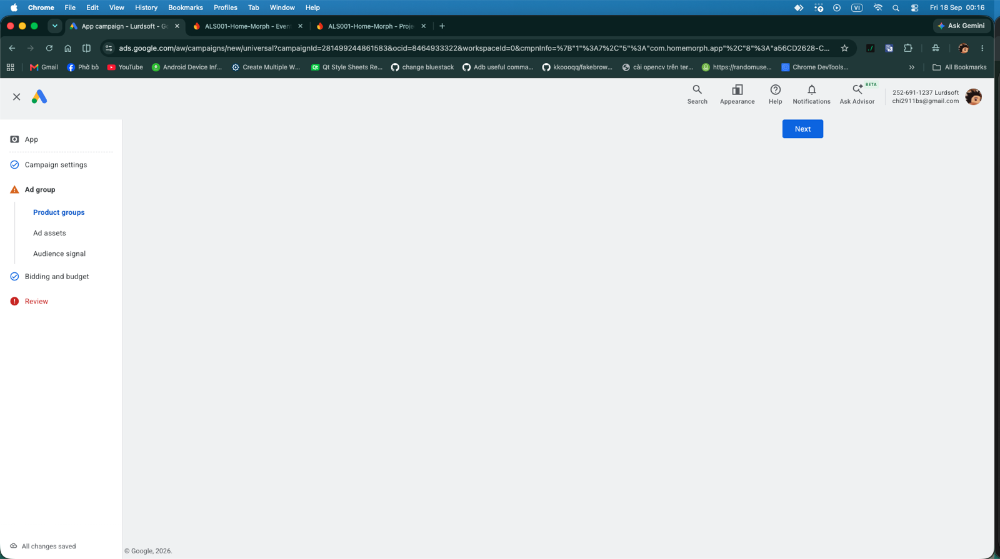

# Google Ads — bước Ad group trống trơn do extension AdBlock

## Bối cảnh

- 18/09/2026 ~00:16, tạo campaign "Home Morph 1" (App installs) trên Google Ads 252-691-1237, Chrome profile của `chi2911bs@gmail.com`.
- Sau khi xong Campaign settings + Bidding, bấm sang **Ad group** thì vùng nội dung trắng trơn, chỉ còn nút Next.

Ảnh trên: wizard App campaign ở bước Ad group → Product groups, pane chính trống. "All changes saved" ở góc trái dưới — draft không mất.

## Diễn biến

1. URL đang ở `currentStep=ad-group,ProductGroupsComponent`. Click sang "Ad assets" → `AppAdAssetsPluginComponent`, vẫn trống.
2. Đọc text trang thì thấy thông báo bị che: **"Turn off ad blockers — Google Ads can't work when you're using an ad blocker."**
3. Profile Chrome đang dùng có extension **"AdBlock — block ads across the web"**. User tắt AdBlock + reload → form Ad assets hiện đủ (Headlines 0/5, Descriptions 0/5, Images 0/20, Videos 0/20). User xác nhận "tắt rồi và được thật".

## Bài học

- Trang Google Ads trắng/thiếu phần → **kiểm tra ad blocker trước tiên**. Whitelist vĩnh viễn `ads.google.com` (và nên cả `admob.google.com`) trong mọi profile làm việc.
- Thông báo "Turn off ad blockers" có thể không hiện rõ trên UI; nó có trong text của trang.
- 🧪 (lời khuyên session, chưa kiểm chứng) Cùng profile có extension VPN miễn phí: nên tắt khi làm việc với Google Ads — IP đổi quốc gia có thể làm sai gợi ý CPI theo vị trí và tăng rủi ro bị flag tài khoản.
