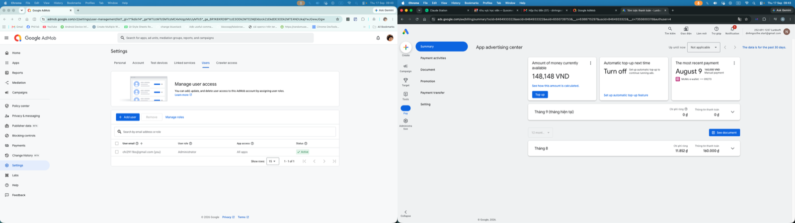

# Link AdMob → Google Ads khi hai bên là hai tài khoản Google khác nhau

## Bối cảnh

- 17/09/2026 sáng. App Home Morph (`com.homemorph.app`).
- AdMob do `chi2911bs@gmail.com` (Administrator) quản lý; Google Ads 252-691-1237 "Lurdsoft" do `dinhngocthe.start@gmail.com` sở hữu. Mục đích: đưa ad revenue sang Google Ads để sau này chạy **tROAS**.

Ảnh trên: tình trạng ban đầu — AdMob (trái) ở Settings → Users, chỉ có 1 user `chi2911bs` là Administrator; cạnh tab Users là tab **Linked services**. Google Ads (phải) đăng nhập bằng tài khoản khác, đang ở trang thanh toán.

## Diễn biến

1. **Không có link trực tiếp AdMob → Google Ads cho tROAS.** Chuỗi đúng: AdMob → Firebase (GA4) → Google Ads. Trong AdMob → Settings → Linked services có mục "Google Ads" (Not linked) nhưng mô tả là *"Create house ad campaigns to cross-promote your app / direct sold campaigns"* — đó là house ads, **không liên quan tROAS**, không cần bật.
2. AdMob → Linked services cho thấy app Home Morph **đã Linked** với Firebase → mắt xích 1 đã xong từ trước.
3. User nói "cả 2 tài khoản đều Owner" (Firebase). Claude kết luận bỏ bước mời chéo → **sai**: kiểm tra GA4 bằng `dinhngocthe.start` chỉ thấy 1 property rỗng "Lurdsoft" (554593861); Firebase → Project settings → Integrations → Google Analytics cho thấy property thật của app là **554526948** trong account "Default Account for Firebase" mà `dinhngocthe.start` không có quyền.
4. Chọn hướng mời: thêm `chi2911bs` làm **Admin (Quản trị)** của Google Ads 252-691-1237 (vì nó đã có quyền GA4) — chỉ 1 lời mời, không mở quyền Analytics cho tài khoản khác. Google Ads → Admin → Access and security → Users → + → email + cấp truy cập "Quản trị" → Gửi lời mời. Google bật **"Xác nhận danh tính"** (2-step) trước khi gửi, user phải tự xác thực.
5. Kết quả: tối cùng ngày `chi2911bs` đã đăng nhập được Google Ads 252-691-1237 và tạo campaign với conversion Firebase first_open của `als001-home-morph` (theo screenshot session def570ce).

## Bài học

- Link dựa trên **quyền**, không cần cùng tài khoản: một tài khoản phải có đủ quyền ở hai đầu của **mỗi** mắt xích tại thời điểm link.
- **Firebase Owner ≠ quyền trên GA4 property.** Quyền GA4 quản lý riêng (Admin → Property access management). Link GA4 ↔ Google Ads cần Editor/Administrator trên GA4 + Admin trên Google Ads (Analytics Help 9379420).
- Trước khi link, lấy **Property ID thật** từ Firebase → Project settings → Integrations → Google Analytics; đừng tin property hiện ra mặc định trong analytics.google.com của tài khoản kia (có thể là property rỗng khác).
- Hướng mời chéo ít rủi ro nhất: kéo tài khoản đã có quyền dữ liệu (AdMob/Firebase/GA4) vào Google Ads, thay vì mở quyền Analytics ra ngoài. Mời quyền vào tài khoản có tiền luôn cần người dùng tự xác thực 2FA.
- Mục "Google Ads" trong AdMob Linked services là cho house ads/direct sold — không phải đường đi của ad revenue.

## Việc tiếp theo

- Xác nhận GA4 554526948 ↔ Google Ads 252-691-1237 đã link (Analytics → Admin → Product links → Google Ads links), bật Impression-level ad revenue trong AdMob, rồi import `ad_impression` cho tROAS. Quy trình: [firebase-setup-link-google-ads-admob](../04-measurement/firebase-setup-link-google-ads-admob.md).
