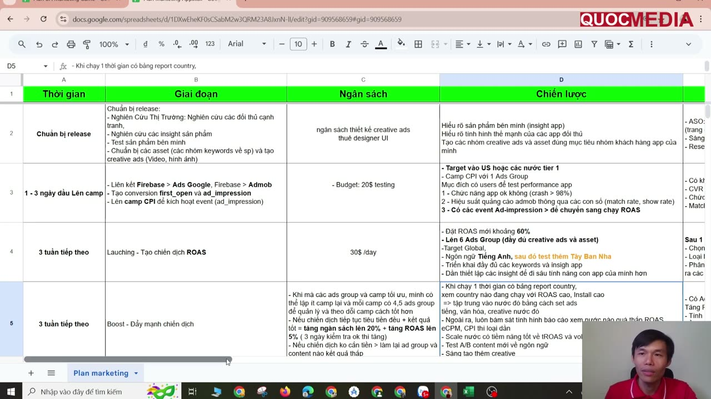
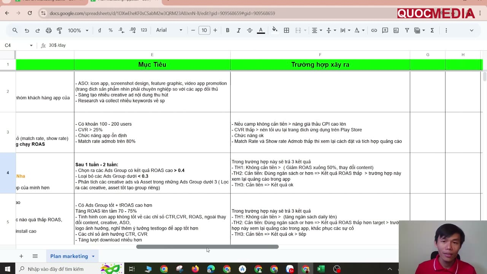
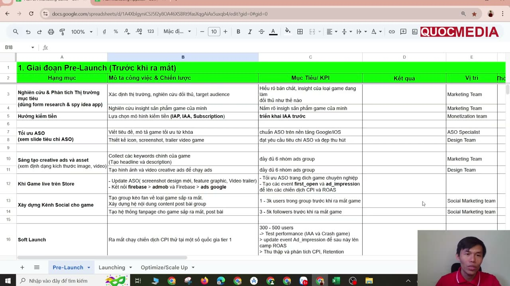

# Lập kế hoạch marketing cho app và game

## Bối cảnh

- Nguồn: bài 6.1 và 6.2 của [khoá Quocmedia](../00-overview/khoa-hoc-quocmedia-ua-marketing-2026.md). Giảng viên trình bày 2 Google Sheet mẫu, học viên tải từ trang khoá.
- Giảng viên nói rõ: đây là khung để **customize** theo team, ngân sách và hoàn cảnh, không phải công thức cố định.
- **Mọi con số dưới đây là ví dụ của giảng viên** (🧪, `confidence: low`). Không có GEO, thể loại app hay dữ liệu thật đi kèm. Không dùng làm benchmark.
- File này chỉ mô tả **cấu trúc plan** và ghi chỗ lệch Google. Từng bước kỹ thuật làm theo playbook riêng:
  - Launch campaign: [launch tCPA → ROAS](launch-google-app-campaign-tcpa-den-roas.md).
  - Quy tắc bid/budget: [App campaigns](../02-ua-channels/google-ads/app-campaigns-tong-quan.md).

## 1. Khung plan cho app (bài 6.1)

Sheet "Plan marketing" có **6 cột**: Thời gian · Giai đoạn · Ngân sách · Chiến lược · Mục tiêu · **Trường hợp xảy ra**. Cột cuối liệt kê sẵn các nhánh xử lý theo kết quả. Đây là điểm đáng học nhất: mỗi giai đoạn có tiêu chí qua cửa và quyết định đã nghĩ trước.

Ảnh trên là nửa trái của sheet. Nó cho thấy mỗi hàng là một giai đoạn có khung thời gian và ngân sách riêng.

| Giai đoạn (thời gian) | Việc chính | Ngân sách (ví dụ GV) | Mục tiêu / điều kiện qua cửa (ví dụ GV) | Trường hợp xảy ra → xử lý |
|---|---|---|---|---|
| **0. Chuẩn bị release** | Research thị trường và đối thủ (form research: Appbrain top country, daily UA, total download, main keyword), insight app, test app, chuẩn bị keyword và creative | Chi phí làm creative / thuê designer | ASO chuyên nghiệp so với đối thủ; nhiều creative; đủ keyword | — |
| **1. Test performance (1–3 ngày, tổng 3–7 ngày)** | Link Firebase ↔ Google Ads, AdMob; tạo conversion `first_open`, `ad_impression`; camp **CPI 1 ad group**, **US hoặc tier 1** | **$20/ngày**; tổng ~₫0,5–1 triệu rồi dừng | **100–200 user; CVR store > 25%; crash-free > 98%; match rate AdMob > 80%**; `ad_impression` đã bắn | Không tiêu tiền → nâng bid CPI. CVR thấp → sửa store listing. Match/show rate thấp → xem lại cách đặt/tích hợp ad |
| **2. Launch ROAS (~3 tuần)** | Camp ROAS **6 ad group** đủ asset, **Global + tiếng Anh**, sau đó test Tây Ban Nha | **$30/ngày** | Target ROAS **~60%**. Sau 1–2 tuần **giữ ad group ROAS > 0,4, loại < 0,3**; lọc creative tốt từ nhóm kém để tạo nhóm mới | Không tiêu → hạ target (về 50%), đổi content. Tiêu đủ nhưng ROAS thấp → kiểm ad trong app. Tiêu và ok → sang bước 3 |
| **3. Boost (~3 tuần)** | Gom về ít camp, mỗi camp 4–5 ad group; đọc report theo **country**: nước ROAS + install cao → tách camp theo ngôn ngữ/creative nước đó; nước ROAS/eCPM kém → loại dần; A/B content theo ngôn ngữ | Chi đều + kết quả tốt → **budget +20% và target ROAS +5%** (kiểm 3 ngày ok rồi tăng) | Target ROAS **70–75%**; đến ngưỡng này thì **giữ nguyên 1–2 tuần** cho học rồi mới tăng; CTR/CVR kém → đổi creative, ASO, icon | Không tiêu → tăng budget ngày. Tiêu nhưng ROAS < target → kiểm app/ad, sửa sự cố. Ok → tiếp |
| **4. Optimize** | Tối ưu liên tục | **+20%/tuần** nếu chi ổn định; target +5% mỗi bước, tới ~95% | **ROAS 0,9–1,1** | — |

Ảnh trên là nửa phải của sheet. Mỗi giai đoạn chạy ROAS có 3 nhánh: (TH1) không tiêu tiền, (TH2) tiêu tiền nhưng ROAS thấp, (TH3) ok thì đi tiếp. Nhánh TH2 luôn quy về kiểm tra **ad trong app** (monetization), không phải campaign.

### ⚠️ Mâu thuẫn với Google / với chính khoá

| Plan của khoá | Chính thức / knowledge | Theo |
|---|---|---|
| Test CPI **$20/ngày** ở **US/tier 1** | Budget tCPI **≥ 50 × bid** (14104492, 9176652). $20/ngày chỉ đủ cho tCPI ≤ $0,4, không thực tế cho US | Chính thức. Muốn test rẻ thì chọn GEO CPI thấp hoặc chấp nhận budget cao hơn. Home Morph đang chạy ID+PH+VN ₫200k/ngày ([quyết định GEO](../decisions/2026-09-home-morph-geo-ua-ads-only.md)) |
| Test ở US/tier 1 (bài 6.1) | Bài 4.3 của chính khoá dùng **All countries + English** ₫200k/ngày cho camp CPI | Khoá tự mâu thuẫn. Chọn GEO test theo mục tiêu: đo chất lượng app/ad thì GEO nào cũng được; ước lượng ROAS thì phải đúng GEO sẽ scale |
| Sang ROAS sau 3–7 ngày, target cố định 60% | Đủ volume (~30+ conv/30 ngày), 3–4 tuần dữ liệu value; target = Conv. value/cost thực (15995101) | Đã ghi ở [playbook launch](launch-google-app-campaign-tcpa-den-roas.md) bước 3 |
| Tăng budget 20% + target ROAS 5% **mỗi 3 ngày** | Biên độ ≤ 20% khớp 9176652. Nhưng với tROAS, thay đổi lớn kích hoạt learning **7–14 ngày**; không đổi quá 1 lần mỗi **1–2 tuần** (15995101) | Biên độ dùng được. Nhịp nên giãn ra 1–2 tuần/lần. Bước target +5% nhỏ hơn ±15–20% nên an toàn |
| Ngưỡng giữ/loại ad group: ROAS > 0,4 / < 0,3 sau 1–2 tuần | Không có nguồn. Google không đưa ngưỡng cắt ad group | 🧪 Chỉ dùng khi ad group đủ conversion. Ghi lại số thật vào `lessons/` để thay ngưỡng này |

## 2. Khung plan cho game (bài 6.2)

Sheet có **3 tab**: Pre-Launch · Launching · Optimize/Scale Up. Cột: Hạng mục · Mô tả công việc & chiến lược · Mục tiêu/KPI · Kết quả · **Vị trí (team phụ trách)** · Thời gian hoàn thành. Khác bản app ở chỗ mỗi việc có **owner** và có cột **Kết quả** để điền thực tế so với KPI.

Ảnh trên là tab Pre-Launch. Mỗi hạng mục gắn KPI và team, ví dụ Monetization team chọn IAP/IAA/Subscription và "triển khai IAA trước".

- **Pre-Launch**
  - Research thị trường và đối thủ, insight game (Marketing).
  - Chọn mô hình kiếm tiền IAP / IAA / Subscription (Monetization).
  - ASO: title/mô tả, icon, screenshot, **trailer** (ASO specialist, Design).
  - Creative đủ **6 ad group**.
  - Khi game live: link Firebase ↔ AdMob ↔ Google Ads, tạo `first_open` và `ad_impression`.
  - **Xây cộng đồng trước launch**: group fan 1–3k user, fanpage 3–5k follower (Social team). Đây là nguồn test user miễn phí.
  - **Soft launch**: camp CPI ở vài nước tier 1 (hoặc đúng tệp đã research), **300–500 user**, để test IAA, crash, kích hoạt `ad_impression`, đo CPI và retention.
- **Launching** (sau tuần đầu, khoảng 3–9 tuần)
  - ROAS **global target > 50%**.
  - Google Ads là nền chính, mở thêm **Meta, TikTok, Unity Ads, IronSource** nếu ngân sách cho phép và người chơi thể loại đó tập trung ở kênh đó. Mỗi kênh có KPI riêng.
  - A/B **6–12 ad group** (Data Analyst).
  - Organic: creator/KOL (giảng viên gợi ý Keymailer).
- **Optimize/Scale Up** (1–6 tháng)
  - A/B vị trí đặt ad.
  - Retention: push, email, thêm level.
  - Mở rộng nước có ROAS IAA cao bằng camp riêng.
  - **Tối ưu giá IAP theo từng nước**.
  - Scale ROAS dần.
- **Value cho tROAS khi có IAP/sub**: không chỉ dùng `ad_impression`. Thêm event mua hàng/subscription làm value, xem [Firebase events cho UA](../04-measurement/firebase-events-cho-ua.md).
- ⚠️ Tab Launching có dòng **"Đẩy đánh giá, review 5 sao"**. Việc này vi phạm policy Ratings, Reviews & Installs (9898684): **không làm**. Chỉ xin review từ user thật qua In-App Review API, xem [ASO](../01-pre-marketing/aso-google-play-store-listing.md) mục 7.

## 3. App khác game ở đâu (tổng hợp từ 2 bài)

| | App (bài 6.1, solo/team nhỏ) | Game (bài 6.2, cần team đủ) |
|---|---|---|
| Đơn vị plan | Hàng = giai đoạn thời gian, có ngân sách/ngày | Tab = phase; hàng = hạng mục có owner |
| Trước launch | ASO + creative | Thêm **cộng đồng/social** và **soft launch** riêng |
| Test performance | 100–200 user | 300–500 user, thêm đo retention |
| Kênh | Google Ads | Google là nền, cộng Meta, TikTok, Unity, IronSource |
| Monetization | IAA (app ads-only) | IAA trước, rồi IAP/sub; giá IAP theo nước |
| Vòng sản phẩm | Cập nhật app vì retention ([roadmap](../00-overview/roadmap.md), yếu tố 5) | LiveOps: level mới, push, email |

## 4. Checklist dựng plan cho một app mới

Phần này do mình rút ra từ khung trên. Số mặc định lấy theo knowledge, không theo ví dụ của giảng viên.

- [ ] Mỗi giai đoạn ghi đủ 6 cột. Cột **Mục tiêu** phải là điều kiện qua cửa đo được (số user, CVR store, crash-free, match rate, ROAS theo mốc).
- [ ] Cột **Trường hợp xảy ra**: viết sẵn ít nhất 3 nhánh (không tiêu tiền / tiêu nhưng kém / ok) kèm hành động cho từng nhánh.
- [ ] Ngân sách ngày tính ngược từ bid: tCPI × 50, tCPA × 10 ([App campaigns](../02-ua-channels/google-ads/app-campaigns-tong-quan.md) mục 3). Không lấy con số cố định.
- [ ] GEO và ngưỡng ROAS lấy theo unit economics của app, xem [quyết định GEO Home Morph](../decisions/2026-09-home-morph-geo-ua-ads-only.md) (D0 ROAS ≥ 25%).
- [ ] Mốc xem lại: 7 ngày · 1 tháng · 4 tháng · 6 tháng ([roadmap](../00-overview/roadmap.md)). Thêm vào watchlist bằng `followup add`.
- [ ] Nhịp thay đổi tROAS: ≤ 1 lần mỗi 1–2 tuần, ±15–20% (15995101).
- [ ] Có cột **Kết quả** để điền số thật cạnh KPI, rồi nạp vào `apps/<app>/campaigns.md`.

## Việc tiếp theo

- Khi Home Morph có số 7 ngày: điền thử plan này cho Home Morph, so ngưỡng giảng viên (CVR > 25%, match rate > 80%, ad group ROAS 0,3/0,4) với số thật.
- Chưa có tài liệu riêng cho kênh Meta/TikTok/Unity/IronSource và soft launch game. Nếu làm game thì cần nạp từ nguồn chính thức.
