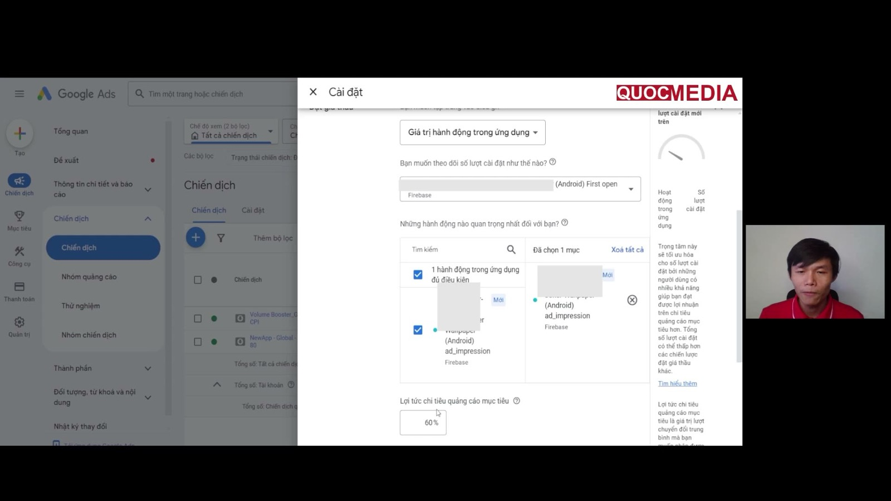

# Playbook: launch Google App campaign (first_open → tROAS)

## Bối cảnh

Triển khai giai đoạn 2 của [roadmap](../00-overview/roadmap.md) cho app Android kiếm tiền bằng ads. Ký hiệu:
- ✅ **[Chính thức]**: có trong Google Ads/AdMob Help (số answer kèm theo).
- 🧪 **[Kinh nghiệm, chưa kiểm chứng]**: thực hành phổ biến hoặc theo roadmap, Google không xác nhận. Khi có data thật thì cập nhật bằng `lessons/`.

## Bước 0: Điều kiện tiên quyết

- [ ] Firebase SDK + GA4, link Google Ads, link AdMob: [firebase-setup-link-google-ads-admob](../04-measurement/firebase-setup-link-google-ads-admob.md).
- [ ] `first_open` đã import vào Google Ads, **Primary**, đang Recording. Chỉ 1 install conversion là Primary.
- [ ] **AdMob: bật Impression-level ad revenue ngay từ bây giờ** ✅ (11322405, 6383165). Nếu dùng MAX thì code log `ad_impression` có value/currency đã lên production ([firebase-events-cho-ua](../04-measurement/firebase-events-cho-ua.md)). Lý do: tROAS sau này cần lịch sử conversion value, nên phải bắt đầu tích luỹ từ ngày đầu.
  - (bổ sung 2026-10-15 từ khoá Quocmedia) Khoá học (bài 4.2) hướng dẫn link Firebase/AdMob/Google Ads nhưng **không nhắc bước bật Impression-level ad revenue** — làm theo khoá thì dễ sót, phải tự kiểm.
- [ ] Bộ creative đủ: 5 headline, 5 description, ≥ 15 ảnh 3 tỉ lệ, ≥ 15 video 3 hướng ([creative-assets](../01-pre-marketing/creative-assets-google-app-campaigns.md)).
- [ ] Store listing đã làm xong ASO.

## Bước 1: Campaign install tối ưu `first_open`

Roadmap gọi là "tCPA tối ưu first_open". Về kỹ thuật, `first_open` là **install conversion**, nên trong Google Ads đây là focus **Installs** với bid **Target CPI** (tCPI là biến thể của Target CPA ✅ 12073727). Cần ghi lại trên UI thực tế màn hình hiện gì.

Setup (12575501):
- [ ] Goal **App promotion** → subtype **App installs** → Android → chọn app. Đặt tên có OS (vd `ACi_Android_US_tCPI_firstopen_2026-10`).
- [ ] GEO + ngôn ngữ. ✅ Không để 2 App campaign của cùng app **trùng GEO** (9176652).
- [ ] Bidding: focus Installs, conversion event = `first_open` (Firebase), đặt **target CPI**.
  - 🧪 Target CPI khởi điểm: Google có *bid guidance* cho ACi tCPI "All users" ✅ (12073727), nên tham khảo. Nếu không có thì lấy CPI kỳ vọng từ kế hoạch tài chính (ROAS mục tiêu × LTV dự kiến). Không có benchmark chung.
- [ ] **Budget ngày ≥ 50 × tCPI** ✅ (14104492, 9176652). Nếu thực sự chọn focus In-app actions với tCPA thì ≥ 10 × tCPA ✅.
- [ ] Asset: điền đủ slot, Ad Strength ≥ Good ✅.
- [ ] Bật auto-tagging ✅.

Sau khi launch:
- ✅ Campaign cần "a few days" để gom dữ liệu. CPI những ngày đầu có thể cao vì conversion về trễ (9176652).
- ✅ Không đổi budget/CPI > 20% một lần. Không đổi event, conversion window, GEO lớn, asset tốt trước **100 conversion đầu** (14104492). Không cycle bid lên xuống.

### Khoá Quocmedia dạy bước 1 thế nào (bổ sung 2026-10-15 từ khoá Quocmedia)

Khoá "UA Marketing Mobile App 2026" (bài 4.1, 4.3, 4.4) chính là nguồn gốc của roadmap. Cách làm của giảng viên:
- Campaign CPI chỉ để **test performance app + SDK AdMob** và để `ad_impression` xuất hiện; không kỳ vọng doanh thu. Chạy **2–3 ngày, tối đa ~300 download** (có chỗ nói 30/100/200 download là đủ). GEO **All countries and territories + English**, budget **₫200.000/ngày** và 🧪 giữ **≤ ₫200k/ngày** ở giai đoạn này để khỏi đốt tiền khi nâng bid.
- **Chọn tCPI bằng Keyword Planner** (cột Top of page bid low range, ₫253–674 cho "volume booster") rồi đặt cao hơn chút → ₫800.
  - ⚠️ **Không làm theo cách này.** Top-of-page bid là CPC ước tính trên Google Search, không phải CPI; App campaign không đấu giá theo keyword. Ngay trên màn hình khoá học, Google gợi ý *typical CPI ₫8.993* nhưng bị bỏ qua. Dùng bid guidance của Google ✅ (12073727) như ở trên.
  - Hậu quả thấy ngay trong khoá: tCPI ₫800 → 3 install, ₫4.421 sau ~5 ngày; nâng ₫2.000 → 157 install, CPI thực ₫1.708, CTR 11,31%, conv. rate 5,21% (All countries, EN, app Android volume booster, 05–07/12/2024). Chi tiết: [lesson](../lessons/2024-12-quocmedia-demo-tcpi-thap-va-troas-cao-khong-spend.md).
- Sau publish, tạo thêm ad group bằng dấu (+), mỗi ad group **content/ảnh/video khác nhau, không trùng** (khớp ✅ 14104492: ad group theo chủ đề).

### Campaign không tiêu tiền sau 3–7 ngày (bổ sung 2026-10-15 từ khoá Quocmedia)

Khoá học (bài 4.4) nêu 2 nguyên nhân:
1. **Bid thấp → nâng tCPI.** Google xác nhận hướng này: campaign *bid-constrained* thì nâng bid ✅ (14104492).
   - ⚠️ Mâu thuẫn mức nâng: khoá nâng một lần +150% (₫800 → ₫2.000); Google khuyên không đổi CPI > 20% một lần ✅ (9176652). Dung hoà 🧪: quy tắc 20% bảo vệ campaign **đang học có data**; campaign gần như chưa phân phối (vài install, spend < 5% budget) thì nâng một lần về khoảng bid guidance/typical CPI là chấp nhận được. Chỉ đổi một lần, đợi 1–2 ngày rồi mới đọc lại.
2. **Creative không hấp dẫn hoặc không khớp app → thay asset** (ảnh, video, text).
- Trước khi nâng bid, kiểm loại trừ lỗi khác: conversion `first_open` có đang Recording không, Ad strength, asset bị từ chối.

## Bước 2: Sau ~3 ngày, import `ad_impression` vào Google Ads

- 🧪 Mốc "~3 ngày" là của roadmap, **không phải yêu cầu của Google**. Không có trở ngại kỹ thuật nào ngăn import sớm hơn: chỉ cần `ad_impression` đã xuất hiện trong GA4 (event mới có thể mất tới ~1 ngày mới hiện để import, theo kinh nghiệm cộng đồng).
  - (bổ sung 2026-10-15 từ khoá Quocmedia) Lý do thực tế của mốc này theo khoá học: app mới **chưa có `ad_impression` trong Firebase → Events** cho tới khi có user thật xem ad, nên phải chạy campaign CPI trước rồi mới import được. Khoá nói "sau 2, 3 hoặc 7 ngày".
- [ ] GA4: đánh dấu `ad_impression` là **key event / conversion** ✅ (13799577).
- [ ] Google Ads: Conversions → + → App → Google Analytics 4 (Firebase) → chọn `ad_impression` → Import. Value lấy từ event ✅.
- [ ] Đặt `ad_impression` là **Secondary** trong lúc campaign install còn chạy, để không làm đổi mục tiêu tối ưu. 🧪 (suy luận: ✅ `ad_impression` chỉ dùng được cho tROAS, nên không gắn vào campaign tCPI).
- [ ] Kiểm tra: segment theo conversion action + cột *Conversion value* phải thấy value > 0. ✅ Cột Conversions của `ad_impression` mặc định hiện 0 (13799577), không phải lỗi.

## Bước 3: Launch campaign tROAS

### Điều kiện chuyển bước (chính thức)
| Điều kiện | Nguồn |
|---|---|
| Đã import `ad_impression` từ GA4, app bidding trên GA events, doanh thu app chủ yếu từ ads | ✅ 13799577 |
| Volume ổn định, **"typically 30+ conversions in 30 days"** | ✅ 15995101 |
| Chuyển từ tCPA cần **3 đến 4 tuần dữ liệu conversion value** | ✅ 15995101 |
| Conversion source = Firebase (hoặc Google Play codeless) | ✅ 15995101 |
| Event tối ưu là Primary, có dynamic value | ✅ 15995101, 7100895 |

> ⚠️ **Mâu thuẫn với roadmap**: roadmap ngầm hiểu launch tROAS sớm (ngay sau khi import `ad_impression`), còn Google khuyên **có 3 đến 4 tuần dữ liệu value**. Tạm thời làm theo Google: dùng 3 đến 4 tuần đó để chạy bước 1 và tích luỹ value. Nếu launch sớm hơn thì ghi rõ là thử nghiệm và lưu kết quả vào `lessons/`.

### ⚠️ Mâu thuẫn: khoá Quocmedia vs Google Help (bổ sung 2026-10-15 từ khoá Quocmedia)

Khoá "UA Marketing Mobile App 2026" (bài 4.5) — nguồn gốc của roadmap — dạy chuyển sang tROAS rất sớm và đổi ngay trên campaign CPI:

Ảnh trên: khoá học đổi bidding **ngay trong Settings của campaign CPI** (không tạo campaign mới), giữ First open làm install tracking, thêm `ad_impression`, đặt target 60%. UI Google Ads 12/2024 cho phép làm vậy.

| Điểm | Khoá Quocmedia (bài 4.1, 4.4, 4.5) | Google Help |
|---|---|---|
| Khi nào chuyển | Sau **2–3 ngày** chạy CPI, khi có **~30–300 install** và `ad_impression` đã hiện | Volume ổn định, **"typically 30+ conversions in 30 days"**; từ tCPA cần **3–4 tuần dữ liệu conversion value** ✅ (15995101) |
| Cách chuyển | **Đổi tại chỗ** campaign CPI đang chạy sang In-app action value | Tạo campaign **mới**; tránh đổi campaign type sau launch ✅ (9176652); đổi focus/bid strategy là thay đổi lớn, learning 7–14 ngày ✅ (15995101) |
| Target khởi điểm | Cố định **50–60%** cho app mới ("dễ tối ưu, học content nhanh hơn") | = **Conv. value/cost thực** của campaign tCPA/tCPI tương đương (cùng app, event, GEO, ngôn ngữ) trong khoảng bằng conversion window; xem Bid guidance ✅ (15995101, 13799577) |
| Nâng target | Bài 4.5: tối ưu ~**1 tháng** rồi nhảy lên **90–100%** (+50–67%). **Bài 4.9 tự sửa lại**: khi ROAS ≥ target ổn định 7–14 ngày thì **+5–10%/lần, mỗi tuần**, budget **+10–20%**, không đổi quá **20%/lần** (bổ sung 2026-10-15) | Mỗi lần **±15–20%**, không đổi lớn quá 1 lần mỗi **1–2 tuần**, đánh giá cửa sổ 14–30 ngày ✅ (15995101) → **bài 4.9 khớp Google**, chỉ bài 4.5 mâu thuẫn |
| Conversion window `ad_impression` | Đổi mặc định 90 ngày → **1 tuần** | 7–30 ngày ✅ (13799577) → **khớp** (7 ngày là cận dưới) |
| Budget | Giữ ₫200k/ngày như campaign CPI | Không công bố hệ số → **không mâu thuẫn** |

Bằng chứng ngay trong khoá: app demo trước khi chuyển chỉ có DAU 23, revenue Firebase $0.02/tuần — ROAS thực xa 60%; và campaign "NewApp - Global - ROAS 80" cùng tài khoản gần như không spend (~₫6k/3 ngày) ([lesson](../lessons/2024-12-quocmedia-demo-tcpi-thap-va-troas-cao-khong-spend.md)).

**Gợi ý dung hoà (🧪, chờ data thật):**
1. **Target khởi điểm = ROAS thực (Conv. value/cost) của campaign CPI** trong khoảng bằng conversion window. Nếu chưa đủ số để tính (vài ngày, vài chục install) thì 50–60% chỉ là **điểm thử**: theo dõi spend 3–5 ngày, campaign không phân phối thì **hạ target**.
2. Nâng target **từng bước 15–20%** (vd 60 → ~70 → ~80 → ~95), mỗi bước cách 1–2 tuần, chỉ nâng khi ROAS đạt ổn định ≥ target và còn volume. Không nhảy thẳng lên 90–100%. (bổ sung 2026-10-15) Chính khoá ở bài 4.9 cũng dạy vậy (+5–10%/tuần, ≤ 20%/lần) — chi tiết ở [vận hành & scale tROAS](van-hanh-va-scale-troas-google-app-campaign.md).
3. Ưu tiên tạo campaign tROAS **mới** (GEO không trùng campaign CPI, hoặc giảm/dừng campaign CPI ở GEO trùng). Nếu đổi tại chỗ cho nhanh như khoá học thì ghi ngày đổi và chấp nhận learning lại 7–14 ngày; lưu kết quả vào `lessons/`.

### Setup
- [ ] Campaign **mới**, App installs → focus **In-app action value** → event `ad_impression` (thêm event IAP nếu hybrid) → nhập **target ROAS %** ✅ (10617884, 13799577). Google khuyên tạo campaign mới thay vì đổi loại campaign cũ ✅ (9176652: tránh đổi campaign type sau launch).
- [ ] **Target ROAS khởi điểm** = *Conv. value/cost* mà campaign bước 1 đạt được (cùng app, event, GEO, ngôn ngữ), đo trên khoảng bằng conversion window ✅ (15995101, 13799577). Nếu tCPI/tCPA đặt cao hơn hẳn chi phí thực thì nhân modifier tương ứng ✅. Có thể xem *Bid guidance*.
- [ ] Conversion window `ad_impression`: **7 đến 30 ngày** ✅ (13799577). Chọn mức bắt được ~90% conversion ✅ (14104492).
- [ ] Budget: Google **không công bố** hệ số cho tROAS. 🧪 Thường để ≥ budget campaign bước 1 để model có đủ dữ liệu.
- [ ] **GEO "global"** (roadmap): ⚠️ nếu campaign bước 1 vẫn chạy cùng GEO thì vi phạm khuyến nghị "không trùng GEO" ✅ (9176652). Phương án: tách GEO, hoặc giảm/dừng campaign bước 1 ở GEO trùng khi tROAS đã ổn. Quyết định cụ thể ghi vào `decisions/`.

### Vận hành tROAS (15995101)
- ✅ Thay đổi lớn kích hoạt learning **7 đến 14 ngày**. Không đổi budget/target lớn quá 1 lần mỗi **1 đến 2 tuần**. Mỗi lần chỉnh target trong khoảng **±15 đến 20%**.
- ✅ Đánh giá trên cửa sổ **14 đến 30 ngày**, bỏ những ngày gần nhất (conversion trễ).
- ✅ Không đạt volume: hạ target ROAS. Bị "Limited by budget": tăng budget (14104492).
- (bổ sung 2026-10-15 từ khoá Quocmedia bài 4.6/4.9) Đọc kết quả 4 tầng (campaign → ad group → asset → GEO), tín hiệu scale, mức nâng target/budget, khi nào tách GEO/thêm kênh, và đo "lãi": [vận hành & scale tROAS](van-hanh-va-scale-troas-google-app-campaign.md). Số thật của demo (ROAS 0,24 với target 60%, đọc all-time): [lesson](../lessons/2024-12-quocmedia-demo-troas-60-ket-qua-ad-group-geo.md).

## Bước 4: Thêm ad group cho campaign tROAS

- 🧪 Chỉ thêm khi ad group đầu đã ổn (qua learning, có asset Best/Good), vì thêm ad group là "composition change" có thể kích hoạt learning lại ✅ (13020501).
- [ ] Mỗi ad group mới = **1 chủ đề/thông điệp** khác (tính năng khác, đối tượng khác), với bộ asset riêng (5+5 text, ảnh 3 tỉ lệ, video 3 hướng), deep link phù hợp chủ đề ✅ (14104492).
- [ ] Ad Strength ≥ Good cho mỗi ad group ✅.
- [ ] Ghi tên ad group + chủ đề + ngày tạo vào `apps/<app>/campaigns.md`.
- (bổ sung 2026-10-15 từ khoá Quocmedia bài 4.6) Cách khoá tạo ad group mới: lấy asset **Best/Good có ROAS cao** từ các ad group đang chạy gom thành 1 ad group mới; ad group ROAS thấp thì pause. ⚠️ Demo ra quyết định trên mẫu 7 install — đặt ngưỡng mẫu trước ([vận hành & scale tROAS](van-hanh-va-scale-troas-google-app-campaign.md) mục 3).

## Sau launch

Đọc chỉ số theo mốc 7 ngày / 1 tháng / 4 tháng / 6 tháng: [doc-chi-so-theo-moc-thoi-gian](../05-optimization/doc-chi-so-theo-moc-thoi-gian.md). Tổng quan bidding/budget: [app-campaigns-tong-quan](../02-ua-channels/google-ads/app-campaigns-tong-quan.md).
