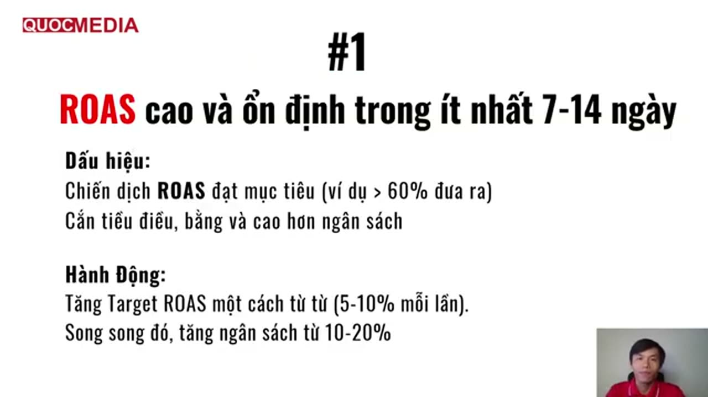

# Playbook: đọc kết quả và scale campaign tROAS

## Bối cảnh

Tiếp nối [playbook launch](launch-google-app-campaign-tcpa-den-roas.md) (bước 3–4): campaign tROAS (focus In-app action value, event `ad_impression`) đã chạy. Nội dung chính lấy từ khoá Quocmedia bài 4.6/4.9, đối chiếu Google Help. Ký hiệu: ✅ chính thức (số answer), 🧪 rule-of-thumb giảng viên/kinh nghiệm chưa kiểm chứng. Ví dụ số thật: [case demo ROAS 0,24](../lessons/2024-12-quocmedia-demo-troas-60-ket-qua-ad-group-geo.md).

## 0. Trước khi đọc: chọn đúng khoảng ngày và cột

- [ ] **Khoảng ngày = từ ngày bật tROAS** (hoặc ngày đổi target gần nhất), không dùng All time. Bỏ 3–7 ngày cuối vì conversion về trễ; đánh giá xu hướng trên cửa sổ **14–30 ngày** ✅ (15995101). Case demo đọc All time nên ROAS 0,24 lẫn lịch sử từ 2023.
- [ ] Bộ cột (khoá bài 4.6): **Target ROAS, Impr., CTR, Avg. CPC, Clicks, Cost, Installs, Cost/Install, All conv. value / cost, Conv. rate**. Tắt cột in-app action, view-through, Conversions/Cost per conv. trùng lặp.
  - 🧪 Thêm **Conv. value / cost**: tROAS bid trên conversion được đưa vào cột Conversions (Primary); *All conv.* gồm cả action Secondary nên có thể lệch.
  - Conv. rate của Google = conversions/interactions, không phải installs/clicks.

## 1. Đọc 4 tầng

| Tầng | Đường đi trên UI (12/2024) | Đọc gì | Hành động theo khoá (🧪) | Đối chiếu |
|---|---|---|---|---|
| **Campaign** | Campaigns → cột như mục 0 | ROAS đạt so với target; spend so với budget; CPI; CR | ROAS = All conv. value/cost; khoá coi **≥ 1,0 (0,9) là hoà vốn**. CR (click→install) mục tiêu **≥ 20–25%** | ⚠️ xem mục 4 về "hoà vốn". ROAS thực << target + không tiêu hết budget = bid-constrained → **hạ target** ✅ (15995101, 14104492) — khoá không nói |
| **Ad group** | Campaign → Ad groups, sort theo ROAS | ROAS, cost, installs từng ad group | **Pause** ad group ROAS thấp (demo pause 0,14 / 0,19 / 0,28; giữ ≥ ~0,3), ưu tiên tắt ad group *tiêu nhiều, install nhiều nhưng ROAS thấp* để budget dồn sang ad group tốt | ⚠️ thêm/bớt ad group kích hoạt learning ✅ (13020501) → pause **từng cái**, cách vài ngày; cần mẫu đủ lớn (mục 3) |
| **Network** | Ad groups → Segment → **Network (with search partners)** | Google tiêu ở Google search / Search partners / Display / YouTube | Network nào nhiều → làm thêm loại creative tương ứng (text ↔ Search; ảnh/video ↔ Display/YouTube) | App campaign không cho chọn network; chỉ dùng để chẩn đoán |
| **Asset** | Ad group → Assets | Nhãn Performance (Best/Good/Low/Learning) + ROAS, CTR, install từng asset | Best/Good + ROAS cao → **gom vào 1 ad group mới**; Low + ROAS thấp → thay nội dung; Learning (vài impression) → đợi; Low nhưng ROAS cao → đợi thêm dữ liệu | ✅ không sửa/xoá asset đang tốt (14104492) → nhân bản sang ad group mới là cách an toàn |
| **GEO** | Insights and reports → When and where ads showed → **Matched locations**, sort theo ROAS | ROAS, conversions, cost theo nước | Nước ROAS > 1 **và** ~**10 install/ngày** → tách ra campaign riêng khi scale | ⚠️ ✅ không để 2 campaign cùng app trùng GEO (9176652) → tách nước nào thì **loại nước đó khỏi campaign global**. "10 install/ngày" không có trên Google Help |

## 2. Khi nào scale và scale bao nhiêu

Ảnh trên: tín hiệu #1 và hành động của khoá. Bài 4.9 có thêm 2 tín hiệu (ad group ROAS > target, asset Best/Good vượt trội) và 4 lưu ý.

**Tín hiệu (khoá, khớp Google):**
- ROAS campaign **≥ target ổn định 7–14 ngày** và campaign **tiêu đều, bằng hoặc vượt budget ngày**. Khớp ✅ learning 7–14 ngày, đánh giá 14–30 ngày (15995101).
- Có ad group ROAS cao hơn target (vd target 60% đạt 80–100%) và asset Best/Good có CTR, CR, ROAS vượt trội.

**Hành động:**

| Đòn bẩy | Khoá Quocmedia (4.9) | Google Help | Dùng |
|---|---|---|---|
| Target ROAS | **+5–10% mỗi lần, mỗi tuần** (vd 60 → 70 → 80) | ±15–20% mỗi lần, không đổi lớn quá 1 lần mỗi **1–2 tuần** ✅ (15995101) | Khớp: bước khoá nhỏ hơn trần Google. Nhịp "mỗi tuần" là cận nhanh — 🧪 nên 1–2 tuần, chỉ nâng khi tuần trước vẫn ≥ target và còn tiêu hết budget |
| Budget | **+10–20% mỗi tuần** | Không đổi budget > 20% một lần ✅ (9176652); "Limited by budget" thì tăng ✅ (14104492) | Khớp |
| Trần chung | Budget **hoặc** target **không quá +20%/lần**; tăng ×3–×5 budget một lần sẽ reset máy học | Như trên | Khớp |
| Sau mỗi lần scale | Theo dõi ROAS, CR, conversion volume | Đánh giá 14–30 ngày, bỏ ngày gần nhất ✅ (15995101) | Khớp |

- ⚠️ **Lệch nhẹ: khoá nâng target và budget cùng lúc.** Hai đòn bẩy kéo ngược nhau (target ↑ thì volume ↓, budget ↑ thì volume ↑) nên đổi cùng lúc không biết cái nào gây kết quả. Google: mỗi lần chỉ một thay đổi lớn, cách 1–2 tuần (15995101). 🧪 Dung hoà: **xen kẽ** — tuần A nâng budget, tuần B (nếu ROAS vẫn ≥ target) nâng target.
- ⚠️ **Mâu thuẫn nội bộ của khoá**: bài 4.5 bảo "~1 tháng sau nhảy 60% → 90–100%", bài 4.9 lại dạy +5–10%/tuần, ≤ 20%/lần. **Theo 4.9** (khớp Google). Từ 60% lên 100% theo nhịp này mất ~5–8 tuần.
- ROAS thực **dưới** target kéo dài và không tiêu hết budget → không scale; **hạ target** về quanh ROAS thực ✅ (15995101). Khoá không có bước này.

## 3. Ngưỡng mẫu trước khi phán (🧪, không có trong khoá)

Khoá ra quyết định trên mẫu rất nhỏ (ad group "lời" 7 install/₫14k; nước "lời" 1 install/₫358). Trước khi pause ad group, giữ asset hay tách GEO:
- Ad group/GEO cần ≥ **30–50 install** (tức spend ≈ 30–50 × CPI) trong cửa sổ đánh giá; dưới mức đó ghi "chưa đủ mẫu", không hành động.
- Mức "30+ conversions in 30 days" của Google (15995101) là điều kiện cho cả campaign tROAS, dùng làm cận dưới khi tách campaign GEO mới.
- So ad group với **trung bình campaign**, không với 1,0 — vì ROAS window 7 ngày (mục 4).

## 4. Đo "lãi" bằng gì

- Khoá chỉ dùng **All conv. value / cost** của Google Ads, coi **1,0 (hoặc 0,9) là hoà vốn**. Không nhắc LTV hay doanh thu AdMob thực.
- ⚠️ Value này là doanh thu `ad_impression` Google gán cho Ads, trong **conversion window** (khoá đặt 7 ngày, bài 4.5) → về bản chất là **ROAS ~D7 attributed**. Theo [unit economics](../05-optimization/unit-economics-ads-only-theo-tier.md): không so ROAS D0/D7 với 100%; hoà vốn thật = **LTV cohort (D30/D90/D180) / CPI**. ROAS D7 = 1,0 thường đã lãi nếu user còn giữ lại; ngược lại ROAS 0,24 có thể vẫn hoà vốn ở D180 **chỉ khi** retention tốt (case demo: ~93% user gỡ app → không).
- 🧪 Đối chiếu chéo: doanh thu AdMob thực (theo GEO/kỳ) ÷ cost Google Ads cùng kỳ, và retention/`app_remove` trên Firebase ([khoá 4.8](../05-optimization/doc-chi-so-theo-moc-thoi-gian.md)). Chọn target ROAS dài hạn theo hệ số D7→D90 của chính app (mốc 4 tháng).

## 5. Thêm ad group / campaign / GEO / kênh

| Việc | Khi nào (khoá) | Google / lưu ý |
|---|---|---|
| **Ad group mới** | Có asset Best/Good + ROAS cao → gom thành ad group mới | ✅ ad group theo chủ đề, asset riêng (14104492); composition change → learning (13020501): chỉ thêm khi campaign đã ổn, mỗi lần 1 ad group |
| **Campaign GEO riêng** | Nước ROAS > 1 và ~10 install/ngày trong campaign global | ✅ loại nước đó khỏi campaign global để không trùng GEO (9176652); campaign mới cần ≥ 30 conversion/30 ngày mới chạy tROAS ổn (15995101) → có thể bắt đầu bằng target = ROAS thực của nước đó. Cách gom nước: [geo-va-ngon-ngu-targeting](../02-ua-channels/google-ads/geo-va-ngon-ngu-targeting.md) |
| **Kênh khác** | "Đa dạng hoá": Facebook/Instagram Ads, TikTok Ads để mở rộng tệp | Khi > 1 kênh trả tiền cần dedup attribution → cân nhắc MMP ([mmp-tong-quan](../04-measurement/mmp-tong-quan.md)) |
| **Song song** | Theo dõi Firebase, nâng chất lượng app, tăng retention | Ngưỡng retention/engagement 🧪 của khoá: [doc-chi-so-theo-moc](../05-optimization/doc-chi-so-theo-moc-thoi-gian.md) |

## Checklist hằng tuần (gộp)

- [ ] Lọc từ ngày đổi gần nhất; ROAS (All conv. và Conv. value/cost) vs target; spend vs budget.
- [ ] Nếu ROAS ≥ target ≥ 7–14 ngày và tiêu hết budget → +10–20% budget **hoặc** +5–10% target (không cả hai), ghi ngày vào `apps/<app>/campaigns.md`.
- [ ] Nếu ROAS << target và spend thiếu → hạ target về quanh ROAS thực.
- [ ] Ad group/asset/GEO: chỉ hành động trên mẫu đủ lớn (mục 3), mỗi tuần tối đa 1 thay đổi cấu trúc.
- [ ] Firebase: D1/D7 retention, `app_remove`, crash-free; AdMob: eCPM top GEO.
- [ ] Thêm mốc xem lại: `node scripts/kb/cli.mjs followup add --when 7d --app <slug> --text "..."`.
